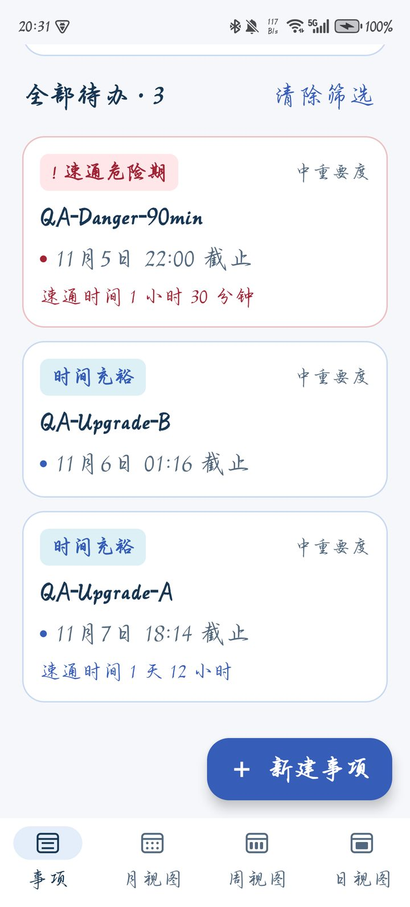
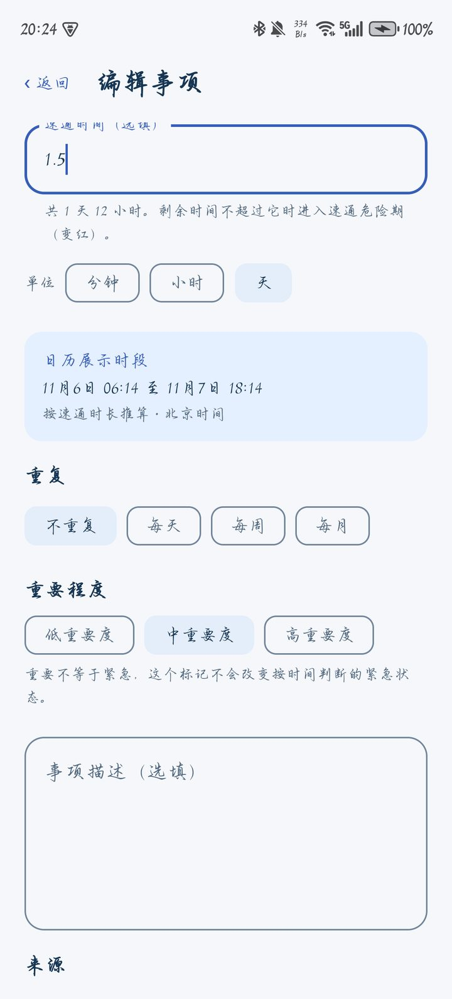
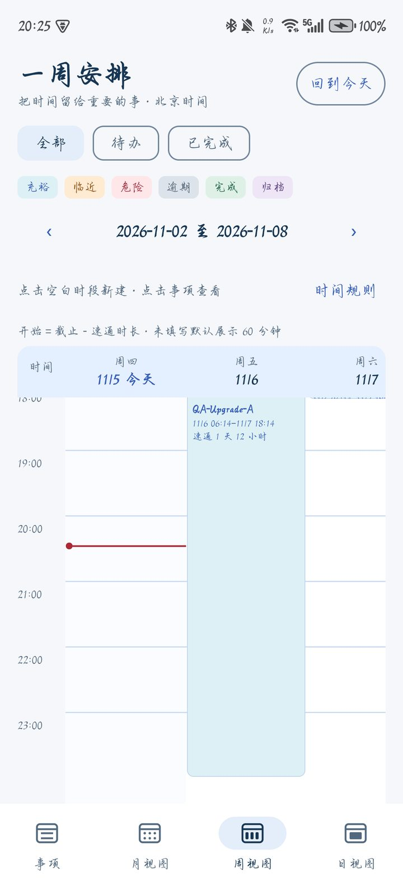
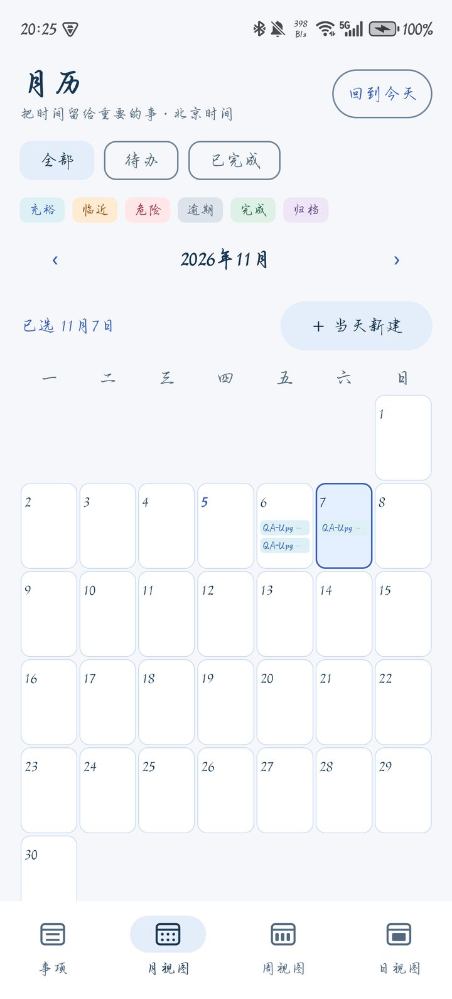

# HUSTer's DDL Saver

[](https://github.com/zidodo1124/hust26_software_engineering_homework/actions/workflows/android.yml)

**面向大学生的 Android 截止日期（DDL）管理与提醒应用** —— 华中科技大学计算机科学与技术学院《软件工程》课程设计，花园鳗小组。

大学生的作业、实验报告、学生工作和生活琐事来自课程群、学习通、邮件等各种渠道，截止时间容易遗漏，也很难判断“还剩的时间够不够做完”。DDL Saver 把所有 DDL 集中记在手机上，并引入 **速通时间**：你估计完成一件事至少要多久，剩余时间进入这个范围时，事项显示为红色，并按设置安排通知，提醒你“该冲刺了”。实际通知送达受权限和系统后台限制影响。应用完全离线，无需注册账号。

| 首页 | 编辑：速通时间按“天”填写 | 周视图 | 月视图 |
| --- | --- | --- | --- |
|  |  |  |  |

## 主要功能

- **事项管理**：标题和截止时间必填；可填写速通时间（分钟 / 小时 / 天）、重要程度、描述（可复制）、来源、标签、自定义字段和多张图片（相册或粘贴）。
- **紧急程度一目了然**：卡片按时间充裕 / 临近截止 / 速通危险期 / 已逾期显示蓝、橙、红、灰，危险期带感叹号；首页统计“今日 DDL”和“速通危险期”数量。
- **三类系统通知**：每日 DDL 汇总（默认 08:00）、进入速通危险期提醒、临近截止提醒（默认提前 1 小时）；事项通知打开对应详情，汇总通知打开今日列表。
- **日历**：底部导航切换月 / 周 / 日视图；周、日视图按“截止时间 − 速通时间”显示时段，点击空白时段即可新建。
- **检索与整理**：关键词搜索 + 来源、标签、日期组合筛选；完成、归档、批量操作；过期事项灰显保留或自动归档。
- **重复事项**：每天 / 每周 / 每月，按次数或日期结束，可修改或删除“本次及后续”。
- **角色陪伴**：“蓝色大肥鱼”经典立绘与 Q 版两种形象，随事项状态切换表情，36 条本地台词。

## 下载与安装

**最新版本：1.0.0**（versionCode 12，适用于 Android 8.0 及以上）

1. 下载安装包：[DDL-Saver-1.0.0.apk](https://github.com/zidodo1124/hust26_software_engineering_homework/releases/download/v1.0.0/DDL-Saver-1.0.0.apk)（[仓库下载备用入口](https://github.com/zidodo1124/hust26_software_engineering_homework/raw/refs/heads/main/releases/android/DDL-Saver-1.0.0.apk)），或用手机扫描下方二维码直接下载；版本说明见 [Releases](https://github.com/zidodo1124/hust26_software_engineering_homework/releases/tag/v1.0.0)。
2. 在手机上用文件管理器打开 APK，按提示允许“安装未知应用”并安装。
3. 打开应用，在“设置”里允许通知；Android 12 以上建议同时允许“闹钟和提醒”（精确提醒）。


> 从 0.3.x 升级：1.0.0 使用新的签名证书，需要先卸载旧版再安装（旧版数据会被清除）。安装包说明与 SHA-256 校验值见 [releases/android](releases/android/README.md)，详细操作见[用户使用手册](docs/user-guide.md)。

## 运行环境与技术栈

| 类别 | 内容 |
| --- | --- |
| 运行平台 | 最低 Android 8.0（API 26），目标 API 35；实测设备荣耀 X50（Android 15，MagicOS 9.0.0），其余设备兼容性未逐一验证 |
| 编程语言 | Kotlin 2.1.20（JVM 17） |
| 界面 | Jetpack Compose（BOM 2025.04.01）、Material 3 |
| 架构 | 单 Activity + ViewModel + Repository（MVVM 分层） |
| 数据存储 | Room 2.7.1（SQLite），schema 5，显式迁移 1→5 |
| 异步 | Kotlin Coroutines / Flow 1.10.2 |
| 系统能力 | AlarmManager、NotificationManager、Photo Picker、剪贴板 |
| 测试 | JUnit 4、Robolectric 4.14.1、Room Testing、Compose UI Test |
| 构建与 CI | Gradle 8.11.1、Android Gradle Plugin 8.9.2、Android SDK 35、GitHub Actions |
| 开发工具 | Android Studio 或命令行 + JDK 17、Git / GitHub |

应用不申请网络权限，数据只保存在手机本地。

## 从源码构建

需要 JDK 17 和 Android SDK（Platform 35、Build Tools 35.0.0）。在仓库根目录执行：

```bash
./gradlew :app:assembleDebug :app:testDebugUnitTest :app:lintDebug   # Windows 用 gradlew.bat
```

安装包输出在 `app/build/outputs/apk/debug/app-debug.apk`。环境准备、真机调试（含荣耀手机免驱动连接）见[开发说明](docs/development.md)。

## 课程提交材料

| 材料 | Markdown | Word |
| --- | --- | --- |
| 选题报告 | [01-选题报告](deliverables/01-选题报告.md) | [docx](deliverables/word/01-选题报告.docx) |
| 需求规格说明书 | [02-需求规格说明书](deliverables/02-需求规格说明书.md) | [docx](deliverables/word/02-需求规格说明书.docx) |
| 设计说明书 | [03-设计说明书](deliverables/03-设计说明书.md) | [docx](deliverables/word/03-设计说明书.docx) |
| 测试报告 | [04-测试报告](deliverables/04-测试报告.md) | [docx](deliverables/word/04-测试报告.docx) |
| 关键源码说明 | [05-关键源码说明](deliverables/05-关键源码说明.md) | [docx](deliverables/word/05-关键源码说明.docx) |
| 小组分工 | [06-小组分工](deliverables/06-小组分工.md) | [docx](deliverables/word/06-小组分工.docx) |

完整清单见 [deliverables/](deliverables/README.md)；开发过程中的需求访谈、各轮测试证据和审核记录在 [docs/](docs/README.md)。

## 小组成员（花园鳗）

| 成员 | 负责方向 |
| --- | --- |
| 支盟渊 | 产品与集成；页面、图片与角色；1.0.0 多单位时长、真机验收与发布 |
| 付泽文 | 数据与信息组织；月 / 周 / 日历、重复事项、独立日历页 |
| 岳羽泉 | Android 通知与提醒的复核与测试 |

各成员的具体工作与提交统计见[小组分工](deliverables/06-小组分工.md)。

## 测试概况

1.0.0：31 个测试类、251 次自动化测试执行全部通过，Lint 0 错误；荣耀 X50 原 13 项验收通过（含同签名重建的旧版本带数据覆盖升级、危险期通知按时送达）。另已[补验](docs/test-evidence/RUN-20261105-CODEX-SUPPLEMENT/README.md)每周重复事项的创建及范围编辑／删除、设置保存回显、强停后重开和飞行模式离线使用。具体范围见[测试报告](deliverables/04-测试报告.md)。

已知限制：手机重启后若不打开应用，提醒可能不会自动恢复（打开一次即可补发）；厂商省电策略可能延迟提醒。

## 项目结构

```text
app/src/main/java/cn/edu/hust/ddlsaver/
├── ui/          Jetpack Compose 页面与 ViewModel
├── domain/      业务模型与规则（紧急程度、查询、重复、校验）
├── data/        Room 数据库、DAO、Repository、迁移
├── reminders/   提醒计划、通知与系统闹钟
└── platform/    图片导入与私有存储
app/src/test/    自动化测试（31 个测试类）
deliverables/    课程提交文档（Markdown + Word）与设计图
docs/            过程文档与测试证据
releases/        Android 安装包
```

## 素材与许可说明

本项目为课程作业。角色“蓝色大肥鱼”的经典立绘使用 CC BY-NC-SA 4.0 许可的同人素材，Q 版图集保留发布者许可与原角色署名链，详见 [docs/character-assets.md](docs/character-assets.md) 及应用内“素材与署名”页面。
