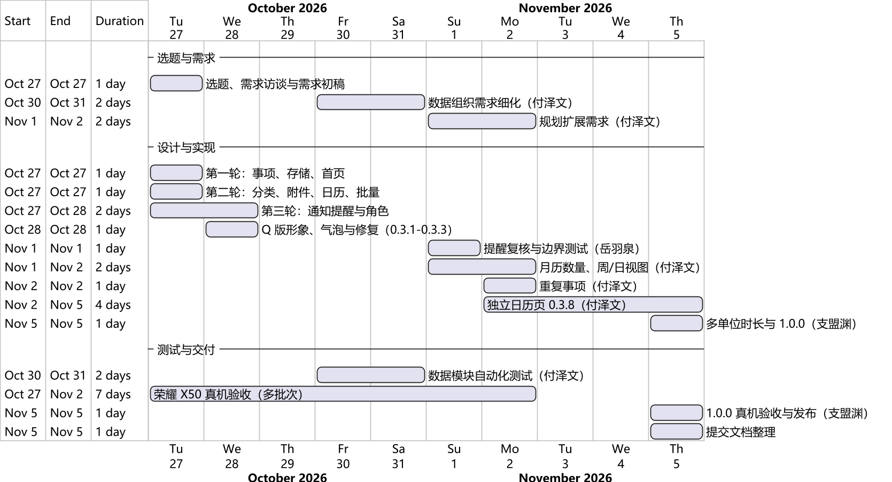

# 1 基本信息

表1-1 项目基本信息

| 项目 | 内容 |
| --- | --- |
| 项目名称 | HUSTer's DDL Saver（大学生截止日期管理与提醒 App） |
| 课程 | 华中科技大学计算机科学与技术学院《软件工程》课程设计 |
| 小组 | 花园鳗 |
| 成员 | 支盟渊、付泽文、岳羽泉 |
| 软件形态 | Android 手机应用，离线单机使用，无需注册账号 |
| 当前版本 | 1.0.0（versionCode 12） |
| 代码仓库 | <https://github.com/zidodo1124/hust26_software_engineering_homework> |

# 2 选题背景与动机

大学生同时面对课程作业、实验报告、学生工作、社团活动和生活琐事，截止日期（DDL）来自课程群、学习通、邮件、班级通知等多个渠道。信息分散导致三个常见问题：

1. **容易遗漏**：DDL 散落在聊天记录和截图里，到期前没有统一提醒。
2. **难以判断先做哪件**：只看到截止日期，不知道“还剩的时间够不够把事情做完”。
3. **相关材料难找**：提交要求、网址、联系人等信息需要临时翻找。

小组最初的想法是做一个“真正能管事、大学生愿意用”的提醒工具：打开就能看到一个可爱的角色在提醒接下来要做什么；每件事以聊天气泡似的卡片显示，按紧急程度用颜色和感叹号区分；可以粘贴截图代替手打文字；每天像微信消息一样推送当天的 DDL。我们还提出了“速通时间”的概念：用户估计完成一件事至少需要多久，剩余时间一旦不够就把它标红，提醒用户“该冲刺了”。

# 3 NABCD 分析

表3-1 NABCD 分析

| 维度 | 分析 |
| --- | --- |
| N（Need，需求） | 大学生 DDL 多、来源杂、时间碎片化；常见的日历和备忘录只记录截止时间，不判断“剩余时间够不够做完” |
| A（Approach，做法） | Android 原生应用：事项卡片 + 速通时间危险期判定 + 三类系统通知 + 月 / 周 / 日历 + 图片附件与自定义字段，全部数据离线保存在手机上 |
| B（Benefit，好处） | 一处集中记录所有 DDL；按“剩余时间 ≤ 速通时间”提前变红并通知；截图和网址随事项保存，提交时直接查看和复制；角色台词让提醒不那么生硬 |
| C（Competitors，竞争） | 通用待办或日历应用（如滴答清单、系统日历与提醒事项）提供事项与日期管理；本项目以独立填写“速通时间”和显示危险期作为设计特点。不同产品的具体提醒与同步能力需以其实际版本为准 |
| D（Delivery，推广） | 安装包放在 GitHub 仓库供同学直接下载；先在小组和同学中试用，收集反馈后迭代 |

# 4 项目目标与范围

## 4.1 项目目标

1. 提供可在 Android 手机上实际安装运行的 DDL 管理应用，覆盖记录、整理、查看、提醒的完整流程。
2. 用“速通时间”把“截止时间”变成“开始行动的时间”，在剩余时间不足时给出明确的视觉和通知提醒。
3. 按软件工程流程完成需求分析、设计、实现、测试和交付，保留真实的版本控制与评审记录。

## 4.2 范围

表4-1 项目范围

| 纳入范围（1.0.0 已实现） | 不纳入范围 |
| --- | --- |
| 事项新建、编辑、删除；标题与截止时间必填；速通时间按分钟 / 小时 / 天填写 | 账号注册、多设备云同步 |
| 来源、标签、自定义字段、图片附件（相册多选、粘贴） | 网络爬取课程平台 DDL、OCR 识别截图文字 |
| 关键词搜索，来源 / 标签 / 日期组合筛选 | 在线 AI 对话 |
| 首页统计、紧急程度颜色、蓝色大肥鱼角色（经典 / Q 版、36 条本地台词） | 子任务 / 检查清单、按事项单独设置提醒、统计复盘（已列入扩展需求，未实现） |
| 月 / 周 / 日历、时段快捷新建 | iOS 与桌面端 |
| 完成、归档、批量操作、过期处理策略 | |
| 每日汇总、速通危险期、临近截止三类通知 | |
| 每天 / 每周 / 每月重复事项 | |

# 5 可行性分析

## 5.1 技术可行性

- **平台能力**：Android 平台直接提供本项目需要的能力：AlarmManager 定时唤醒、NotificationManager 系统通知、系统相册选择器与剪贴板、应用私有存储。不需要服务器。
- **技术栈**：采用 Kotlin + Jetpack Compose 编写界面，Room（SQLite）保存数据，协程与 Flow 驱动界面刷新。这些都是 Google 官方推荐的现代 Android 开发技术，文档与社区资料充足。小组成员熟悉 Java、Python、C++；Kotlin 与 Java 可互操作，学习成本可控。
- **风险与对策**：厂商系统（MagicOS）对后台和定时提醒有限制。设计上把“提醒计划”持久化到数据库，打开应用或收到系统广播时都会重新核对；同时在设置页说明权限与省电限制。

## 5.2 经济可行性

开发工具（JDK、Android SDK、Gradle、Git、GitHub、GitHub Actions）均免费；运行不需要服务器和付费服务；测试使用组员自己的手机（荣耀 X50）。开发成本主要是组员时间。

## 5.3 进度可行性

课程周期约两周。采用迭代开发：先完成能运行的基本版本，再分轮增加信息组织、提醒、角色、日历和重复事项，每轮都能交付可安装的版本，降低最终验收的风险。

## 5.4 法律与素材

应用不收集个人信息，所有数据只保存在手机上，并且没有申请网络权限。角色立绘使用 CC BY-NC-SA 4.0 许可的同人素材，Q 版图集保留发布者许可和原角色署名链，应用内“素材与署名”页面完整展示。本项目为课程作业，非商业使用，符合许可要求。

# 6 技术路线

表6-1 技术选型

| 类别 | 选择 | 理由 |
| --- | --- | --- |
| 语言 | Kotlin 2.1.20 | Android 官方首选语言，空安全，协程支持好 |
| 界面 | Jetpack Compose（BOM 2025.04.01）、Material 3 | 声明式界面，状态驱动，便于做气泡卡片、日历网格和时间轴 |
| 架构 | 单 Activity + ViewModel + Repository（MVVM 分层） | 界面、业务规则、数据访问分离，规则可单独测试 |
| 存储 | Room 2.7.1（SQLite） | 结构化数据、事务、显式数据库迁移 |
| 提醒 | AlarmManager + NotificationManager | 系统级定时与通知，不依赖网络 |
| 测试 | JUnit 4、Robolectric 4.14.1、Compose UI Test | 业务规则、数据库与界面流程都能在电脑上自动化测试 |
| 构建与协作 | Gradle 8.11.1、AGP 8.9.2、Git + GitHub、GitHub Actions | 每个 Pull Request 自动构建、测试和 Lint |

# 7 进度计划与实际执行

项目于 2026-10-27 启动，2026-11-05 交付 1.0.0。实际进度依据 Git 提交与 Pull Request 记录整理，如图7-1和表7-1所示。

表7-1 阶段与里程碑

| 日期 | 阶段 | 主要成果 |
| --- | --- | --- |
| 10-27 | 选题与需求、第一至三轮实现 | 需求初稿；v0.1.0 事项与存储；v0.2.0 分类、附件、日历、批量；v0.3.0 通知与角色 |
| 10-28 | 界面与角色完善、首次真机验收 | 0.3.1–0.3.3：海蓝主题、Q 版形象、聊天气泡、表情残片修复；荣耀 X50 覆盖升级与通知实测 |
| 10-30—10-31 | 数据模块完善（付泽文） | PR #1—#9：数据需求、架构核查、迁移 / 回滚 / 冲突 / 重试 / 组合筛选测试、模块报告 |
| 11-01 | 提醒复核（岳羽泉）、稳定性 | 去重同刻合并、旧提醒失效、权限文案测试；0.3.4 稳定性与真机验收 |
| 11-02 | 日历与重复事项（付泽文） | PR #10—#14：扩展需求、月历数量、周 / 日视图、重复事项；0.3.5 演示版、0.3.7 |
| 11-05 | 最终版（付泽文、支盟渊） | PR #15 独立日历页（0.3.8）；PR #16 多单位时长与 1.0.0；PR #17 真机验收；提交文档 |

# 8 预期成果与交付物

表8-1 交付物

| 交付物 | 位置 |
| --- | --- |
| 可安装的 Android 应用（APK） | `releases/android/`、GitHub Release v1.0.0 |
| 源代码与提交记录 | GitHub 仓库 `main` 分支 |
| 选题报告（本文档） | `deliverables/01-选题报告` |
| 需求规格说明书 | `deliverables/02-需求规格说明书` |
| 设计说明书 | `deliverables/03-设计说明书` |
| 测试报告 | `deliverables/04-测试报告` |
| 关键源码说明 | `deliverables/05-关键源码说明` |
| 小组分工 | `deliverables/06-小组分工` |
| 实验报告 | 另行编写 |
