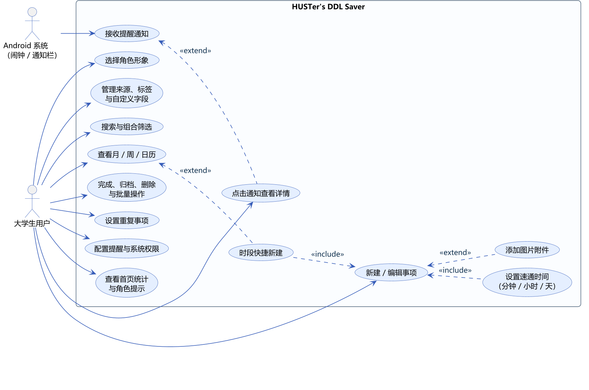
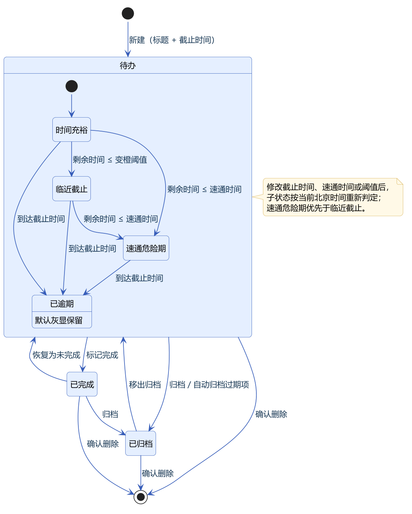
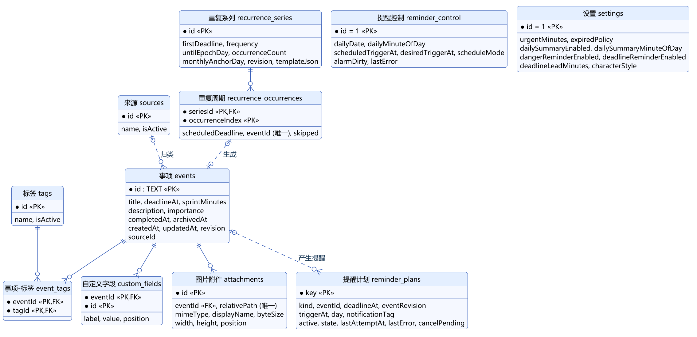
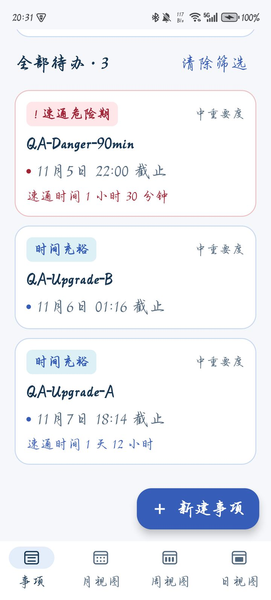
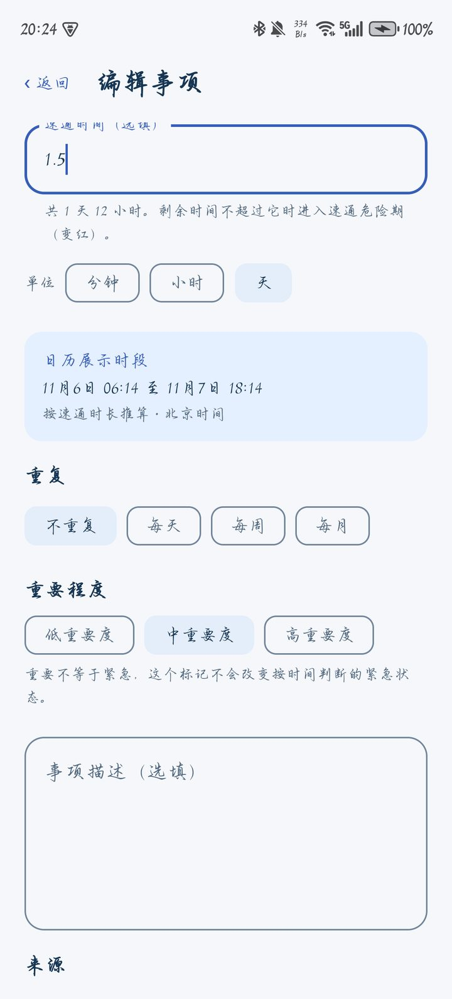
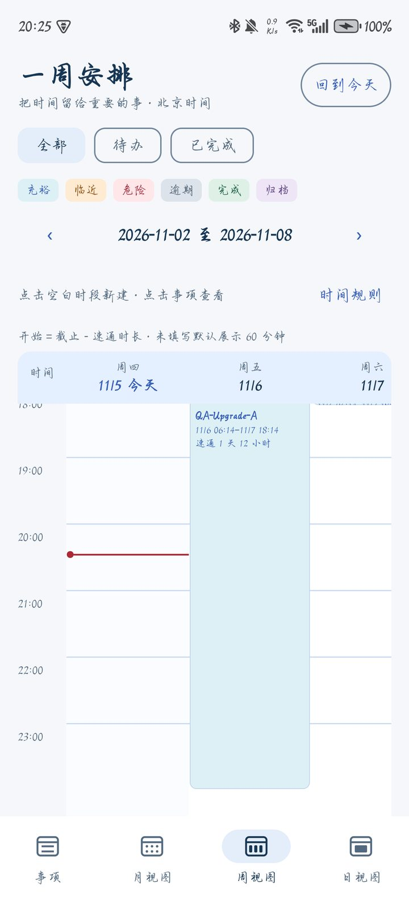
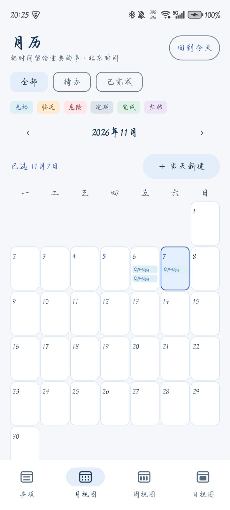

# 1 引言

## 1.1 编写目的

本文档定义 HUSTer's DDL Saver 1.0.0 的功能需求、业务规则、数据需求和非功能需求，作为设计、实现、测试和验收的依据。读者包括小组成员、课程老师和测试人员。

## 1.2 项目范围

HUSTer's DDL Saver 是面向大学生的 Android 截止日期（DDL）管理与提醒应用。应用离线运行，不需要注册账号，所有数据保存在手机本地。不纳入本版本范围的内容见《选题报告》第 4.2 节。

## 1.3 术语定义

表1-1 术语

| 术语 | 含义 |
| --- | --- |
| DDL / 事项 | 一件有截止时间的任务，标题和截止时间必填 |
| 截止时间 | 按北京时间（Asia/Shanghai）解释，精确到分钟 |
| 速通时间 | 用户估计完成事项至少需要的时长，可按分钟、小时或天填写，选填 |
| 速通危险期 | 事项未截止、未完成、未归档，且剩余时间 ≤ 速通时间；界面显示红色和感叹号 |
| 临近截止 | 剩余时间 ≤ 变橙阈值（默认 1 天）且未进入危险期；界面显示橙色 |
| 已逾期 | 已到截止时间仍未完成；默认灰显保留 |
| 归档 | 把事项移出待办列表保存，可随时移出归档 |
| 来源 / 标签 | 事项分类。一个事项最多一个来源，可以有多个标签 |
| 自定义字段 | 每个事项单独添加的“名称 + 文本”，如地点、网址 |
| 重复系列 | 按每天 / 每周 / 每月规则生成的一组事项，每次是一个独立事项 |
| 提醒计划 | 应用为每类提醒算出的触发时刻和发送记录，保存在数据库中 |

## 1.4 参考资料

- 《选题报告》（本仓库 `deliverables/01-选题报告`）
- 小组原始想法 `docs/project/idea.md` 与课程要求 `docs/project/task_finish_tips.md`
- 过程版本需求文档：`docs/requirements.md`、`docs/data-requirements.md`、`docs/planning-extension-requirements.md`

# 2 总体描述

## 2.1 产品视角

应用是一个独立的 Android 程序，只与手机系统交互：通过 AlarmManager 定时唤醒，通过 NotificationManager 发送通知，通过系统相册选择器和剪贴板读取用户选择的图片。应用不连接任何服务器，也没有申请网络权限。

## 2.2 用户特征

主要用户是使用 Android 手机的大学生。他们熟悉手机操作，需要同时处理课程学习（作业、实验报告、课程项目）、学生工作（活动报名、材料收集）和日常生活中的限时安排。他们希望录入快、一眼看清先做什么，并且不愿意注册账号。

## 2.3 运行环境

表2-1 运行环境

| 项目 | 要求 |
| --- | --- |
| 操作系统 | Android 8.0（API 26）及以上，目标版本 Android 15（API 35） |
| 实测设备 | 荣耀 X50（HONOR ALI-AN00），Android 15，MagicOS 9.0.0 |
| 权限 | 通知（Android 13+ 运行时授权）、精确闹钟（Android 12+ 特殊权限，可不授予，届时使用近似提醒）、开机广播 |
| 网络 | 不需要 |

## 2.4 设计与实现约束

1. 所有日期和时间按北京时间解释和显示，与手机所在时区无关。
2. 数据只保存在应用私有存储；卸载应用会删除数据。
3. 数据库结构升级必须使用显式迁移，保留旧数据，不允许破坏性重建。
4. 角色素材必须保留来源、署名与许可说明。

## 2.5 假设与依赖

- 系统允许应用发送通知、设置闹钟。厂商省电策略、强制停止、重启等情况可能延迟或阻止提醒，应用需要在下次打开时补发并重排。
- 用户选择或粘贴的图片可以被系统读取（content URI）。纯网址文本不能作为图片导入。

# 3 功能需求

## 3.1 用例图

系统的参与者为“大学生用户”和“Android 系统（闹钟 / 通知栏）”。主要用例如图3-1所示。

## 3.2 功能需求列表

优先级：高 = 核心流程，缺少则无法使用；中 = 重要增强；低 = 体验优化。状态均以 1.0.0 实际实现为准。

表3-1 功能需求

| 编号 | 功能 | 需求描述 | 优先级 | 1.0.0 状态 |
| --- | --- | --- | --- | --- |
| FR-01 | 离线安装使用 | 安装后无需账号、无需联网即可使用全部功能 | 高 | 已实现 |
| FR-02 | 新建事项 | 标题、截止日期与时间必填；截止时间精确到分钟 | 高 | 已实现 |
| FR-03 | 编辑事项 | 所有字段可修改；修改后首页、日历、提醒同步更新；旧页面的过期修改会被拒绝 | 高 | 已实现 |
| FR-04 | 事项卡片与紧急标识 | 首页以卡片显示事项；按状态显示蓝 / 橙 / 红 / 灰，危险期带感叹号 | 高 | 已实现 |
| FR-05 | 详情与复制 | 详情页显示全部信息；描述和自定义字段可复制；图片可逐张放大 | 高 | 已实现 |
| FR-06 | 角色提示 | “蓝色大肥鱼”经典立绘 / Q 版两种形象，按事项状态切换表情和台词（36 条本地台词） | 中 | 已实现 |
| FR-07 | 北京时间钟表 | 首页显示北京时间日期、星期和时刻，按分钟刷新 | 中 | 已实现 |
| FR-08 | 首页统计 | 显示“今日 DDL”和“速通危险期”数量，点击可筛选对应事项 | 中 | 已实现 |
| FR-09 | 速通时间与危险期 | 速通时间选填；剩余时间 ≤ 速通时间时进入危险期 | 高 | 已实现 |
| FR-10 | 删除与批量操作 | 单个删除需确认；批量完成、归档、删除只影响选中项，删除前确认 | 高 | 已实现 |
| FR-11 | 过期处理 | 默认灰显保留；可设为自动归档过期未完成事项；可一键归档过期事项 | 中 | 已实现 |
| FR-12 | 每日汇总通知 | 每天按设定时刻（默认 08:00）汇总今天截止的待办 | 高 | 已实现 |
| FR-13 | 危险期与临近提醒 | 进入速通危险期时提醒；截止前按提前量（默认 1 小时）提醒 | 高 | 已实现 |
| FR-14 | 重要程度、来源、标签 | 重要程度低 / 中 / 高；来源单选、标签多选；分类可新增、改名、停用、恢复 | 中 | 已实现 |
| FR-15 | 本地持久化 | 事项、分类、字段、图片、设置在重启和升级后保留 | 高 | 已实现 |
| FR-16 | 完成与恢复 | 标记完成后进入“已完成”，可恢复为未完成 | 高 | 已实现 |
| FR-17 | 归档与恢复 | 归档后进入“归档”，可移出归档 | 中 | 已实现 |
| FR-18 | 搜索、筛选、排序 | 关键词搜索标题、描述和自定义字段；与来源、标签、日期组合筛选；按截止时间排序 | 高 | 已实现 |
| FR-19 | 自定义字段 | 每个事项可添加多组“名称 + 文本”，可编辑、移除、复制 | 中 | 已实现 |
| FR-20 | 提醒设置 | 三类提醒可分别开关；汇总时刻、提前量、变橙阈值可修改；显示权限状态并提供授权入口 | 高 | 已实现 |
| FR-21 | 重复事项 | 每天 / 每周 / 每月重复；不结束、按次数、按日期结束；可修改或删除“本次及后续”、停止后续重复 | 中 | 已实现 |
| FR-22 | 独立日历页 | 底部导航切换事项 / 月 / 周 / 日视图；月格显示带状态颜色的事项标题；周 / 日为时间轴 | 中 | 已实现 |
| FR-23 | 时段快捷新建 | 月视图“当天新建”；周 / 日视图点击空白时段新建并预填截止时间 | 低 | 已实现 |
| FR-24 | 多单位时长输入 | 速通时间、变橙阈值、提醒提前量可按分钟 / 小时 / 天填写，支持两位小数 | 中 | 已实现（1.0.0 新增） |
| FR-25 | 版本与课程信息 | 设置页显示版本号、课程与小组成员 | 低 | 已实现（1.0.0 新增） |

## 3.3 主要用例规约

### UC-01 新建事项

表3-2 UC-01 新建事项

| 项目 | 内容 |
| --- | --- |
| 参与者 | 大学生用户 |
| 前置条件 | 应用已打开 |
| 基本流 | 1. 用户点击“＋ 新建事项”；2. 填写标题，选择截止日期和时间；3. 可选填写速通时间（输入数字并选择分钟 / 小时 / 天）、重要程度、描述、来源、标签、自定义字段、图片；4. 页面实时显示“日历展示时段”预览；5. 用户点击“保存事项”；6. 系统校验并保存，进入事项详情 |
| 备选流 | 2a. 标题为空或未选时间：提示“给事项填个标题吧。”/“还需要选好截止日期和时间。”，不保存；3a. 速通时间换算后小于 1 分钟或超过 365 天：输入框下方即时提示，不能保存；3b. 截止时间早于现在：提示“截止时间已过，保存后会显示为已逾期”，允许保存；5a. 用户返回且有未保存修改：弹出“放弃未保存的修改？”确认 |
| 后置条件 | 事项写入数据库，首页、日历和提醒计划同步更新 |
| 相关需求 | FR-02、FR-09、FR-24 |

### UC-02 编辑与删除事项

表3-3 UC-02 编辑与删除事项

| 项目 | 内容 |
| --- | --- |
| 前置条件 | 事项存在 |
| 基本流 | 1. 在详情页点击“编辑事项”；2. 表单带出原值，速通时间按能整除的最大单位显示（如 120 分钟显示为“2 小时”）；3. 修改后保存；4. 删除时点击“删除”并确认 |
| 备选流 | 3a. 该事项已在其他页面被修改（修订号不一致）：提示“这条事项刚被修改过，请重新打开再编辑。”；3b. 事项已被删除：提示后返回列表 |
| 后置条件 | 修订号加 1；提醒计划按新内容重建，已失效的通知被取消 |
| 相关需求 | FR-03、FR-10 |

### UC-03 添加图片附件

表3-4 UC-03 添加图片附件

| 项目 | 内容 |
| --- | --- |
| 基本流 | 1. 编辑页点击“从相册选择”或“粘贴图片”；2. 系统返回图片；3. 应用逐张复制为私有副本并显示缩略图；4. 保存事项后附件生效 |
| 备选流 | 2a. 内容不是图片、无法读取、已损坏、单张超过 20 MiB 或 1 亿像素：给出中文提示，本批已复制的文件全部回滚；4a. 取消编辑：本次新复制的文件被清理，原附件不受影响 |
| 约束 | 重复事项不能带图片；删除应用内附件不影响相册原图 |
| 相关需求 | FR-05 |

### UC-04 管理来源、标签与自定义字段

表3-5 UC-04 管理分类与字段

| 项目 | 内容 |
| --- | --- |
| 基本流 | 1. 设置 → 分类管理，新增或改名来源 / 标签；2. 停用后新建事项不可再选，已有事项保留关联并可按其筛选；3. 编辑事项时添加、修改、移除自定义字段 |
| 备选流 | 名称为空：提示“给分类填个名称吧。”；自定义字段名称为空：提示填写或移除 |
| 相关需求 | FR-14、FR-19 |

### UC-05 搜索与组合筛选

表3-6 UC-05 搜索与组合筛选

| 项目 | 内容 |
| --- | --- |
| 基本流 | 1. 在首页输入关键词；2. 展开“来源 / 标签”和“日期筛选”选择条件；3. 在待办 / 已完成 / 归档之间切换；4. 列表按截止时间升序显示结果 |
| 规则 | 关键词按完整连续文字匹配，英文不区分大小写，匹配标题、描述、自定义字段名称和内容；各条件取交集，多个标签要求全部包含 |
| 相关需求 | FR-08、FR-18 |

### UC-06 查看日历与快捷新建

表3-7 UC-06 查看日历与快捷新建

| 项目 | 内容 |
| --- | --- |
| 基本流 | 1. 点击底部“月视图 / 周视图 / 日视图”；2. 用“‹ ›”切换周期，“回到今天”定位今天；3. 月视图点击日期查看当天事项，点“＋ 当天新建”新建（截止预填当天 23:59）；4. 周 / 日视图点击空白时段新建（开始时刻按 15 分钟对齐，截止预填为一小时后）；5. 点击事项进入详情，返回时回到原日历页面 |
| 规则 | 时间轴中事项的开始时间 = 截止时间 − 速通时间，未填速通时间按 60 分钟展示；跨日事项分段显示；时间重叠时并排显示；今天显示红色当前时间线 |
| 相关需求 | FR-22、FR-23 |

### UC-07 完成、归档与批量操作

表3-8 UC-07 完成、归档与批量操作

| 项目 | 内容 |
| --- | --- |
| 基本流 | 1. 详情页“标记完成 / 恢复未完成”“归档 / 移出归档”；2. 首页“批量管理”多选或全选当前结果，执行完成、归档或删除 |
| 备选流 | 批量删除需要确认，取消则数据不变；批量操作在一个数据库事务中完成，失败时全部不生效 |
| 相关需求 | FR-10、FR-11、FR-16、FR-17 |

### UC-08 设置重复事项

表3-9 UC-08 设置重复事项

| 项目 | 内容 |
| --- | --- |
| 基本流 | 1. 编辑页选择“每天 / 每周 / 每月”；2. 选择不结束、按次数（含首次）或按日期（含当天）结束；3. 保存后生成各次事项；4. 编辑某一次时选择“仅本次”或“本次及后续”；5. 在“本次及后续”中选“停止后续重复”可保留本次、删除后续 |
| 规则 | 每次是独立事项；首次保存生成到 max(首次截止, 现在) + 90 天，之后打开应用或提醒唤醒时继续补到未来 90 天；每月重复锚定首次日期，短月取月末；已完成或已归档的历史不被修改；删除的某一次记为跳过，不会再补生成 |
| 相关需求 | FR-21 |

### UC-09 接收提醒通知

表3-10 UC-09 接收提醒通知

| 项目 | 内容 |
| --- | --- |
| 参与者 | Android 系统（主动）、大学生用户 |
| 前置条件 | 用户已允许通知；精确闹钟可选 |
| 基本流 | 1. 系统闹钟到点唤醒应用；2. 应用核对提醒计划，发送到期的通知；3. 用户点击通知：单项提醒打开该事项详情，每日汇总打开首页“今日 DDL”列表 |
| 备选流 | 事项已完成、归档、删除或改期：原计划失效，已显示的通知被取消；未授权精确闹钟：使用近似提醒，可能延迟；正在编辑时点击通知：先保护草稿再跳转 |
| 相关需求 | FR-12、FR-13、FR-20 |

### UC-10 设置与角色

表3-11 UC-10 设置与角色

| 项目 | 内容 |
| --- | --- |
| 基本流 | 1. 打开“设置”；2. 修改变橙阈值、汇总时刻、三类提醒开关和提醒提前量；3. 预览并选择经典立绘或 Q 版形象；4. 点“保存设置”生效；5. 底部查看版本号、课程与小组信息 |
| 备选流 | 有未保存修改时返回：确认是否放弃；时长换算后不合法或汇总时刻不是 HH:mm：提示并不保存 |
| 相关需求 | FR-06、FR-20、FR-24、FR-25 |

## 3.4 业务规则

表3-12 业务规则

| 编号 | 规则 |
| --- | --- |
| BR-01 紧急程度判定 | 依次判断：已归档 → 已完成 → 剩余时间 ≤ 0 为已逾期 → 填了速通时间且剩余时间 ≤ 速通时间为速通危险期 → 剩余时间 ≤ 变橙阈值为临近截止 → 否则时间充裕。危险期优先于临近 |
| BR-02 北京时间 | “今天”“日历日期”“每日汇总时刻”“重复事项结束日期”都按北京时间计算 |
| BR-03 今日统计 | 今日 DDL = 北京时间今天截止、未完成且未归档的事项，包括今天已逾期的；危险期统计 = 当前处于速通危险期的待办 |
| BR-04 过期处理 | 默认灰显保留。启用自动归档后，在打开应用、回到前台和运行中每分钟检查，只归档过期且未完成的事项 |
| BR-05 搜索 | 见 UC-05；查询不修改数据 |
| BR-06 每日汇总 | 默认 08:00；只汇总今天截止、未完成且未归档的事项，没有就不发送，当天记为已处理；同一天不重复发送 |
| BR-07 事项提醒 | 危险期提醒在“截止时间 − 速通时间”触发；临近提醒在“截止时间 − 提醒提前量”触发；同一事项同一时刻的两类提醒合并为一条通知；每类原因只发送一次 |
| BR-08 时长输入 | 数字最多两位小数，换算为分钟后四舍五入，至少 1 分钟，最长 365 天；数据库统一保存分钟 |
| BR-09 重复事项 | 见 UC-08 |
| BR-10 图片 | 只接受图片；单张不超过 20 MiB、1 亿像素；缩略图最长边 320 像素，放大预览不超过 1600 像素 |
| BR-11 角色反馈 | 按待办中最紧急的事项选择表情：危险期 > 已逾期 > 临近 > 普通；刚完成一件事时短暂显示开心表情。台词为本地预设，不联网 |

## 3.5 事项状态

事项在生命周期中的状态及转换如图3-2所示。

# 4 数据需求

## 4.1 概念数据模型

系统的主要数据实体及关系如图4-1所示：一个事项可以有一个来源、多个标签、多个自定义字段和多张图片；重复系列生成多个周期，每个周期对应一个事项；提醒计划由事项和设置推导得出。

## 4.2 数据项说明

表4-1 主要数据项

| 数据项 | 类型 / 取值 | 必填 | 说明 |
| --- | --- | --- | --- |
| 标题 | 文本，去除首尾空格后非空 | 是 | |
| 截止时间 | 北京时间，精确到分钟 | 是 | 保存为毫秒时间戳 |
| 速通时间 | 正整数分钟，界面上限 365 天 | 否 | 按分钟 / 小时 / 天输入 |
| 重要程度 | 低 / 中 / 高，默认中 | 是 | 不影响紧急程度 |
| 描述 | 任意长度文本 | 否 | 可复制 |
| 来源 | 0 或 1 个 | 否 | 可停用 |
| 标签 | 0 个或多个 | 否 | 可停用 |
| 自定义字段 | 名称（非空）+ 文本 | 否 | 按添加顺序保存 |
| 图片附件 | 私有副本文件 + 类型、尺寸、大小 | 否 | 重复事项不支持 |
| 完成 / 归档时间 | 时间戳 | 否 | 两者独立 |
| 修订号 | 正整数，每次修改加 1 | 是 | 用于编辑冲突检查 |
| 设置 | 变橙阈值（默认 1 天）、过期策略、汇总开关与时刻（默认 08:00）、危险期 / 临近提醒开关、提醒提前量（默认 1 小时）、角色形象 | 是 | 全局唯一一份 |

完整的表结构与字段说明见《设计说明书》第 5 章。

# 5 非功能需求

表5-1 非功能需求

| 编号 | 类别 | 需求 | 验证结果（1.0.0） |
| --- | --- | --- | --- |
| NFR-01 | 性能 | 冷启动到首页显示不超过 2 秒（测试设备） | 荣耀 X50 实测 1574 ms（含数据库迁移）、1719 ms（全新安装） |
| NFR-02 | 可靠性 | 保存、批量、重复生成等写操作在一个数据库事务内完成，失败时不留下部分结果；业务数据与提醒计划同事务提交 | 自动化测试覆盖回滚场景，通过 |
| NFR-03 | 数据兼容 | 升级应用时通过显式迁移保留原有数据，覆盖 schema 1→5 | 自动化迁移测试通过；真机 0.3.5→1.0.0 升级保留数据 |
| NFR-04 | 离线与隐私 | 不申请网络权限，不收集个人信息；数据只存于应用私有目录，排除云备份 | 清单仅有通知、精确闹钟、开机广播三项权限 |
| NFR-05 | 易用性 | 核心操作在三步内完成；错误提示用中文说明原因和处理办法；150% 字号下主要页面内容完整 | 真机 150% 字号检查通过 |
| NFR-06 | 兼容性 | 支持 Android 8.0–15；权限受限时降级（无精确闹钟时使用近似提醒） | 测试覆盖 API 28 / 35 配置；真机为 Android 15 |
| NFR-07 | 可维护性 | 界面、业务规则、数据访问分层；业务规则有单元测试；每个 Pull Request 自动构建、测试和 Lint | 31 个测试类、251 次执行全部通过 |
| NFR-08 | 合规 | 角色素材保留来源、署名与许可，应用内可查看 | 已实现“素材与署名”页面 |

# 6 界面需求

界面采用海蓝主题和浅色卡片。主要页面及跳转关系见《设计说明书》第 8 章。图6-1至图6-4为 1.0.0 在荣耀 X50 上的实际界面。

# 7 验收标准

表7-1 验收标准

| 编号 | 验收场景 | 对应需求 |
| --- | --- | --- |
| AC-01 | 手机上安装 APK 后无需联网即可新建、查看、编辑事项 | FR-01、FR-02、FR-03 |
| AC-02 | 设置速通时间后，剩余时间不足时卡片变红并在到点时收到通知，点击通知进入该事项 | FR-09、FR-13 |
| AC-03 | 速通时间可按分钟 / 小时 / 天填写，非法值有提示，重开时正确回显 | FR-24 |
| AC-04 | 关键词与来源、标签、日期组合筛选结果正确 | FR-18 |
| AC-05 | 月 / 周 / 日历显示正确，可从空白时段快捷新建 | FR-22、FR-23 |
| AC-06 | 批量操作只影响选中项；取消删除不改变数据 | FR-10 |
| AC-07 | 重复事项按规则生成，修改或删除“本次及后续”不影响已完成历史 | FR-21 |
| AC-08 | 覆盖安装新版本后原有事项、图片和设置保留 | FR-15、NFR-03 |
| AC-09 | 每日汇总在设定时刻送达，内容为今天截止的待办 | FR-12 |
| AC-10 | 角色形象可切换并保存，表情随事项状态变化 | FR-06 |

各验收场景对应的测试用例和结果见《测试报告》。
