# 1 引言

## 1.1 编写目的

本文档说明 HUSTer's DDL Saver 1.0.0 的总体结构、模块划分、数据库、关键流程、关键算法和界面设计，描述的是仓库 `main` 分支的实际代码，供实现、维护、测试和答辩使用。需求依据见《需求规格说明书》。

## 1.2 设计原则

1. **分层**：界面只负责显示和收集输入；业务规则写成纯 Kotlin 函数，不依赖 Android，便于单元测试；数据访问集中在 Repository。
2. **单一数据源**：数据库是唯一的事实来源。界面通过 Flow 订阅数据库变化，不自行缓存事项副本。
3. **事务一致**：业务数据和提醒计划在同一个数据库事务中提交，避免“事项改了但提醒没改”。
4. **可恢复**：提醒计划、发送记录、闹钟快照都写入数据库；应用被系统杀掉或手机重启后，打开应用即可重新核对和补发。
5. **离线与隐私**：不申请网络权限；图片复制为应用私有副本。

# 2 总体设计

## 2.1 技术选型

表2-1 技术选型

| 类别 | 技术与版本 | 在本项目中的作用 |
| --- | --- | --- |
| 语言 | Kotlin 2.1.20（JVM 17） | 全部业务与界面代码 |
| 界面 | Jetpack Compose（BOM 2025.04.01）、Material 3 | 首页卡片、编辑表单、日历网格与时间轴、设置页 |
| 状态管理 | AndroidX ViewModel / Lifecycle 2.9.0、Kotlin Coroutines / Flow 1.10.2 | UI 状态、数据库订阅、后台操作 |
| 存储 | Room 2.7.1（SQLite）、KSP 2.1.20-1.0.32 | 11 张表、事务、显式迁移、导出 schema |
| 系统能力 | AlarmManager、NotificationManager、Photo Picker、ClipboardManager、ContentResolver、BitmapFactory、ExifInterface | 定时唤醒、通知、图片选择与读取、解码与方向校正 |
| 构建 | Gradle 8.11.1、Android Gradle Plugin 8.9.2、Android SDK 35 | 编译、打包、Lint |
| 测试 | JUnit 4.13.2、Robolectric 4.14.1、Room Testing、Compose UI Test | 规则、数据库、迁移、界面流程测试 |

没有使用 Hilt、Navigation、Retrofit、WorkManager 等库：依赖由 ViewModel 手动创建；页面切换由一个状态变量控制；应用不联网；定时任务直接使用 AlarmManager，以便控制精确 / 近似两种模式。

## 2.2 系统架构

系统采用单 Activity + MVVM 分层架构，如图2-1所示。

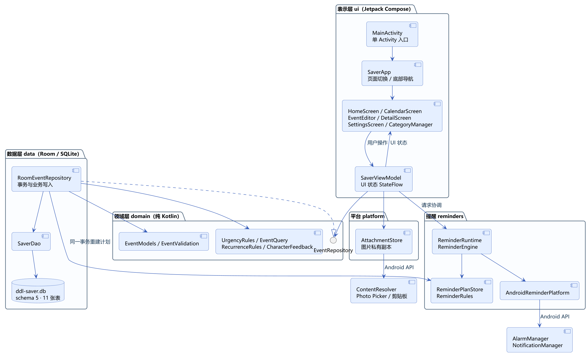

表2-2 各层职责

| 层 / 包 | 主要类 | 职责 |
| --- | --- | --- |
| 表示层 `ui` | `MainActivity`、`SaverApp`、`HomeScreen`、`CalendarScreen`、`EventEditor`、`ReminderSettingsPanel`、`SaverViewModel` | 渲染页面、收集输入、保存草稿状态；ViewModel 把用户操作交给 Repository，并把结果整理成 `SaverUiState` |
| 领域层 `domain` | `EventModels`、`EventValidation`、`UrgencyRules`、`EventQuery`、`RecurrenceRules`、`CharacterFeedback`、`EventRepository` 接口 | 业务对象、输入校验、紧急程度、查询、重复规则、角色反馈；不依赖 Android |
| 数据层 `data` | `RoomEventRepository`、`SaverDao`、`SaverDatabase`、实体类、`RecurrenceTemplate` | 事务内的业务写入、关系维护、数据库迁移、重复事项生成 |
| 提醒 `reminders` | `ReminderRules`、`ReminderPlanStore`、`ReminderEngine`、`ReminderRuntime`、`AndroidReminderPlatform`、两个 Receiver | 计算提醒计划、发送通知、安排系统闹钟、开机 / 升级后恢复 |
| 平台 `platform` | `AttachmentStore`、`AttachmentImportDiagnostics` | 图片读取、校验、私有副本、预览解码与清理 |

## 2.3 部署结构

应用打包为单个 APK，安装在 Android 手机上，数据保存在应用私有目录，如图2-2所示。

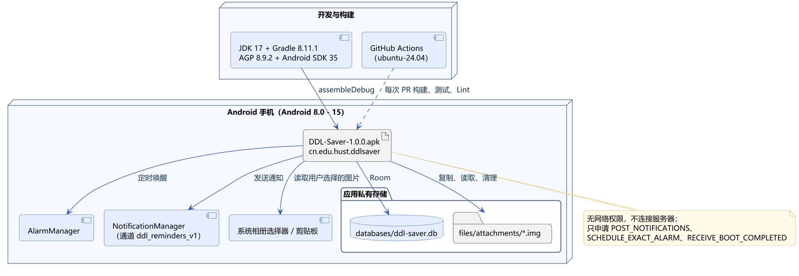

# 3 功能模块设计

## 3.1 功能模块结构

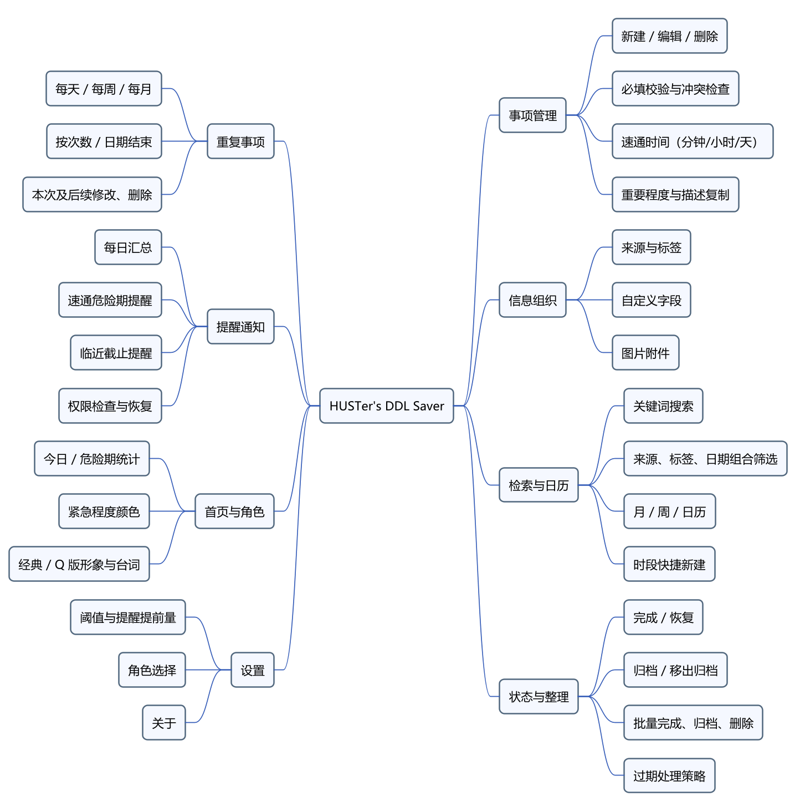

## 3.2 模块说明

表3-1 模块与实现位置

| 模块 | 功能 | 主要实现 |
| --- | --- | --- |
| 事项管理 | 新建、编辑、删除；必填与冲突检查；多单位速通时间 | `ui/EventEditor.kt`、`ui/DurationInput.kt`、`domain/EventValidation.kt`、`data/RoomEventRepository.save` |
| 信息组织 | 来源、标签、自定义字段、图片附件 | `ui/CategoryManager.kt`、`ui/EditorExtras.kt`、`ui/AttachmentUi.kt`、`platform/AttachmentStore.kt` |
| 检索与日历 | 搜索与组合筛选；月 / 周 / 日历；时段快捷新建 | `domain/EventQuery.kt`、`ui/HomeScreen.kt`、`ui/CalendarScreen.kt`、`ui/CalendarTimelineLayout.kt` |
| 状态与整理 | 完成、归档、批量、过期处理 | `RoomEventRepository.setCompleted / setArchived / applyBatch / applyExpiredPolicy` |
| 重复事项 | 规则计算、系列生成、范围修改与删除 | `domain/RecurrenceRules.kt`、`data/RecurrenceEntities.kt`、`data/RecurrenceTemplate.kt`、`RoomEventRepository.createRecurrence` 等 |
| 提醒通知 | 计划计算、发送、系统闹钟、恢复 | `reminders/` 包 |
| 首页与角色 | 统计、紧急颜色、角色表情与台词 | `ui/HomeScreen.kt`、`ui/CharacterPanel.kt`、`domain/CharacterFeedback.kt`、`domain/UrgencyRules.kt` |
| 设置 | 阈值、提醒、角色、关于 | `ui/ReminderSettingsPanel.kt`、`ui/CharacterPanel.kt` |

## 3.3 模块接口

表示层通过领域层接口 `EventRepository` 访问数据，主要方法见表3-2。`RoomEventRepository` 实现该接口，并额外提供重复事项相关方法。

表3-2 EventRepository 接口

| 方法 | 说明 |
| --- | --- |
| `events / settings / sources / tags: Flow` | 订阅数据库中的事项（含关联）、设置和分类 |
| `save(draft: EventDraft): DdlEvent` | 新建或修改事项；按草稿内容走普通、新建系列、转为系列、仅本次、本次及后续、停止后续等分支 |
| `setCompleted(id, completed)` / `setArchived(id, archived)` / `delete(id)` | 单个事项状态变更与删除 |
| `applyBatch(ids, operation)` | 批量完成、归档、删除，单事务执行 |
| `saveSettings(settings)` | 校验并保存设置，重建提醒计划 |
| `saveSource / saveTag / setSourceActive / setTagActive` | 分类新增、改名、停用、恢复 |
| `archiveExpired()` / `applyExpiredPolicy()` | 手动或按策略归档过期事项 |
| `referencedAttachmentPaths()` | 返回仍被引用的图片文件，用于清理孤儿文件 |

提醒模块通过 `ReminderPlatform` 接口访问系统能力（`capabilities`、`scheduleAlarm`、`cancelAlarm`、`post`、`cancelNotification`），测试时可替换为假实现。

# 4 类设计

关键类及其关系如图4-1所示，图中仅显示类型和关系，接口方法见表3-2、类职责见表4-1，数据字段见第5章。`DdlEvent` 是只读的领域对象；界面提交的是 `EventDraft`，其中 `expectedRevision` 用于编辑冲突检查，`applyToFuture` 与 `stopAfterThis` 用于重复事项的范围选择。

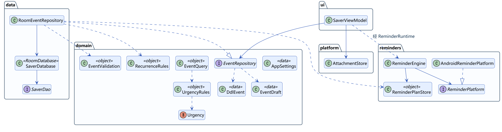

表4-1 主要类说明

| 类 | 类型 | 说明 |
| --- | --- | --- |
| `DdlEvent` | 数据类 | 事项及其来源、标签、字段、附件、重复信息 |
| `EventDraft` | 数据类 | 编辑页提交的草稿 |
| `AppSettings` | 数据类 | 变橙阈值、过期策略、汇总开关与时刻、两类提醒开关与提前量、角色形象 |
| `Urgency` | 枚举 | NORMAL、SOON、DANGER、OVERDUE、COMPLETED、ARCHIVED |
| `UrgencyRules` | 单例 | 紧急程度判定、今天判定（北京时间） |
| `EventQuery` | 单例 | 组合查询与排序 |
| `RecurrenceRules` | 单例 | 计算第 n 次截止时间、区间内的周期、缺失的周期 |
| `RoomEventRepository` | 类 | 所有写操作；用 `reminderTransaction` 包裹业务写入和提醒计划重建 |
| `ReminderPlanStore` | 单例 | 由事项和设置推导期望的提醒计划，与已有计划合并 |
| `ReminderEngine` | 类 | 核对计划、发送到期通知、安排下一次系统闹钟（串行执行） |
| `SaverViewModel` | ViewModel | 合并数据库 Flow 与界面状态；统一的 `perform` 处理忙碌、成功和失败提示 |
| `AttachmentStore` | 类 | 图片复制、校验、预览和清理（IO 线程 + 互斥锁） |
| `DurationUnit` / `parseDuration` / `DurationField` | 枚举 / 函数 / 组件 | 1.0.0 新增的多单位时长输入 |

# 5 数据库设计

## 5.1 E-R 图

数据库文件为 `ddl-saver.db`，当前 schema 版本为 5，共 11 张表，关系如图5-1所示。截止、创建等时刻保存为 UTC 纪元毫秒，显示时按北京时间转换；每日汇总时刻使用当天分钟数，重复结束日期使用 epoch day。

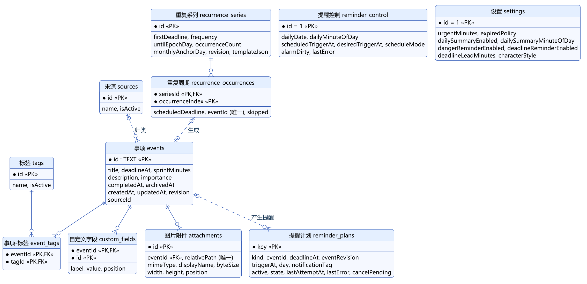

## 5.2 表结构

以下表结构与 Room 导出的 `app/schemas/cn.edu.hust.ddlsaver.data.SaverDatabase/5.json` 一致。

表5-1 events（事项）

| 字段 | 类型 | 可空 | 键 | 说明 |
| --- | --- | --- | --- | --- |
| id | TEXT | 否 | PK | UUID |
| title | TEXT | 否 | | 标题，已去除首尾空格 |
| deadlineAt | INTEGER | 否 | | 截止时间（毫秒，截到整分钟） |
| sprintMinutes | INTEGER | 是 | | 速通时间（分钟） |
| description | TEXT | 否 | | 描述 |
| importance | TEXT | 否 | | LOW / NORMAL / HIGH |
| completedAt | INTEGER | 是 | | 完成时间 |
| archivedAt | INTEGER | 是 | | 归档时间 |
| createdAt / updatedAt | INTEGER | 否 | | 创建 / 修改时间 |
| revision | INTEGER | 否 | | 修订号，每次修改加 1 |
| sourceId | TEXT | 是 | | 来源 ID（由 Repository 校验存在性） |

表5-2 sources / tags（来源 / 标签）

| 字段 | 类型 | 可空 | 键 | 说明 |
| --- | --- | --- | --- | --- |
| id | TEXT | 否 | PK | UUID |
| name | TEXT | 否 | | 名称 |
| isActive | INTEGER | 否 | | 1 启用，0 停用（停用后保留已有关联） |

表5-3 event_tags（事项—标签）

| 字段 | 类型 | 可空 | 键 | 说明 |
| --- | --- | --- | --- | --- |
| eventId | TEXT | 否 | PK、FK→events.id（级联删除） | |
| tagId | TEXT | 否 | PK、FK→tags.id（限制删除） | 带索引 |

表5-4 custom_fields（自定义字段）

| 字段 | 类型 | 可空 | 键 | 说明 |
| --- | --- | --- | --- | --- |
| eventId | TEXT | 否 | PK、FK→events.id（级联删除） | |
| id | TEXT | 否 | PK | 字段 ID |
| label / value | TEXT | 否 | | 名称 / 内容 |
| position | INTEGER | 否 | | 显示顺序 |

表5-5 attachments（图片附件）

| 字段 | 类型 | 可空 | 键 | 说明 |
| --- | --- | --- | --- | --- |
| id | TEXT | 否 | PK | UUID |
| eventId | TEXT | 否 | FK→events.id（级联删除），索引 | |
| relativePath | TEXT | 否 | 唯一索引 | 私有文件名 `<id>.img` |
| mimeType / displayName | TEXT | 否 | | 图片类型 / 显示名 |
| byteSize / width / height | INTEGER | 否 | | 大小与尺寸 |
| position | INTEGER | 否 | | 显示顺序 |

表5-6 settings（设置，单行 id = 1）

| 字段 | 类型 | 默认值 | 说明 |
| --- | --- | --- | --- |
| urgentMinutes | INTEGER | 1440 | 变橙阈值（分钟） |
| expiredPolicy | TEXT | KEEP | KEEP 灰显保留 / AUTO_ARCHIVE 自动归档 |
| dailySummaryEnabled | INTEGER | 1 | 每日汇总开关 |
| dailySummaryMinuteOfDay | INTEGER | 480 | 汇总时刻（当日第几分钟，480 = 08:00） |
| dangerReminderEnabled | INTEGER | 1 | 危险期提醒开关 |
| deadlineReminderEnabled | INTEGER | 1 | 临近提醒开关 |
| deadlineLeadMinutes | INTEGER | 60 | 临近提醒提前量（分钟） |
| characterStyle | TEXT | CLASSIC | CLASSIC 经典立绘 / CHIBI Q 版 |

表5-7 reminder_plans（提醒计划与发送账本）

| 字段 | 类型 | 可空 | 说明 |
| --- | --- | --- | --- |
| key | TEXT | 否 | PK，格式“类型:事项ID:截止时间”，每日汇总为“DAILY:日期” |
| kind | TEXT | 否 | DAILY / DANGER / DEADLINE |
| eventId / deadlineAt / eventRevision | TEXT / INTEGER | 是 | 对应事项（每日汇总为空） |
| triggerAt | INTEGER | 否 | 触发时刻 |
| day | TEXT | 是 | 每日汇总的日期 |
| notificationTag | TEXT | 否 | 系统通知标签，同刻合并的提醒共用 |
| active | INTEGER | 否 | 是否仍有效 |
| state | TEXT | 否 | PENDING / CLAIMED / SENT / FAILED |
| lastAttemptAt / lastError | INTEGER / TEXT | 是 | 最近尝试时间与错误 |
| cancelPending | INTEGER | 否 | 已显示的通知是否待取消 |

表5-8 reminder_control（提醒控制，单行 id = 1）

| 字段 | 类型 | 可空 | 说明 |
| --- | --- | --- | --- |
| alarmIdentity | TEXT | 否 | 系统闹钟标识 |
| dailyDate / dailyMinuteOfDay | TEXT / INTEGER | 是 | 下一次每日汇总的日期与时刻 |
| scheduledTriggerAt | INTEGER | 是 | 已向系统登记的唤醒时刻 |
| desiredTriggerAt | INTEGER | 是 | 期望的下一次唤醒时刻 |
| scheduleMode | TEXT | 是 | exact 精确 / approximate 近似 |
| alarmDirty | INTEGER | 否 | 系统闹钟是否需要重新登记 |
| lastError | TEXT | 是 | 最近一次安排失败原因 |

表5-9 recurrence_series（重复系列）

| 字段 | 类型 | 可空 | 说明 |
| --- | --- | --- | --- |
| id | TEXT | 否 | PK |
| firstDeadline | INTEGER | 否 | 第 0 次的截止时间 |
| frequency | TEXT | 否 | DAILY / WEEKLY / MONTHLY |
| untilEpochDay | INTEGER | 是 | 结束日期（含当天） |
| occurrenceCount | INTEGER | 是 | 总次数（含首次） |
| monthlyAnchorDay | INTEGER | 是 | 每月重复的锚定日 |
| revision | INTEGER | 否 | 系列修订号 |
| templateJson | TEXT | 否 | 模板：标题、描述、重要程度、速通时间、来源、标签、自定义字段 |

表5-10 recurrence_occurrences（重复周期）

| 字段 | 类型 | 可空 | 说明 |
| --- | --- | --- | --- |
| seriesId | TEXT | 否 | PK、FK→recurrence_series.id（级联删除） |
| occurrenceIndex | INTEGER | 否 | PK，从 0 开始的序号 |
| scheduledDeadline | INTEGER | 否 | 按规则计算的截止时间 |
| eventId | TEXT | 是 | 生成的事项 ID（唯一索引） |
| skipped | INTEGER | 否 | 1 表示该次被删除，补生成时跳过 |

## 5.3 数据库迁移

数据库升级全部使用显式迁移，保留原有数据（表5-11）。迁移由 `SaverDatabase.create` 注册，测试读取历史 schema 文件创建真实旧库后升级验证。

表5-11 数据库迁移

| 迁移 | 对应版本 | 内容 |
| --- | --- | --- |
| 1→2 | 0.2.0 | 新增来源、标签、事项—标签、自定义字段、附件表；事项增加 sourceId；设置增加过期策略 |
| 2→3 | 0.3.0 | 设置增加三类提醒开关、汇总时刻、提前量；新增提醒计划表与提醒控制表 |
| 3→4 | 0.3.1 | 设置增加角色形象，默认经典立绘 |
| 4→5 | 0.3.6 | 新增重复系列表与重复周期表 |

1.0.0 没有改动数据库结构，多单位时长只是输入方式的变化，存储仍以分钟为单位。

## 5.4 文件存储

图片保存在应用私有目录 `files/attachments/<uuid>.img`。导入时先写 `.part` 临时文件，校验通过后改名；事务提交前副本只属于编辑草稿。取消、移除或删除事项后，按数据库引用清理文件；超过 24 小时仍未被引用的文件由孤儿清理兜底删除。应用的数据提取规则排除了云备份和设备迁移。

# 6 关键流程设计

## 6.1 保存事项与提醒重建

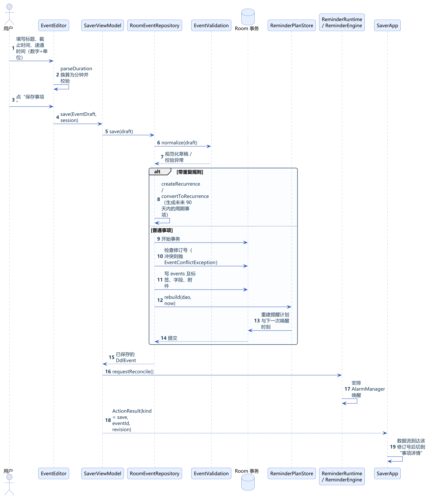

要点：编辑页先在本地把“数字 + 单位”换算为分钟；Repository 规范化草稿并检查修订号；业务写入和 `ReminderPlanStore.rebuild` 在同一个 Room 事务中提交；ViewModel 随后请求提醒引擎核对并安排系统闹钟；界面等数据库 Flow 发出该修订号后才切到详情页，避免显示旧数据。

## 6.2 提醒触发与通知点击

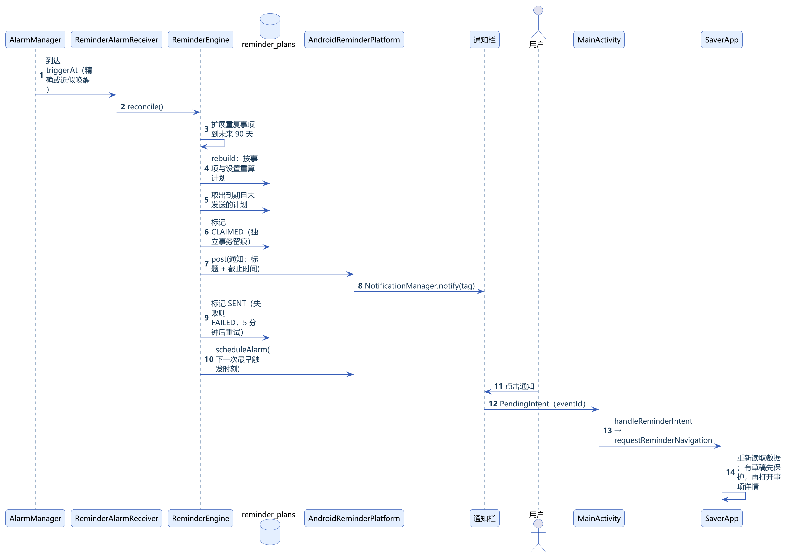

提醒计划的状态变化如图6-3所示。计划先以 CLAIMED 状态独立提交，再调用系统通知，成功后记为 SENT；这样可以保留发送尝试，并在后续核对时重试仍有效的 CLAIMED 或 FAILED 计划。通知与数据库提交不能作为一个系统事务，应用使用稳定的通知标签降低重复显示；实际送达仍依赖系统调度，重启后自动恢复的 OBS-02 尚未解决。

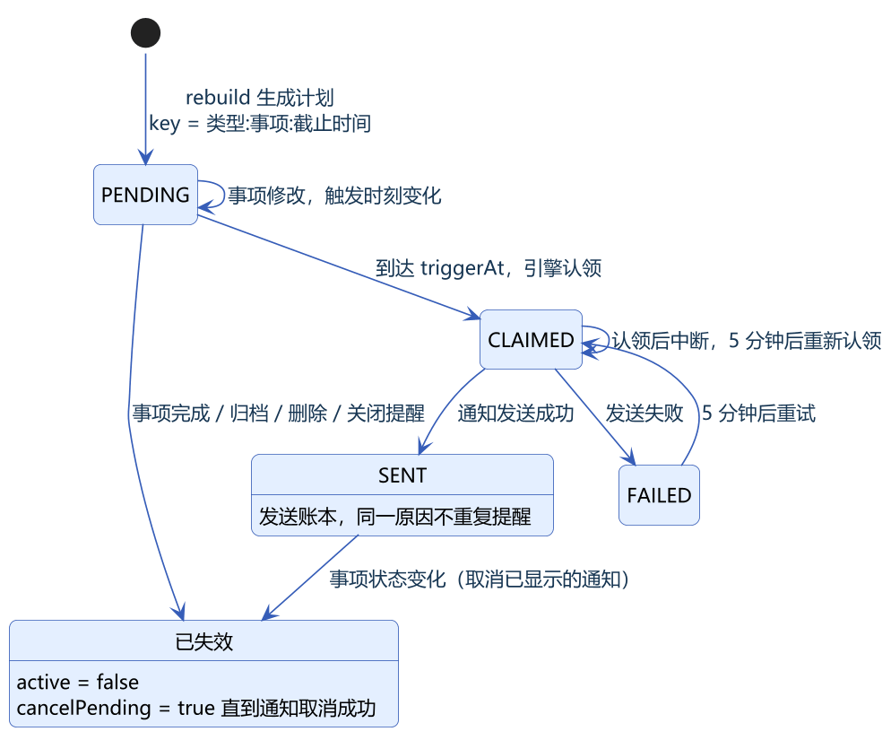

## 6.3 图片导入

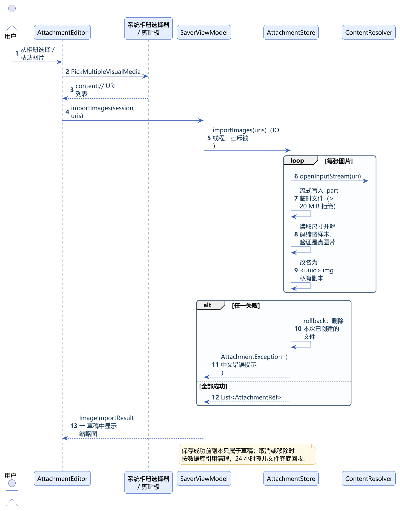

## 6.4 重复事项生成

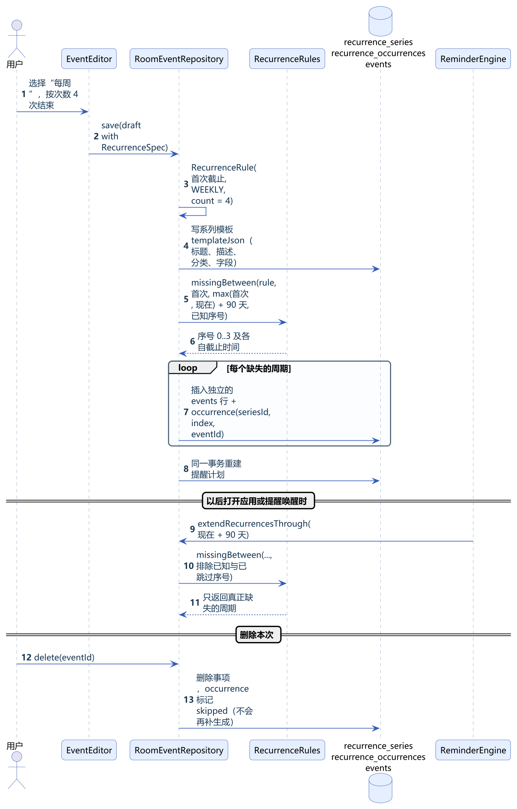

# 7 关键算法设计

## 7.1 紧急程度判定

`UrgencyRules.classify` 按图7-1的顺序判断，结果决定卡片颜色、首页统计、角色表情和日历颜色。速通危险期优先于临近截止，因为它表示“剩下的时间已经不够做完”。

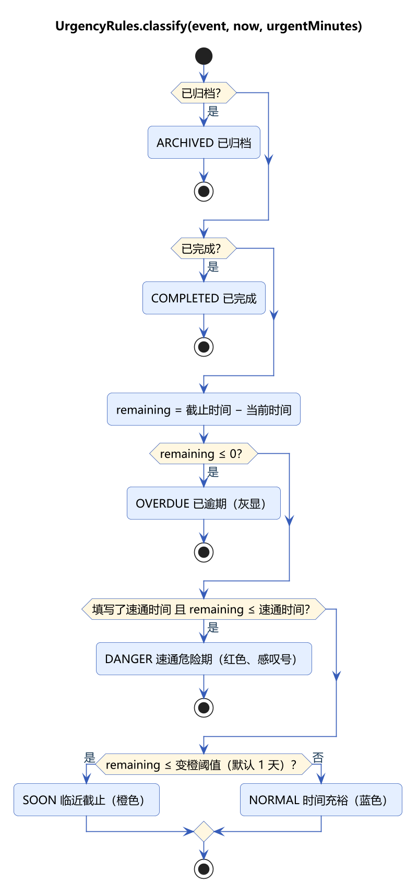

## 7.2 重复周期计算

`RecurrenceRules.occurrenceAt(rule, n)` 每次都从首次截止时间直接计算第 n 次，而不是在上一次的基础上累加：

- 每天：首次日期 + n 天；每周：首次日期 + n 周；时刻保持不变（北京时间）。
- 每月：先取“首次所在月 + n 个月”，再取锚定日与该月天数的较小值。例如 1 月 31 日开始的系列，2 月取 28（或 29）日，3 月仍回到 31 日。
- 超过总次数或结束日期时返回空。

`between` 根据区间起点直接算出起始序号，不从很久以前逐次遍历；`missingBetween` 再排除数据库中已有和已跳过的序号，因此补生成不会重复，也不会把用户删掉的那次加回来。单次查询最多返回 10,000 条，防止异常规则生成过多数据。

## 7.3 日历时间轴分栏

周 / 日视图中，每个事项的显示区间为“截止时间 − 速通时间（未填为 60 分钟）”到“截止时间”，按天裁剪后转换为当天的分钟区间，最短显示 24 分钟以便点击。`timelinePlacements` 先把区间按开始时间排序，把相互重叠的区间归为一组；组内依次放入第一条“已结束”的栏（栏的结束时刻 ≤ 本区间开始），没有空栏就新开一栏。每个事项的宽度 = 列宽 ÷ 本组栏数。排序为 O(n log n)；查找空栏会线性扫描已有栏，全部区间重叠时整体最坏为 O(n²)。

## 7.4 组合查询

`EventQuery.select` 对事项列表一次遍历，同时检查：所在列表（待办 / 已完成 / 归档）、来源、标签全包含、截止日期（北京时间）、只看危险期、关键词（标题、描述、字段名称和内容，忽略大小写的连续子串）。结果按截止时间、再按 ID 排序，保证顺序稳定。

## 7.5 提醒计划推导与去重

`ReminderPlanStore.rebuild` 在每次写操作的事务内执行：

1. 由所有未截止的待办事项和当前设置推导“期望计划”：危险期提醒触发于“截止 − 速通时间”，临近提醒触发于“截止 − 提前量”；加上下一次每日汇总。
2. 期望集合中没有的旧计划标记为失效并等待取消已显示的通知（当天已发送的每日汇总保留）。
3. 计划主键包含事项 ID 和截止时间，事项改期会生成新的计划；已发送（SENT）的计划保持 SENT，同一原因不会重复提醒。
4. 同一事项同一时刻的多条计划共用一个通知标签，合并为一条通知。
5. 计算所有有效且未发送计划中最早的触发时刻，写入提醒控制表，由引擎向系统登记唯一的一个闹钟。

## 7.6 多单位时长换算（1.0.0）

`parseDuration(text, unit)` 用正则 `\d{1,9}(\.\d{0,2})?` 校验输入，用 BigDecimal 计算“数值 × 单位分钟数”并四舍五入到整分钟，避免浮点误差和整数溢出；结果小于 1 分钟或超过 365 天时返回带中文提示的错误。`splitDuration(minutes)` 选择能整除的最大单位回显（2880 → “2 天”，2160 → “36 小时”，90 → “90 分钟”），保证“显示 → 再解析”得到相同的分钟数。

# 8 界面设计

## 8.1 页面结构与跳转

应用只有一个 Activity，页面由 `SaverApp` 中的 `screen` 状态切换：事项首页、月 / 周 / 日历、编辑页、详情页、设置页、分类管理。首页和日历页底部有导航栏。详情页和编辑页记录“从哪里来”，返回时回到原页面。页面跳转如图8-1所示。

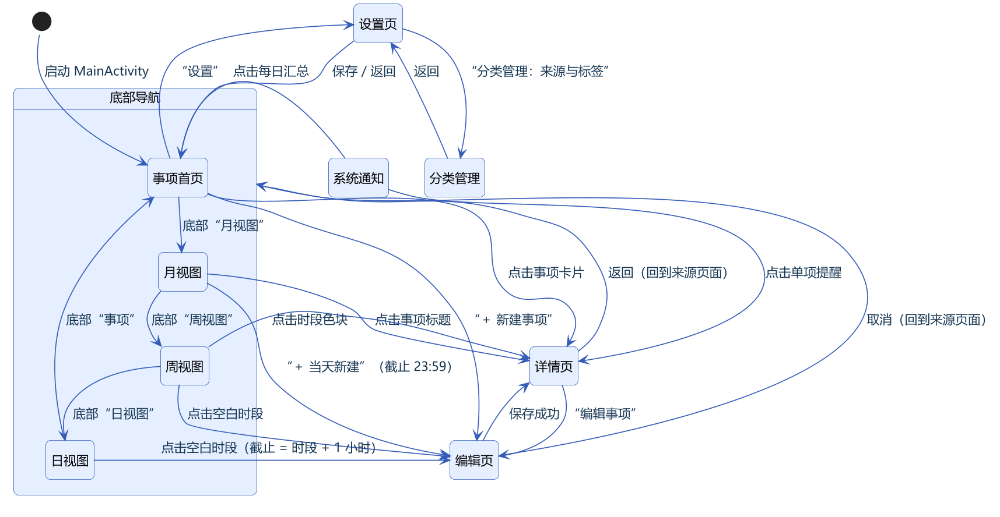

## 8.2 视觉规范

表8-1 主题配色

| 用途 | 颜色 |
| --- | --- |
| 主色（海蓝） | #365DB8 |
| 正文 | #173653 |
| 次要文字 | #52687E |
| 页面背景 | #F5F7FB |
| 浅色强调底 | #E4EFFF |
| 紧急状态 | 时间充裕蓝色、临近截止橙色、速通危险期红色并带感叹号、已逾期灰色 |

字体层级、圆角（6—24 dp）与卡片样式统一定义在 `ui/SaverTheme.kt`。窄屏和大字号时，统计卡片与角色区改为纵向排列；月格在大字号时加高。

## 8.3 主要界面

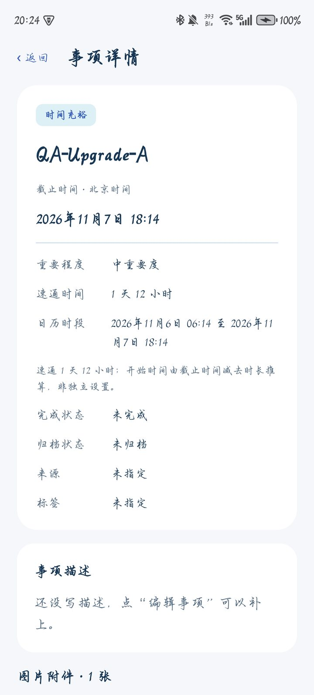

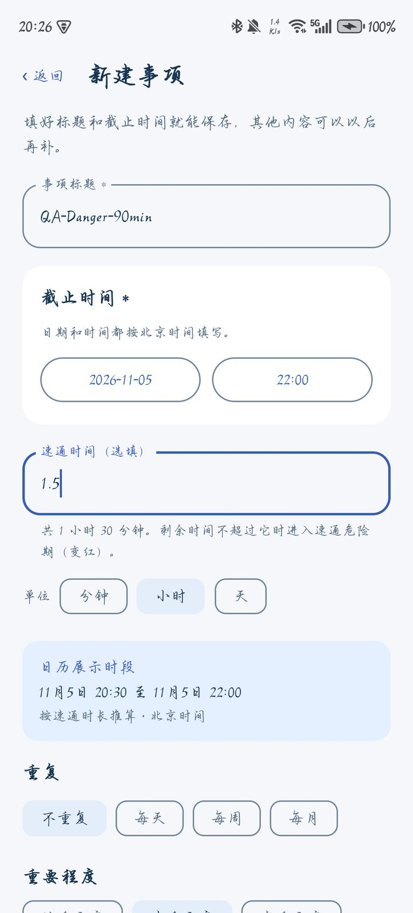

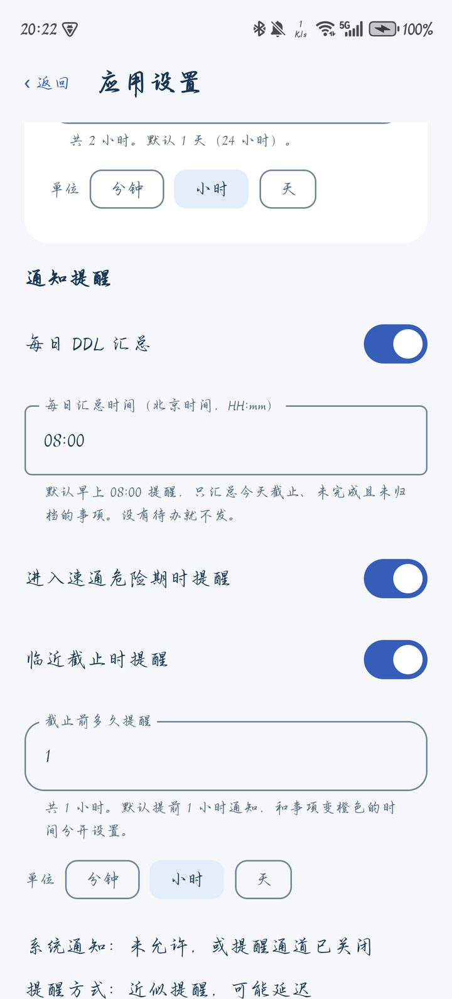

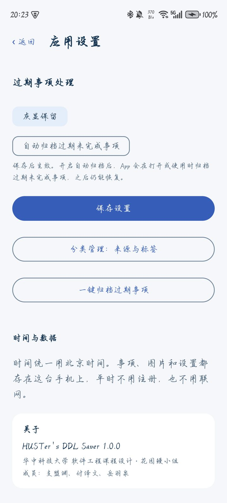

# 9 异常处理与可靠性设计

表9-1 异常处理

| 场景 | 处理方式 |
| --- | --- |
| 输入不合法 | 界面即时提示；Repository 再用 `EventValidation` 校验一次，不只依赖界面 |
| 编辑冲突 | 草稿记录打开时的修订号，保存时不一致则拒绝并提示重新打开 |
| 事项已被删除 | 抛出 `EventNotFoundException`，提示后回到列表；通知点击到已删除事项时回到列表并说明 |
| 写入失败 | 事务回滚，草稿保留在页面上，可直接重试 |
| 未保存就返回 | 弹出“放弃未保存的修改？”确认 |
| 图片导入失败 | 本批已复制的文件全部删除，给出原因（非图片、损坏、过大、无读取权限） |
| 通知发送失败 | 计划记为 FAILED，5 分钟后重试；系统闹钟安排失败时记录错误，下次打开应用重试 |
| 无通知权限 / 无精确闹钟 | 无通知权限时保留业务计划但不登记闹钟；仅缺精确闹钟权限时使用近似提醒。设置页显示状态并提供授权入口 |
| 重启、升级、改时间、强制停止 | 设计上由开机、应用升级、系统时间或时区变化、精确闹钟权限变化等广播触发恢复；打开应用时重新核对。强制停止后需用户再次打开应用；荣耀 X50 的重启自动恢复仍有 OBS-02，未能通过实测 |
| 数据库升级 | 显式迁移，不允许破坏性重建 |

# 10 安全与隐私设计

- 应用只申请通知、精确闹钟和开机广播三项权限，没有网络权限，数据不会离开手机。
- 图片使用系统相册选择器，只能访问用户选中的图片；应用复制私有副本，不长期持有外部 URI。
- 数据提取规则排除云备份和设备迁移。
- 闹钟 Receiver 不对外导出；恢复 Receiver 只响应系统广播。
- 调试用的恢复诊断只在 debuggable 构建中记录固定字段，不写事项内容。

# 11 需求—设计追踪

表11-1 需求与设计对应

| 需求 | 设计章节 | 实现位置 |
| --- | --- | --- |
| FR-02、FR-03、FR-09、FR-24 | 6.1、7.1、7.6 | `EventEditor`、`DurationInput`、`EventValidation`、`RoomEventRepository.save`、`UrgencyRules` |
| FR-04、FR-06、FR-07、FR-08 | 7.1、8 | `HomeScreen`、`CharacterPanel`、`CharacterFeedback` |
| FR-05 | 5.4、6.3 | `AttachmentStore`、`AttachmentUi` |
| FR-10、FR-11、FR-16、FR-17 | 3.3、9 | `RoomEventRepository.applyBatch / setCompleted / setArchived / applyExpiredPolicy` |
| FR-12、FR-13、FR-20 | 6.2、7.5 | `reminders` 包、`ReminderSettingsPanel` |
| FR-14、FR-19 | 5.2 | `CategoryManager`、`EditorExtras` |
| FR-15 | 5.3 | `SaverDatabase` 迁移 |
| FR-18 | 7.4 | `EventQuery`、`HomeScreen` |
| FR-21 | 6.4、7.2 | `RecurrenceRules`、`RoomEventRepository` 重复相关方法 |
| FR-22、FR-23 | 7.3、8.1 | `CalendarScreen`、`CalendarTimelineLayout`、`SaverApp` |
| FR-25 | 8.3 | `ReminderSettingsPanel.AboutSection` |
