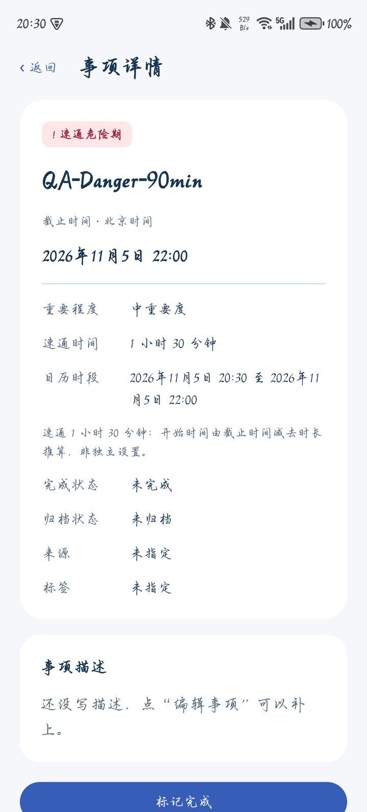
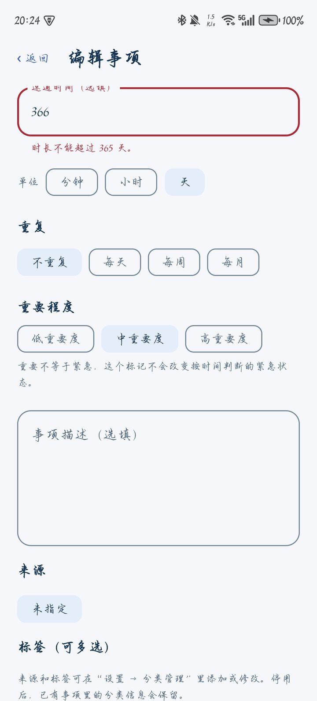

# 1 引言

## 1.1 目的

本报告汇总 HUSTer's DDL Saver 的测试策略、测试环境、自动化测试与真机测试结果、缺陷统计和需求覆盖情况，并对 1.0.0 能否交付给出结论。

## 1.2 测试对象

表1-1 被测版本

| 项目 | 内容 |
| --- | --- |
| 软件版本 | 1.0.0（versionCode 12），包名 `cn.edu.hust.ddlsaver`，数据库 schema 5 |
| 源码 | `main` 分支提交 `3d8ee79`（合并 PR #16） |
| 安装包 | `DDL-Saver-1.0.0.apk`，SHA-256 `cb421de42cd4b548e5a4481f09b3aa9288ae780d4c76746807f78a50274f9234` |
| 测试时间 | 2026-10-27 至 2026-11-05，共 20 余个测试批次；本报告的结论以 1.0.0 的最终批次为准 |

## 1.3 参考资料

- 《需求规格说明书》《设计说明书》
- 测试计划与执行记录（过程版本）：`docs/test-plan.md`、`docs/test-records.md`
- 1.0.0 真机验收原始记录：`docs/test-evidence/RUN-20261105-FINAL-1.0.0/`

# 2 测试环境

表2-1 测试环境

| 类别 | 配置 |
| --- | --- |
| 开发机 | Windows 11，JDK 17（Eclipse Temurin 17.0.21），Android SDK Platform 35、Build Tools 35.0.0，Gradle 8.11.1 |
| 持续集成 | GitHub Actions，ubuntu-24.04，JDK 17，每次推送 `main` 和每个 Pull Request 执行构建、单元测试和 Lint |
| 测试设备 | 荣耀 X50（HONOR ALI-AN00），Android 15 / API 35，MagicOS 9.0.0，1200×2652，时区 Asia/Shanghai |
| 自动化框架 | JUnit 4.13.2、Kotlin Coroutines Test、Robolectric 4.14.1（在电脑上模拟 Android，覆盖 API 28 与 35）、Room Testing、Compose UI Test |
| 真机工具 | adb（Platform Tools 37）、uiautomator 界面信息、`test-tools/device_helper.py` 截图与操作脚本 |

# 3 测试策略与方法

## 3.1 测试层次

表3-1 测试层次

| 层次 | 内容 | 实现 |
| --- | --- | --- |
| 单元测试 | 紧急程度、时间边界、查询、重复规则、输入校验、提醒规则、多单位时长换算 | `domain/*Test`、`reminders/ReminderRulesTest`、`ui/DurationInputTest` 等 |
| 集成测试 | Room 事务与回滚、数据库迁移（用历史 schema 建真实旧库）、提醒引擎与数据库、图片私有副本 | `data/*Test`、`reminders/ReminderEngineTest`、`platform/AttachmentStoreTest` |
| 界面流程测试 | 在 Robolectric 中启动真实 Activity，操作 Compose 页面：新建、编辑冲突、筛选、批量、日历、重复、设置、通知点击、旋转重建 | `ui/SaverAppFlowTest` 等 |
| 真机测试 | 在荣耀 X50 上安装、升级、授权、实际操作和接收通知 | 各 `RUN-*` 批次，最终批次见第 6 章 |
| 回归测试 | 每个 PR 和每次合并后 CI 重新执行全部自动化测试 | GitHub Actions |

## 3.2 测试方法

- **黑盒测试**：按需求设计用例；对输入采用等价类划分和边界值分析（见第 5.2 节速通时长用例）；对多步骤业务采用场景法（如“新建 → 编辑 → 完成 → 恢复”）。
- **白盒测试**：针对紧急程度判定的每个分支、提醒计划的每种状态转换、重复规则的月末与闰年分支编写单元测试。
- **故障注入**：在测试中模拟数据库写入失败、通知发送失败、图片读取被拒绝、进程在通知发出后提交前中断，检查回滚与重试。

## 3.3 通过标准

1. 全部自动化测试通过，Lint 无错误。
2. 1.0.0 新增及新改动功能在真机上逐项通过。
3. 没有未解决的严重缺陷；已知限制在报告中写明。

# 4 自动化测试结果

## 4.1 总体结果

在 `main` 的 `3d8ee79` 上执行 `:app:assembleDebug :app:testDebugUnitTest :app:lintDebug`：

表4-1 自动化测试汇总

| 指标 | 结果 |
| --- | --- |
| 测试类 | 31 个 |
| 测试方法 | 212 个 |
| 执行次数 | 251 次（部分测试在 API 28 和 35 两种配置下各运行一次） |
| 失败 / 错误 / 跳过 | 0 / 0 / 0 |
| Android Lint | 0 个错误，16 个警告（10 个依赖有新版本提示，其余为可选的代码风格建议，均不影响功能） |
| GitHub Actions | 同一提交的 [Android 工作流运行](https://github.com/zidodo1124/hust26_software_engineering_homework/actions/runs/42026084886) 成功 |

测试代码共约 6,100 行，产品代码约 5,600 行（Kotlin）。

## 4.2 分模块结果

表4-2 分模块测试结果

| 模块 | 测试类（执行次数） | 合计 | 结果 |
| --- | --- | --- | --- |
| 领域规则 | UrgencyRulesTest（10）、EventQueryTest（6）、EventValidationTest（7）、ExtendedEventValidationTest（4）、RecurrenceRulesTest（6）、CharacterFeedbackTest（10） | 43 | 全部通过 |
| 数据与迁移 | RoomEventRepositoryTest（10）、RoundTwoRepositoryTest（25）、SaverDatabaseMigrationTest（3）、CharacterStylePersistenceTest（3） | 41 | 全部通过 |
| 提醒 | ReminderRulesTest（10）、ReminderEngineTest（20）、AndroidReminderPlatformTest（6）、ReminderRestoreIntegrationTest（3）、ReminderRecoveryDiagnosticsTest（20）、ReminderStatusCopyTest（3） | 62 | 全部通过 |
| 图片附件 | AttachmentStoreTest（26）、AttachmentImportDiagnosticsTest（20）、AttachmentClipboardFlowTest（2）、ContentClipboardFlowTest（3） | 51 | 全部通过 |
| 界面与日历 | SaverAppFlowTest（24）、CalendarGridTest（2）、CalendarTimelineLayoutTest（4）、DurationInputTest（7）、ReminderColdLaunchTest（2）、SaverViewModelFeedbackTest（1） | 40 | 全部通过 |
| 角色与主题 | CharacterArtworkTest（6）、CharacterAssetsTest（2）、CharacterBubbleLayoutTest（3）、OceanThemeContrastTest（1）、OceanUiRenderTest（2） | 14 | 全部通过 |

原始 JUnit 结果见 `docs/test-evidence/RUN-20261105-FINAL-1.0.0/test-results/`。

## 4.3 测试规模的演进

表4-3 各版本自动化测试执行次数

| 版本 | 执行次数 | 说明 |
| --- | --- | --- |
| 0.1.0 | 30 | 首轮：事项、存储、页面基础流程 |
| 0.2.0 | 87 | 分类、字段、附件、日历、批量、迁移 |
| 0.3.0 | 132 | 三类提醒、权限、角色 |
| 0.3.4 | 218 | 数据模块测试（付泽文）、提醒边界测试（岳羽泉）、恢复诊断 |
| 0.3.7 | 236 | 日历视图、重复事项 |
| 1.0.0 | 251 | 独立日历页、时间轴布局、多单位时长 |

# 5 功能测试用例与结果

## 5.1 用例与结果汇总

结果列中，“自动化”指第 4 章的测试类；“真机”指荣耀 X50 上的实测批次，D01—D13 为 1.0.0 最终批次的检查项（见第 6 章）。

表5-1 功能测试用例与结果

| 用例 | 测试内容 | 需求 | 依据 | 结果 |
| --- | --- | --- | --- | --- |
| TC-01 | 安装、离线使用 | FR-01 | 真机 D01、D13；补验 S06 在飞行模式且 Wi-Fi 关闭时创建、保存并重新查看；清单无网络权限 | 通过 |
| TC-02 | 标题与时间必填校验 | FR-02 | 自动化 EventValidationTest、SaverAppFlowTest；真机（0.2.0） | 通过 |
| TC-03 | 编辑同步与冲突 | FR-03 | 自动化 staleEditShowsConflictAndKeepsDraft… 等；真机 D06 | 通过 |
| TC-04 | 来源与标签管理 | FR-14 | 自动化 RoundTwoRepositoryTest、categoryManagementAndCustomFieldsPersist…；真机（0.2.0） | 通过 |
| TC-05 | 相册多图附件 | FR-05 | 自动化 AttachmentStoreTest；真机（0.2.0、0.3.4）、D01 升级后附件保留 | 通过 |
| TC-06 | 粘贴图片 | FR-05 | 自动化 ContentClipboardFlowTest 等；真机跨应用粘贴（0.2.0、0.3.4） | 部分通过（OBS-01 未解决） |
| TC-07 | 自定义字段 | FR-19 | 自动化 RoundTwoRepositoryTest、SaverAppFlowTest；真机（0.2.0） | 通过 |
| TC-08 | 长内容与大字号 | NFR-05 | 自动化 CharacterBubbleLayoutTest、narrowScreenWithLargeText…；真机 D12（150%） | 通过 |
| TC-09 | 危险期边界 | FR-09 | 自动化 UrgencyRulesTest（恰好等于速通时间时进入危险期）；真机 D10 | 通过 |
| TC-10 | 未填速通时间 | FR-09 | 自动化 UrgencyRulesTest、noSprintAndDisabledReasonsDoNotCreateDangerPlans | 通过 |
| TC-11 | 跨日与时区 | BR-02 | 自动化 beijingMidnightChangesTodayScope、deviceTimeZoneDoesNotChangeBeijingDateMembership | 通过 |
| TC-12 | 日历日期与筛选 | FR-07 | 自动化 CalendarGridTest、calendarCrossesMonth…；真机（0.3.5 月 / 周 / 日、跨年） | 通过 |
| TC-13 | 统计与列表一致 | FR-08 | 自动化 combinedSourceTagsKeywordAndDateFilter…WithoutChangingTodayCount | 通过 |
| TC-14 | 搜索与组合筛选 | FR-18 | 自动化 EventQueryTest（6）、keywordMatches…、multiWordKeyword… | 通过 |
| TC-15 | 完成与恢复 | FR-16 | 自动化 completedItemCanBeRecovered…；真机（0.3.5） | 通过 |
| TC-16 | 归档与恢复 | FR-17 | 自动化 restoringArchiveDoesNotMarkCompletedEventAsUnfinished 等 | 通过 |
| TC-17 | 过期处理策略 | FR-11 | 自动化 autoArchiveIncludesOnlyExpiredUnfinishedRows…、manualCleanupArchives… | 通过 |
| TC-18 | 批量操作 | FR-10 | 自动化 batchUsesOnlySelectedIds…、failureInsideBatchTransactionRollsBack…；真机（0.2.0） | 通过 |
| TC-19 | 设置保存与校验 | FR-20 | 自动化 reminderSettingsValidateAndPreserveIndependentOptions；真机 D03、补验 S01 保存后重开 | 通过 |
| TC-20 | 每日汇总通知 | FR-12 | 自动化 dailySummaryUsesCurrentRows…、summaryIncludesTodayOverdue…；真机后台汇总送达（0.3.0） | 部分通过（真机上点击汇总通知未单独验证） |
| TC-21 | 速通危险期通知 | FR-13 | 自动化 ReminderEngineTest；真机 D10（按时送达，+205 ms） | 通过 |
| TC-22 | 临近截止通知 | FR-13 | 自动化 ReminderRulesTest；真机（0.3.0、0.3.4 后台送达） | 通过 |
| TC-23 | 完成 / 改期后旧提醒失效 | FR-13 | 自动化 completingAfterDelivery…、rescheduleAfterDelivery…（岳羽泉）；真机（0.3.0、0.3.4） | 通过 |
| TC-24 | 同刻提醒合并与去重 | BR-07 | 自动化 coincidentReasonsMerge…、planKeysAreStableUnique…（岳羽泉） | 通过 |
| TC-25 | 新建时已在提醒窗口内 | BR-07 | 自动化覆盖到期计划立即发送的逻辑 | 部分通过（未单独做真机用例） |
| TC-26 | 通知与精确闹钟权限 | FR-20 | 自动化 AndroidReminderPlatformTest、deniedNotificationPermission…；真机 D04 | 通过 |
| TC-27 | 锁屏、省电、重启后的提醒 | NFR-06 | 真机：受控 idle 下送达；重启后未打开应用时未自动恢复 | 未完全通过（OBS-02） |
| TC-28 | 点击通知进入详情 | UC-09 | 自动化 coldReminderLaunchOpensDetail…、reminderTapResetsHomeFilters…；真机 D10 | 通过 |
| TC-29 | 角色形象与台词 | FR-06 | 自动化 CharacterFeedbackTest、CharacterArtworkTest；真机（0.3.3、0.3.4） | 通过 |
| TC-30 | 保存失败与重试 | NFR-02 | 自动化 failedFieldWriteKeepsDraft…、invalidSaveAndSettingLeaveExistingDataUntouched | 通过 |
| TC-31 | 速通时间多单位输入 | FR-24 | 自动化 DurationInputTest（7）、sprintTimeAcceptsHoursAndDays…；真机 D06、D07、D09 | 通过 |
| TC-32 | 设置提前量多单位输入 | FR-24 | 自动化 reminderSettingsValidate…；真机 D03、补验 S01 的 2 天及 90 分钟回显 | 通过 |
| TC-33 | 关于信息 | FR-25 | 自动化（版本号断言）；真机 D05 | 通过 |
| TC-34 | 独立月 / 周 / 日历页 | FR-22 | 自动化 CalendarTimelineLayoutTest、monthQuickCreate…；真机 D08 | 通过 |
| TC-35 | 时段快捷新建 | FR-23 | 自动化 timelineBlankSlotPrefillsEditor…；真机 D09 | 通过 |
| TC-36 | 截止已过提示 | UC-01 | 真机 D11 | 通过 |
| TC-37 | 覆盖升级与数据迁移 | NFR-03 | 自动化 SaverDatabaseMigrationTest、migratesV4AndPersists…；真机 D01（0.3.5→1.0.0） | 通过 |
| TC-38 | 重复事项 | FR-21 | 自动化 RecurrenceRulesTest、RoundTwoRepositoryTest、createWeeklySeries…；补验 S02–S04 完成每周 4 次创建及“本次及后续”编辑、删除 | 部分通过（每周主流程通过，其他频率及例外未完整实测） |

**统计**：38 个用例中，通过 33 个，部分通过 4 个（TC-06、TC-20、TC-25、TC-38），未完全通过 1 个（TC-27）。部分通过与未通过项的具体边界见第 7、9 章。

## 5.2 速通时长输入的等价类与边界值用例

速通时间 = 数字 + 单位。有效等价类：空（不填）；0 < 换算分钟数 ≤ 525,600（365 天）且最多两位小数。无效等价类：非数字、负数、超过两位小数、换算后不足 1 分钟、超过 365 天。

表5-2 速通时长输入用例（自动化 DurationInputTest 与真机）

| 编号 | 输入 | 单位 | 预期 | 实际 |
| --- | --- | --- | --- | --- |
| DT-01 | （空） | 任意 | 允许保存，不启用危险期 | 一致 |
| DT-02 | 45 | 分钟 | 45 分钟 | 一致 |
| DT-03 | 2 | 小时 | 120 分钟 | 一致 |
| DT-04 | 1.5 | 小时 | 90 分钟（真机 D09） | 一致 |
| DT-05 | 1.5 | 天 | 2160 分钟，显示“1 天 12 小时”（真机 D06） | 一致 |
| DT-06 | 0.01 | 小时 | 0.6 分钟，四舍五入为 1 分钟（下边界） | 一致 |
| DT-07 | 0.4 | 分钟 | 提示“时长至少 1 分钟。”（真机 D07） | 一致 |
| DT-08 | 0 | 天 | 提示“时长至少 1 分钟。” | 一致 |
| DT-09 | 365 | 天 | 525,600 分钟（上边界） | 一致 |
| DT-10 | 366 | 天 | 提示“时长不能超过 365 天。”（真机 D07） | 一致 |
| DT-11 | 999999999.99 | 天 | 拒绝，不溢出 | 一致 |
| DT-12 | -5、abc、1.234、1,5、1e3、.5 | 小时 | 提示“请填写数字，最多保留两位小数。” | 一致 |
| DT-13 | 已保存 120 / 2160 / 2880 分钟 | — | 重开时显示 2 小时 / 36 小时 / 2 天 | 一致 |

# 6 1.0.0 真机验收

2026-11-05 在荣耀 X50 上执行，只覆盖 1.0.0 新增或此前未在真机上测过的功能，以前批次已通过的功能不重复测试。完整记录、截图与日志见 `docs/test-evidence/RUN-20261105-FINAL-1.0.0/README.md`。

表6-1 1.0.0 真机验收结果

| 编号 | 检查内容 | 结果 |
| --- | --- | --- |
| D01 | 0.3.5（schema 4）有数据时覆盖安装 1.0.0：2 条事项、速通时间、图片、阈值设置全部保留，数据库升到 5 | 通过 |
| D02 | 冷启动耗时：升级后首次 1574 ms，全新安装 1719 ms | 通过（≤ 2 s） |
| D03 | 迁移来的 120 分钟阈值在设置页显示为“2 小时” | 通过 |
| D04 | 应用内申请通知权限与精确闹钟权限 | 通过 |
| D05 | “关于”显示 1.0.0、课程与成员 | 通过 |
| D06 | 速通时间由 2 小时改为 1.5 天，预览与详情正确 | 通过 |
| D07 | 0.4 分钟、366 天的提示 | 通过 |
| D08 | 周视图跨天色块、月视图事项标题 | 通过 |
| D09 | 日视图点击 21:00 空白处，截止预填 22:00 | 通过 |
| D10 | 危险期通知 20:30:00.205 送达（计划 20:30:00），点击进入详情 | 通过 |
| D11 | 截止时间早于现在时的提示 | 通过 |
| D12 | 150% 字号下卡片与单位选项完整 | 通过 |
| D13 | 清理测试数据，全新安装检查，恢复权限 | 完成 |

同日另补验此前未完成的具体情形，见[补验记录与截图](https://github.com/zidodo1124/hust26_software_engineering_homework/blob/v1.0.0/docs/test-evidence/RUN-20261105-CODEX-SUPPLEMENT/README.md)。以下 6 个步骤分属设置保存、每周重复、强停重开、离线保存 4 类场景，与原 13 项分别统计。

表6-2 1.0.0 补充真机核验

| 编号 | 步骤与预期 | 实际结果 |
| --- | --- | --- |
| S01 | 两项提前量分别设为 2 天和 90 分钟，保存后重开 | 数值和单位正确回显；通过，之后恢复默认值 |
| S02 | 新建每周重复、含首次共 4 次的事项 | 11 月 6、13、20、27 日各一条；通过 |
| S03 | 第 2 次修改标题，范围选择“本次及后续” | 第 1 次全部事件列不变，第 2–4 次标题更新；通过 |
| S04 | 第 2 次永久删除“本次及后续”，再删除首次 | 先保留第 1 次，再清空测试事项；通过 |
| S05 | 保存 4 次事项后强制停止并重新打开 | 4 次事项仍在；通过，不验证强停期间的后台提醒 |
| S06 | 飞行模式开启且 Wi-Fi 关闭时创建、保存并重开 | 标题和截止时间保留；通过，测试后恢复网络状态 |

范围删除后应用内部仍保留停止的序列与跳过记录。确认测试前业务数据为空、只新增本批测试数据后，按原计划全新安装同一 APK；机主完成安装器身份验证。最终业务表为空，默认设置、通知和精确提醒权限、字号及网络状态恢复。详细限定日志见补验目录的 `checks.txt`，私有备份不提交仓库。

# 7 缺陷统计

## 7.1 缺陷列表

表7-1 缺陷与问题汇总

| 编号 | 类型 | 描述 | 发现方式 | 处理 | 状态 |
| --- | --- | --- | --- | --- | --- |
| BUILD-001 | 构建 | 可空初始状态不符合 Compose 保存状态接口，编译失败 | 首轮构建 | 改用显式可空状态 | 已关闭 |
| ENV-001 | 环境 | 测试运行库下载失败 | 首轮测试 | 指定 Maven Central 官方地址 | 已关闭 |
| BUG-001 | 界面（高） | 成功提示条遮住底部保存和删除按钮 | 界面测试 | 提示条放入底栏并可关闭 | 已关闭 |
| CHECK-001 | 静态检查 | 缺少 Android 12+ 数据提取规则 | Lint | 增加排除云备份的规则 | 已关闭 |
| BUG-R3-001 | 提醒 | 系统时间回拨后可能跳过当天的每日汇总 | 代码评审 | 按当前北京时间重算下一次汇总，补回归测试 | 已关闭 |
| BUG-R3-002 | 提醒 | 已发送计划因编辑描述被重建时丢失尝试时间 | 代码评审 | 保留原尝试时间，补回归测试 | 已关闭 |
| BUG-R3-003 | 提醒 | 次日计划建立后误取消当天已显示的汇总 | 代码评审 | 保留当天已发送汇总，补回归测试 | 已关闭 |
| BUG-UI-001 | 界面 | Q 版部分表情帧边缘有图像残片 | 真机审图（0.3.2） | 运行时把固定区域置透明（0.3.3） | 已关闭 |
| CAL-001 | 界面 | 周视图折叠日历面板后周范围退回单日 | 真机（0.3.5 前） | 移除对面板展开状态的依赖，补回归测试 | 已关闭 |
| CI-45 | 测试稳定性 | CI 中角色页面一次等待超时 | CI #45 | 加强断言与诊断，之后未复现 | 观察中 |
| OBS-01 | 设备 | 强停后重开，复用旧剪贴板图片 URI 读取失败（来源授权失效） | 真机 | 已给出“重新复制”提示，重新复制可恢复；根因未定 | 开放 |
| OBS-02 | 设备 | 手机真实重启后，未打开应用时提醒没有自动恢复 | 真机（0.3.3、0.3.4） | 打开应用后补发并重排；根因调查中 | 开放 |

## 7.2 统计分析

表7-2 缺陷统计

| 类别 | 数量 | 已关闭 | 开放 / 观察 |
| --- | --- | --- | --- |
| 构建与环境 | 2 | 2 | 0 |
| 静态检查 | 1 | 1 | 0 |
| 业务逻辑（提醒） | 3 | 3 | 0 |
| 界面 | 3 | 3 | 0 |
| 测试稳定性 | 1 | 0 | 1 |
| 设备与系统条件 | 2 | 0 | 2 |
| 合计 | 12 | 9 | 3 |

提醒逻辑的 3 个缺陷在代码评审中发现、修复并补充回归测试；界面问题也通过真机检查发现。OBS-01 涉及跨应用图片来源的读取授权，OBS-02 涉及重启后的提醒恢复，两者根因仍未确定；应用提供重新复制提示和打开应用后重新核对等处理。1.0.0 最终批次没有发现新缺陷。

# 8 需求覆盖

表8-1 需求—测试追踪

| 需求 | 测试用例 | 覆盖情况 |
| --- | --- | --- |
| FR-01 | TC-01、S06 | 已覆盖安装及飞行模式下创建、保存、查看 |
| FR-02、FR-03 | TC-02、TC-03、TC-30 | 已覆盖 |
| FR-04、FR-07、FR-08 | TC-12、TC-13 | 已覆盖 |
| FR-05 | TC-05、TC-06 | 部分覆盖（OBS-01 开放） |
| FR-06 | TC-29 | 已覆盖 |
| FR-09 | TC-09、TC-10、TC-21 | 已覆盖 |
| FR-10、FR-11 | TC-17、TC-18 | 已覆盖 |
| FR-12 | TC-20 | 部分覆盖 |
| FR-13 | TC-21—TC-25 | 部分覆盖（TC-25 未单独做真机用例） |
| FR-14、FR-19 | TC-04、TC-07 | 已覆盖 |
| FR-15 | TC-37 | 已覆盖 |
| FR-16、FR-17 | TC-15、TC-16 | 已覆盖 |
| FR-18 | TC-14 | 已覆盖 |
| FR-20 | TC-19、TC-26 | 已覆盖 |
| FR-21 | TC-38、S02–S04 | 每周 4 次与范围操作实测通过；其他频率、例外仍为部分覆盖 |
| FR-22、FR-23 | TC-34、TC-35 | 已覆盖 |
| FR-24 | TC-31、TC-32、DT-01—DT-13 | 已覆盖 |
| FR-25 | TC-33 | 已覆盖 |
| NFR-01 | D02 | 已覆盖 |
| NFR-03 | TC-37 | 已覆盖 |
| NFR-05 | TC-08 | 已覆盖 |
| NFR-06 | TC-26、TC-27 | 部分覆盖（OBS-02） |

25 项功能需求均有测试映射；映射不等于每一场景都已完成验证。FR-05、FR-12、FR-13 和 FR-21 的相应测试仍有部分通过项，详见表5-1；提醒重启恢复仍存在 OBS-02。

# 9 测试结论

1. 1.0.0 的 251 次自动化测试全部通过，Lint 无错误，GitHub Actions 检查通过。
2. 荣耀 X50 上原 13 项检查通过，包括同签名重建的旧版本带数据覆盖升级；补验另有 6 个步骤通过，覆盖设置回显、每周重复主流程、强停重开和离线保存。
3. 表7-1 所列 9 项构建、环境、静态检查、逻辑和界面问题已处理；CI-45 仍在观察，OBS-01、OBS-02 仍开放。
4. 已知限制：
   - **OBS-02**：手机重启后如果不打开应用，提醒可能不会自动恢复。建议重启后打开一次应用；应用会自动补发并重新安排。
   - **OBS-01**：强制停止后复用旧的剪贴板图片可能读取失败。重新复制图片即可。
   - 持续锁屏、系统省电 / Doze 条件下的提醒准时性受厂商策略影响，未做长时间实测。
   - 重复事项已有自动化测试及每周 4 次创建、范围编辑和删除的真机证据；其他频率和例外分支未完成实机覆盖。

**结论：现有自动化检查和真机分项支持将 1.0.0 作为课程版本交付；测试未覆盖的场景及开放问题按以上记录保留，不能据此认定全部需求均已验收。**
