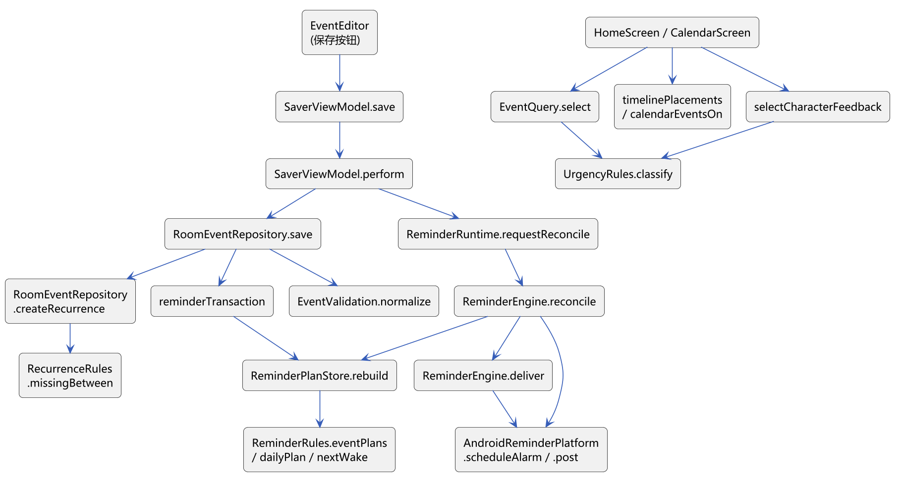

# 1 说明

本文档说明 1.0.0 源码的组织方式、各模块关键函数的功能与调用关系，并在附录中摘录带注释的关键代码。完整源码在仓库 `app/src/main/java/cn/edu/hust/ddlsaver/`，自动化测试在 `app/src/test/java/cn/edu/hust/ddlsaver/`。文中的文件路径均相对于该包目录。

表1-1 代码规模（1.0.0）

| 项目 | 数量 |
| --- | --- |
| 产品代码（Kotlin） | 38 个文件，约 5,600 行 |
| 测试代码（Kotlin） | 31 个测试类，约 6,100 行 |
| 数据库 schema 文件 | 5 个（`app/schemas/.../1.json`—`5.json`） |
| 资源 | 角色立绘与 Q 版图集（WebP）、许可与署名文件 |

# 2 代码结构

```text
cn/edu/hust/ddlsaver/
├── MainActivity.kt              单 Activity 入口，接收通知点击
├── domain/                      业务模型与规则（纯 Kotlin，不依赖 Android）
│   ├── EventModels.kt           DdlEvent、EventDraft、AppSettings、枚举与异常
│   ├── EventValidation.kt       草稿规范化与校验
│   ├── UrgencyRules.kt          紧急程度判定、北京时间“今天”
│   ├── EventQuery.kt            搜索与组合筛选
│   ├── RecurrenceRules.kt       重复周期计算
│   ├── CharacterFeedback.kt     角色表情与台词选择
│   └── EventRepository.kt       仓库接口
├── data/                        Room 数据库
│   ├── Entities.kt / RecurrenceEntities.kt   表实体与转换
│   ├── SaverDao.kt              SQL 查询与写入
│   ├── SaverDatabase.kt         数据库定义与 1→5 迁移
│   ├── RoomEventRepository.kt   事务内的业务写入、重复事项生成
│   └── RecurrenceTemplate.kt    重复系列模板编码
├── reminders/                   提醒
│   ├── ReminderModels.kt        计划实体、ReminderRules
│   ├── ReminderPlanStore.kt     推导与合并提醒计划
│   ├── ReminderEngine.kt        核对、发送、安排闹钟
│   ├── ReminderRuntime.kt       单例运行时与两个广播接收器
│   └── AndroidReminderPlatform.kt  AlarmManager 与通知的适配
├── platform/
│   └── AttachmentStore.kt       图片导入、校验、预览、清理
└── ui/                          Jetpack Compose 界面
    ├── SaverApp.kt              页面切换、底部导航、详情页、事项卡片
    ├── SaverViewModel.kt        UI 状态与操作协调
    ├── HomeScreen.kt            首页、统计、筛选、批量
    ├── CalendarScreen.kt / CalendarTimelineLayout.kt  月 / 周 / 日历与时间轴布局
    ├── EventEditor.kt / EditorExtras.kt / DurationInput.kt  编辑表单与多单位时长
    ├── AttachmentUi.kt / CategoryManager.kt  附件与分类界面
    ├── CharacterPanel.kt        角色形象、气泡与署名
    └── ReminderSettingsPanel.kt 设置页、权限面板、关于
```

# 3 关键函数说明

## 3.1 事项保存链路

表3-1 事项保存相关函数

| 函数 | 位置 | 功能 | 调用关系 |
| --- | --- | --- | --- |
| `EventEditor` | `ui/EventEditor.kt` | 编辑表单；草稿状态按编辑会话保存，屏幕旋转不丢失；生成 `EventDraft` | 调用 `parseDuration`；点击保存时调用 `onSave` → `SaverViewModel.save` |
| `parseDuration` / `splitDuration` | `ui/DurationInput.kt` | 数字 + 单位 ↔ 分钟的换算与回显 | 被 `EventEditor`、`SettingsScreen` 调用 |
| `SaverViewModel.save` | `ui/SaverViewModel.kt` | 交给 `perform` 统一处理忙碌状态与错误，成功后清理草稿图片 | 调用 `RoomEventRepository.save`、`ReminderRuntime.requestReconcile` |
| `RoomEventRepository.save` | `data/RoomEventRepository.kt` | 规范化草稿，按普通 / 新建系列 / 转系列 / 仅本次 / 本次及后续 / 停止后续分支处理 | 调用 `EventValidation.normalize`、`createRecurrence`、`reminderTransaction` |
| `reminderTransaction` | 同上 | 在一个 Room 事务中执行业务写入并重建提醒计划 | 调用 `ReminderPlanStore.rebuild` |
| `EventValidation.normalize` | `domain/EventValidation.kt` | 去除标题空格，检查必填、修订号、分类、字段、附件，截止时间截到整分钟 | 被所有保存入口调用 |

## 3.2 查询、紧急程度与日历

表3-2 查询与日历相关函数

| 函数 | 位置 | 功能 | 调用关系 |
| --- | --- | --- | --- |
| `UrgencyRules.classify` | `domain/UrgencyRules.kt` | 判定六种紧急状态 | 被卡片、统计、日历颜色、角色反馈、查询调用 |
| `EventQuery.select` | `domain/EventQuery.kt` | 组合筛选并按截止时间稳定排序 | 被 `HomeScreen` 调用 |
| `CalendarScreen` | `ui/CalendarScreen.kt` | 月格、周 / 日时间轴、周期切换、快捷新建 | 调用 `calendarEventsOn`、`timelinePlacements`、`calendarWeeks` |
| `timelinePlacements` | `ui/CalendarTimelineLayout.kt` | 计算时间轴上每个事项的起止分钟和所在栏 | 调用 `calendarEventsOn`、`calendarStart` |
| `calendarSlotDeadline` | 同上 | 点击时段 → 预填截止时间（时段 + 1 小时） | 被 `CalendarScreen` 调用 |
| `selectCharacterFeedback` | `domain/CharacterFeedback.kt` | 选出最需要关注的事项并给出表情与台词 | 调用 `UrgencyRules.classify` |

## 3.3 重复事项

表3-3 重复事项相关函数

| 函数 | 位置 | 功能 |
| --- | --- | --- |
| `RecurrenceRules.occurrenceAt` | `domain/RecurrenceRules.kt` | 计算第 n 次的截止时间（每月锚定日、短月取月末） |
| `RecurrenceRules.missingBetween` | 同上 | 区间内尚未生成且未跳过的周期 |
| `RoomEventRepository.createRecurrence` | `data/RoomEventRepository.kt` | 保存系列模板并生成首批事项 |
| `RoomEventRepository.updateSeriesFromOccurrence` | 同上 | 修改“本次及后续”，保留已完成 / 已归档的历史 |
| `RoomEventRepository.deleteRecurrenceFollowing` | 同上 | 删除“本次及后续”，截断系列 |
| `RoomEventRepository.extendRecurrencesThrough` | 同上 | 打开应用或提醒唤醒时补生成到未来 90 天 |

## 3.4 提醒

表3-4 提醒相关函数

| 函数 | 位置 | 功能 | 调用关系 |
| --- | --- | --- | --- |
| `ReminderRules.eventPlans` | `reminders/ReminderModels.kt` | 由一个事项和设置算出危险期、临近两类计划，同刻合并 | 被 `ReminderPlanStore.rebuild` 调用 |
| `ReminderPlanStore.rebuild` | `reminders/ReminderPlanStore.kt` | 期望计划与已有计划合并，失效旧计划，计算下一次唤醒 | 在每个写事务和引擎核对时调用 |
| `ReminderEngine.reconcile` | `reminders/ReminderEngine.kt` | 补生成重复事项、重建计划、发送到期通知、登记系统闹钟（加锁串行） | 被 `ReminderRuntime` 调用 |
| `ReminderEngine.deliver` | 同上 | 先记 CLAIMED，再发送，成功记 SENT，失败记 FAILED | 调用 `ReminderPlatform.post` |
| `AndroidReminderPlatform.scheduleAlarm / post` | `reminders/AndroidReminderPlatform.kt` | 精确或近似闹钟；创建通知通道并发送通知 | 调用 AlarmManager、NotificationManager |
| `ReminderAlarmReceiver` / `ReminderRestoreReceiver` | `reminders/ReminderRuntime.kt` | 闹钟到点、开机、升级、时间变化时触发核对 | 调用 `ReminderRuntime` |
| `MainActivity.handleReminderIntent` | `MainActivity.kt` | 点击通知后交给 ViewModel 导航 | 调用 `SaverViewModel.requestReminderNavigation` |

## 3.5 图片附件

表3-5 图片相关函数

| 函数 | 位置 | 功能 |
| --- | --- | --- |
| `AttachmentStore.importImages` | `platform/AttachmentStore.kt` | 逐张导入；任一失败则回滚本批已创建文件 |
| `AttachmentStore.importOne` | 同上 | 流式复制为私有副本、限制大小、解码校验 |
| `AttachmentStore.loadPreview` | 同上 | 按目标尺寸采样解码并校正 EXIF 方向 |
| `AttachmentStore.cleanupOrphans` / `discardUnreferenced` | 同上 | 清理不再被数据库引用的副本 |

## 3.6 调用关系图



# 附录 关键代码摘录

以下片段依据 1.0.0 源码整理，中文注释为本文档添加；部分语句为便于说明而合并、换行或省略，不是可直接编译的完整源码。以对应文件为准。

## A.1 紧急程度判定（domain/UrgencyRules.kt）

```kotlin
object UrgencyRules {
    val BEIJING_ZONE: ZoneId = ZoneId.of("Asia/Shanghai")   // 所有日期按北京时间解释

    fun classify(event: DdlEvent, now: Instant, urgentMinutes: Long = 1440): Urgency {
        if (event.archivedAt != null) return Urgency.ARCHIVED       // 归档优先
        if (event.completedAt != null) return Urgency.COMPLETED
        val remaining = Duration.between(now, Instant.ofEpochMilli(event.deadlineAt))
        if (remaining.isNegative || remaining.isZero) return Urgency.OVERDUE
        val sprint = event.sprintMinutes
        // 剩余时间不超过速通时间：做不完了，进入危险期（优先于“临近”）
        if (sprint != null && sprint > 0 && remaining <= Duration.ofMinutes(sprint)) {
            return Urgency.DANGER
        }
        return if (remaining <= Duration.ofMinutes(urgentMinutes)) Urgency.SOON else Urgency.NORMAL
    }

    fun isActive(event: DdlEvent): Boolean = event.completedAt == null && event.archivedAt == null

    fun isToday(event: DdlEvent, now: Instant): Boolean =
        Instant.ofEpochMilli(event.deadlineAt).atZone(BEIJING_ZONE).toLocalDate() ==
            now.atZone(BEIJING_ZONE).toLocalDate()
}
```

## A.2 多单位时长换算（ui/DurationInput.kt，1.0.0 新增）

```kotlin
internal enum class DurationUnit(val label: String, val minutes: Long) {
    MINUTE("分钟", 1L), HOUR("小时", 60L), DAY("天", 24L * 60L);
}

internal const val MaxInputDurationMinutes: Long = 365L * 24L * 60L   // 界面上限 365 天

// 回显：选能整除的最大单位，120 → "2" 小时，90 → "90" 分钟
internal fun splitDuration(minutes: Long?, emptyUnit: DurationUnit = DurationUnit.HOUR): DurationText = when {
    minutes == null -> DurationText("", emptyUnit)
    minutes > 0 && minutes % DurationUnit.DAY.minutes == 0L -> DurationText((minutes / DurationUnit.DAY.minutes).toString(), DurationUnit.DAY)
    minutes > 0 && minutes % DurationUnit.HOUR.minutes == 0L -> DurationText((minutes / DurationUnit.HOUR.minutes).toString(), DurationUnit.HOUR)
    else -> DurationText(minutes.toString(), DurationUnit.MINUTE)
}

private val DurationPattern = Regex("""\d{1,9}(\.\d{0,2})?""")          // 最多两位小数

internal fun parseDuration(text: String, unit: DurationUnit, maxMinutes: Long = MaxInputDurationMinutes): DurationParse {
    val trimmed = text.trim()
    if (trimmed.isEmpty()) return DurationParse.Blank                     // 选填
    if (!DurationPattern.matches(trimmed)) return DurationParse.Invalid("请填写数字，最多保留两位小数。")
    // BigDecimal 计算，避免浮点误差和溢出；四舍五入到整分钟
    val minutes = BigDecimal(trimmed).multiply(BigDecimal.valueOf(unit.minutes)).setScale(0, RoundingMode.HALF_UP)
    if (minutes < BigDecimal.ONE) return DurationParse.Invalid("时长至少 1 分钟。")
    if (minutes > BigDecimal.valueOf(maxMinutes)) return DurationParse.Invalid("时长不能超过 ${formatDuration(maxMinutes)}。")
    return DurationParse.Valid(minutes.longValueExact())
}
```

## A.3 组合查询（domain/EventQuery.kt）

```kotlin
fun select(events: List<DdlEvent>, filter: EventFilter, now: Instant, settings: AppSettings = AppSettings()): List<DdlEvent> {
    val keyword = filter.keyword.trim()
    return events.filter { event ->
        val inMode = when (filter.mode) {                    // 待办 / 已完成 / 归档
            EventListMode.TODO -> UrgencyRules.isActive(event)
            EventListMode.COMPLETED -> event.completedAt != null && event.archivedAt == null
            EventListMode.ARCHIVED -> event.archivedAt != null
        }
        inMode &&
            (filter.sourceId == null || event.source?.id == filter.sourceId) &&
            event.tags.map { it.id }.toSet().containsAll(filter.tagIds) &&       // 多标签：全部包含
            (filter.date == null || Instant.ofEpochMilli(event.deadlineAt)
                .atZone(UrgencyRules.BEIJING_ZONE).toLocalDate() == filter.date) &&
            (!filter.dangerOnly || UrgencyRules.classify(event, now, settings.urgentMinutes) == Urgency.DANGER) &&
            (keyword.isEmpty() || event.title.contains(keyword, ignoreCase = true) ||
                event.description.contains(keyword, ignoreCase = true) ||
                event.customFields.any { it.label.contains(keyword, ignoreCase = true) || it.value.contains(keyword, ignoreCase = true) })
    }.sortedWith(compareBy<DdlEvent> { it.deadlineAt }.thenBy { it.id })      // 稳定排序
}
```

## A.4 保存事项：事务与冲突检查（data/RoomEventRepository.kt）

```kotlin
override suspend fun save(draft: EventDraft): DdlEvent {
    val normalized = EventValidation.normalize(draft)
    // 带重复规则的新建或转换走重复系列分支，生成到 max(首次, 现在) + 90 天
    normalized.recurrence?.takeUnless { normalized.applyToFuture }?.let { spec -> /* … */ }
    return reminderTransaction {
        val now = clock.millis()
        val id = normalized.id ?: UUID.randomUUID().toString()
        val previous = normalized.id?.let { dao.findEvent(it) ?: throw EventNotFoundException() }
        // 乐观锁：草稿打开时的修订号必须等于数据库中的修订号
        if (previous != null && normalized.expectedRevision != previous.revision) throw EventConflictException()
        if (normalized.stopAfterThis) return@reminderTransaction stopSeriesAfterOccurrence(normalized, previous)
        if (normalized.applyToFuture) return@reminderTransaction updateSeriesFromOccurrence(normalized, previous)
        validateRelations(id, normalized, previous)
        // … 插入或更新 events（修订号 + 1），再整体替换标签、自定义字段、附件关联
        checkNotNull(dao.findEventWithRelations(id)).toDomain()
    }
}

// 业务写入与提醒计划在同一个事务中提交，任何一步失败都会整体回滚
private suspend fun <T> reminderTransaction(action: suspend () -> T): T = database.withTransaction {
    val result = action()
    ReminderPlanStore.rebuild(dao, clock.millis())
    result
}
```

## A.5 重复周期计算（domain/RecurrenceRules.kt）

```kotlin
// 每次都从首次截止时间直接计算第 index 次，短月不会让后面的月份“漂移”
fun occurrenceAt(rule: RecurrenceRule, index: Long): RecurrenceOccurrence? {
    require(index >= 0)
    if (rule.occurrenceCount != null && index >= rule.occurrenceCount.toLong()) return null   // 次数含首次
    val first = rule.firstDeadline.atZone(UrgencyRules.BEIJING_ZONE)
    val date = when (rule.frequency) {
        RecurrenceFrequency.DAILY -> first.toLocalDate().plusDays(index)
        RecurrenceFrequency.WEEKLY -> first.toLocalDate().plusWeeks(index)
        RecurrenceFrequency.MONTHLY -> {
            val month = YearMonth.from(first).plusMonths(index)
            // 锚定日超过当月天数时取月末，如 1 月 31 日 → 2 月 28/29 日
            month.atDay(minOf(rule.monthlyAnchorDay ?: first.dayOfMonth, month.lengthOfMonth()))
        }
    }
    if (rule.untilDate != null && date > rule.untilDate) return null                        // 结束日期含当天
    return RecurrenceOccurrence(index, date.atTime(first.toLocalTime()).atZone(UrgencyRules.BEIJING_ZONE).toInstant())
}

// 排除已生成和已跳过（被删除）的序号，补生成不会重复，也不会让删掉的那次复活
fun missingBetween(rule: RecurrenceRule, from: Instant, through: Instant, knownIndexes: Set<Long>,
                   maxResults: Int = 10_000): List<RecurrenceOccurrence> =
    between(rule, from, through, maxResults).filterNot { it.index in knownIndexes }
```

## A.6 日历时间轴分栏（ui/CalendarTimelineLayout.kt）

```kotlin
// 显示区间：开始 = 截止 − 速通时间（未填按 60 分钟），只用于展示，不写回事项
internal fun calendarStart(event: DdlEvent): Instant =
    Instant.ofEpochMilli(event.deadlineAt).minus(event.sprintMinutes ?: 60L, ChronoUnit.MINUTES)

internal fun timelinePlacements(date: LocalDate, events: List<DdlEvent>): List<TimelinePlacement> {
    val from = date.atStartOfDay(BeijingZone).toInstant()
    val through = date.plusDays(1).atStartOfDay(BeijingZone).toInstant()
    data class Block(val event: DdlEvent, val start: Int, val end: Int)
    val blocks = calendarEventsOn(date, events).map { event ->               // 裁剪到当天的分钟区间
        val start = maxOf(calendarStart(event), from)
        val end = minOf(Instant.ofEpochMilli(event.deadlineAt), through)
        val startMinute = Duration.between(from, start).toMinutes().toInt().coerceIn(0, 1439)
        val endMinute = Duration.between(from, end).toMinutes().toInt().coerceIn(startMinute, 1440)
        Block(event, startMinute, maxOf(endMinute, startMinute + 24))       // 最短显示 24 分钟，便于点击
    }.sortedWith(compareBy<Block> { it.start }.thenBy { it.end }.thenBy { it.event.id })
    val result = mutableListOf<TimelinePlacement>()
    var first = 0
    while (first < blocks.size) {
        var end = first + 1                                                   // 找出相互重叠的一组
        var groupEnd = blocks[first].end
        while (end < blocks.size && blocks[end].start < groupEnd) { groupEnd = maxOf(groupEnd, blocks[end].end); end++ }
        val laneEnds = mutableListOf<Int>()                                   // 每栏当前的结束分钟
        val assigned = blocks.subList(first, end).map { block ->
            val available = laneEnds.indexOfFirst { it <= block.start }      // 复用第一条已空出的栏
            val lane = if (available < 0) laneEnds.size.also { laneEnds.add(block.end) }
                else available.also { laneEnds[it] = block.end }
            block to lane
        }
        result += assigned.map { (block, lane) -> TimelinePlacement(block.event, block.start, block.end, lane, laneEnds.size) }
        first = end
    }
    return result
}
```

## A.7 由事项推导提醒计划（reminders/ReminderModels.kt）

```kotlin
fun eventPlans(event: DdlEvent, settings: AppSettings): List<ReminderPlanEntity> {
    if (!UrgencyRules.isActive(event)) return emptyList()                    // 已完成或已归档不提醒
    val plans = buildList {
        if (settings.dangerReminderEnabled && event.sprintMinutes != null) {
            add(eventPlan(event, ReminderKind.DANGER, event.sprintMinutes))      // 截止 − 速通时间
        }
        if (settings.deadlineReminderEnabled) {
            add(eventPlan(event, ReminderKind.DEADLINE, settings.deadlineLeadMinutes))   // 截止 − 提前量
        }
    }
    // 同一时刻的多个原因共用一个通知标签，合并成一条通知
    val signatures = plans.groupBy { it.triggerAt }.mapValues { (_, group) -> group.map { it.kind }.sorted().joinToString("+") }
    return plans.map { it.copy(notificationTag =
        "event:${event.id}:${event.deadlineAt}:${it.triggerAt}:${signatures.getValue(it.triggerAt)}") }
}
// 计划主键为“类型:事项ID:截止时间”：改期生成新计划，同一原因发送过（SENT）就不会再发
```

## A.8 发送通知：先认领再发送（reminders/ReminderEngine.kt）

```kotlin
private suspend fun deliver(keys: List<String>, now: Long) {
    // 第一步：单独提交 CLAIMED，进程在发送前后被杀也能从数据库看出“已尝试”
    val claimed = database.withTransaction {
        ReminderPlanStore.rebuild(dao, now)
        keys.mapNotNull { dao.readReminderPlan(it) }.filter { ready(it, now) }.onEach {
            dao.putReminderPlan(it.copy(state = "CLAIMED", lastAttemptAt = now, lastError = null))
        }.map { it.key }
    }
    if (claimed.isEmpty()) return
    database.withTransaction {
        // 第二步：读取最新的事项内容再发送，避免发出过时的通知
        val currentNow = clock.millis()
        val current = claimed.mapNotNull { dao.readReminderPlan(it) }
            .filter { it.active && it.state == "CLAIMED" && it.triggerAt <= currentNow }
        val notification = content(current, dao.readAllEventEntities().map { it.toDomain() }, currentNow)
        try {
            if (notification != null) platform.post(notification)
            current.forEach { dao.putReminderPlan(it.copy(state = "SENT", lastError = null)) }
        } catch (error: Exception) {
            if (error is CancellationException) throw error
            // 失败记录原因，5 分钟后由 nextWake 安排重试
            current.forEach { dao.putReminderPlan(it.copy(state = "FAILED", lastAttemptAt = currentNow,
                lastError = "通知发送出了问题（${error.javaClass.simpleName}），将重试。")) }
        }
    }
}
```

## A.9 图片导入（platform/AttachmentStore.kt）

```kotlin
private suspend fun importOne(uri: Uri, created: MutableList<File>, diagnostics: AttachmentImportDiagnostics): AttachmentRef {
    if (uri.scheme != "content" && uri.scheme != "file") {
        throw AttachmentException("图片网址不能直接添加，请选择或粘贴图片本身。")
    }
    // … 检查声明类型必须是图片
    val id = UUID.randomUUID().toString()
    val temporary = checkedFile("$id.part", allowTemporary = true)        // 先写临时文件
    val destination = checkedFile("$id.img")
    // … 流式复制，每读一块检查一次，超过 20 MiB 立即停止
    val bounds = readBounds(temporary)
    // 文件头看起来正确还不够：实际解码一个小样本，确认不是损坏文件
    val validationBitmap = decodePrivateImage(temporary, BitmapFactory.Options().apply { inSampleSize = validationSample })
        ?: throw AttachmentException("这张图片读不出来，可能已损坏，请换一张。")
    validationBitmap.recycle()
    if (!temporary.renameTo(destination)) throw AttachmentException("图片没保存下来，请检查手机存储空间。")
    return AttachmentRef(id = id, relativePath = destination.name, mimeType = requireNotNull(bounds.outMimeType),
        displayName = displayName(uri), byteSize = byteCount, width = bounds.outWidth, height = bounds.outHeight)
}
```

## A.10 数据库迁移（data/SaverDatabase.kt）

```kotlin
// 4 → 5：新增重复系列与重复周期两张表，原有表与数据不动
val MIGRATION_4_5 = object : Migration(4, 5) {
    override fun migrate(db: SupportSQLiteDatabase) {
        db.execSQL("CREATE TABLE IF NOT EXISTS recurrence_series (id TEXT NOT NULL, firstDeadline INTEGER NOT NULL, " +
            "frequency TEXT NOT NULL, untilEpochDay INTEGER, occurrenceCount INTEGER, revision INTEGER NOT NULL, " +
            "templateJson TEXT NOT NULL, monthlyAnchorDay INTEGER, PRIMARY KEY(id))")
        // … recurrence_occurrences 表（主键 seriesId + occurrenceIndex，外键级联删除）
        db.execSQL("CREATE UNIQUE INDEX IF NOT EXISTS index_recurrence_occurrences_eventId ON recurrence_occurrences(eventId)")
    }
}

// 注册全部显式迁移；没有 fallbackToDestructiveMigration，迁移失败时不会退回破坏性重建
fun create(context: Context): SaverDatabase = Room.databaseBuilder(
    context.applicationContext, SaverDatabase::class.java, "ddl-saver.db",
).addMigrations(MIGRATION_1_2, MIGRATION_2_3, MIGRATION_3_4, MIGRATION_4_5).build()
```
