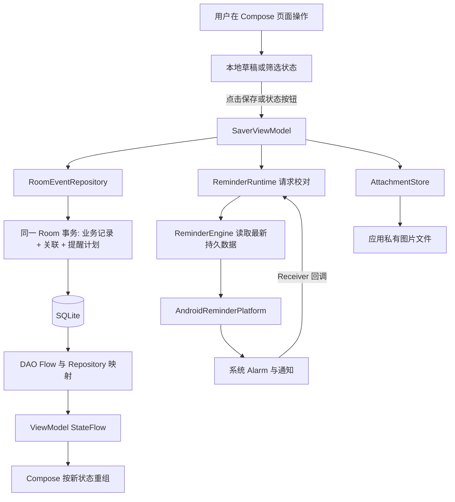

# 实现环境、技术栈与程序架构

适用：`demo-v0.3.5`，0.3.5／8、schema 4。返回[演示后提问速查](README.md)；按功能看[源码对照](02-feature-source-map.md)。本页用于演示前自学，以及功能演示结束后按老师的问题查阅；前 5 分钟不讲技术栈或架构，也不默认在结束后主动讲解本页。以下版本来自仓库配置，不是网上“最新版本”的推荐清单。

## 1. 环境与依赖各自负责什么

| 类别 | 本项目实际配置 | 用途与源码依据 |
| --- | --- | --- |
| 编程语言 | Kotlin 2.1.20 | App 主要源文件是 `.kt`；[根 build.gradle.kts](../../build.gradle.kts)，L1—6；[固定版本](https://github.com/zidodo1124/hust26_software_engineering_homework/blob/demo-v0.3.5/build.gradle.kts#L1-L6) |
| 构建脚本 | Gradle Kotlin DSL，Gradle 8.11.1 | `.gradle.kts` 描述模块和依赖；wrapper 固定 Gradle 发行包及 SHA；[wrapper 配置](../../gradle/wrapper/gradle-wrapper.properties)，L1—8；[固定版本](https://github.com/zidodo1124/hust26_software_engineering_homework/blob/demo-v0.3.5/gradle/wrapper/gradle-wrapper.properties#L1-L8) |
| Android 构建插件 | AGP 8.9.2 | 把 Android 资源、Kotlin 代码等构建成 APK；根构建文件 L2 |
| Java 工具链／字节码目标 | JDK 17，Java compatibility 17，Kotlin jvmTarget 17 | 这是构建所用 JDK／目标，不表示 App 主要用 Java 编写；[模块构建文件](../../app/build.gradle.kts)，L20—26；[固定版本](https://github.com/zidodo1124/hust26_software_engineering_homework/blob/demo-v0.3.5/app/build.gradle.kts#L20-L26) |
| Android SDK | minSdk 26；compileSdk／targetSdk 35 | 最低声明支持 Android 8.0；编译及目标 API 35。声明范围不等于所有机型都实测；模块构建文件 L7—18 |
| UI | Jetpack Compose，Compose BOM 2025.04.01，Material 3，Activity Compose 1.10.1 | 使用可组合函数描述页面，Material 3 提供按钮、输入框、对话框等。BOM 统一管理 Compose 库版本，不应把它说成每一个库的版本；模块构建文件 L55—60 |
| 生命周期与状态 | Lifecycle runtime／ViewModel Compose 2.9.0 | ViewModel 保存协调状态，页面按生命周期收集 StateFlow；模块构建文件 L61—62 |
| 异步与数据流 | Kotlin Coroutines Android 1.10.2 | `viewModelScope`、`Dispatchers.IO`、`Flow`、`StateFlow`、`Mutex`；模块构建文件 L66 |
| 本地存储 | Room 2.7.1 + SQLite；schema 4 | 实体、DAO、关系查询、迁移、事务；Room 是 SQLite 的抽象层，并非云数据库；模块构建文件 L63—65 |
| 代码生成 | KSP 2.1.20-1.0.32，Room compiler 2.7.1，启用 KSP2 | 在构建期处理注解、生成 Room 实现并导出 schema；不是运行时动态生成数据库代码；根构建文件 L5、[gradle.properties](../../gradle.properties) L5、模块构建文件 L50—52、L65 |
| 图片 | Android ContentResolver、BitmapFactory、ExifInterface、私有文件目录 | 无额外网络图片库；读取授权 URI、验证解码、复制、缩略图采样与方向修正；[AttachmentStore.kt](../../app/src/main/java/cn/edu/hust/ddlsaver/platform/AttachmentStore.kt) |
| 提醒 | AlarmManager、NotificationManager、PendingIntent、BroadcastReceiver | 系统负责唤醒和显示通知，App 的持久化账本决定业务有效性；[AndroidReminderPlatform.kt](../../app/src/main/java/cn/edu/hust/ddlsaver/reminders/AndroidReminderPlatform.kt) |
| 自动测试 | JUnit 4.13.2、Robolectric 4.14.1、Compose UI Test、Room testing、coroutines-test | 位于 `app/src/test`，在 JVM／Robolectric 上运行规则、存储和页面回归；这些不是 App 的界面框架或线上运行服务；模块构建文件 L68—77 |
| 本轮实际验证设备 | 荣耀 X50，Android 15／API 35 | 本轮安装与日历证据见[验收记录](../test-evidence/RUN-20261101-CALENDAR-FINAL/README.md)。构建宿主为 Windows／JDK 17，手机执行与本机测试分开记录 |

本项目只有一个 `:app` 模块，见 [settings.gradle.kts](../../settings.gradle.kts) L17—18；`ui`、`domain` 等是源码包，不是多个服务或多个 Gradle 模块。Android Studio 可作为 IDE；Windows 下仓库提供 [scripts/gradle.ps1](../../scripts/gradle.ps1) 选择本地 JDK／SDK 后调用已检入的 wrapper。实际产物为 debug APK，不能称为已经完成商店发布签名的正式商业包。

复现本机检查时，在环境准备好的仓库根目录执行：

```powershell
powershell -ExecutionPolicy Bypass -File scripts/gradle.ps1 :app:assembleDebug :app:testDebugUnitTest :app:lintDebug
```

此命令不会替代实机验收，也不会自动把 APK 安装到手机。不要在临上台时重新构建／升级不同分支；演示及代码讲解使用同一个固定版本。

## 2. 单 Activity、分层职责与页面状态

程序入口是 [MainActivity.kt](../../app/src/main/java/cn/edu/hust/ddlsaver/MainActivity.kt) L17—38 的 `onCreate`：取得 `SaverViewModel`，用 `setContent` 加载主题和 `SaverApp`。[固定版本](https://github.com/zidodo1124/hust26_software_engineering_homework/blob/demo-v0.3.5/app/src/main/java/cn/edu/hust/ddlsaver/MainActivity.kt#L17-L38)

可称为“**ViewModel／Repository 分层、状态驱动的 Compose 单 Activity 应用**”。本项目没有引入 Hilt、Retrofit、Android Navigation 组件或远程后端；`SaverApp` 用 `screen`、`selectedId` 等状态手动切换页面，不应拿通用架构图代替实际实现。

| 包／入口 | 主要职责 | 不应该承担的职责 |
| --- | --- | --- |
| `MainActivity` | Android 生命周期、创建 UI、接收通知 Intent | 直接写业务数据库或把 Intent 当事项真实状态 |
| `ui` | Compose 页面、草稿、筛选状态；ViewModel 协调保存、附件与提醒 | 在组合函数中直接读写数据库／复制图片 |
| `domain` | `DdlEvent`／`EventDraft` 等模型，校验、筛选、时间状态、角色规则、Repository 接口 | 依赖某个 Compose 控件或 Android 系统通知对象 |
| `data` | Room 实体、DAO、Repository 实现、事务、schema 迁移 | 直接决定当前跳到哪一个页面 |
| `platform` | 图片授权读取、私有副本、验证、预览及文件清理 | 把外部临时 URI 当永久保存的附件 |
| `reminders` | 计划规则、持久化账本、校对引擎、Android 适配器及 Receiver | 仅凭过期回调参数发送通知 |



“状态驱动”可以用保存后出现详情解释：页面观察 `StateFlow`，并不靠手工给每个控件刷新文字。DAO 的 `Flow` 先把数据库变化传出，`SaverViewModel.reload` 合并事项／设置／来源／标签；`SaverApp` 等新 revision 出现在观察结果中，才打开保存后的详情，避免“保存成功却暂时找不到记录”的时序问题。入口分别是 [SaverDao.kt](../../app/src/main/java/cn/edu/hust/ddlsaver/data/SaverDao.kt) L15—17、[SaverViewModel.kt](../../app/src/main/java/cn/edu/hust/ddlsaver/ui/SaverViewModel.kt) L75—90、[SaverApp.kt](../../app/src/main/java/cn/edu/hust/ddlsaver/ui/SaverApp.kt) L141—176。

首页筛选与编辑草稿使用 `rememberSaveable`；`SaverApp` 的 `rememberSaveableStateHolder` 为首页、编辑页等保存可恢复状态。这支持页面往返及相应 Activity 重建场景，**不等于每个未保存草稿或日历偏好都已永久写入数据库**。`ViewModel` 还能在 Activity 重建期间继续持有图片导入任务，但进程死亡后不能假设内存任务仍存在。

## 3. 数据模型与事务：为什么演示一次保存会涉及多张表

[SaverDatabase.kt](../../app/src/main/java/cn/edu/hust/ddlsaver/data/SaverDatabase.kt) L13—20 注册 **9 张表**，schema 为 4；[固定版本](https://github.com/zidodo1124/hust26_software_engineering_homework/blob/demo-v0.3.5/app/src/main/java/cn/edu/hust/ddlsaver/data/SaverDatabase.kt#L13-L20)。验收报告所说“六张业务表”特指下面前六项，不是数据库总共只有六张表。

| 表 | 存什么 | 关键关系／设计 |
| --- | --- | --- |
| `events` | 标题、截止时间、速通分钟、重要程度、描述、来源 ID、完成／归档时间、revision | 一条事项是业务事实的核心；来源合法性由 Repository 校验，`events.sourceId` 在此版并没有声明 Room 外键 |
| `sources` | 来源目录和启用状态 | 一条事项最多一个来源；停用目录项保留历史关联 |
| `tags` | 标签目录和启用状态 | 可供多个事项使用 |
| `event_tags` | 事项与标签对应关系 | 联合主键 `(eventId, tagId)`；事项删除级联删除关联；标签外键为 RESTRICT |
| `custom_fields` | 当前事项的字段名、字段内容、排序 | 联合主键 `(eventId, id)`，防止不同事项的同 ID 字段互相覆盖 |
| `attachments` | 附件 ID、相对文件名、类型、尺寸、大小、排序 | 图片字节在私有目录，数据库只存元数据；事项删除级联删除元数据 |
| `settings` | 全局设置、提醒开关、时间参数和角色样式 | 单例设置行；未读到行时有领域默认值 |
| `reminder_plans` | 稳定计划键、触发时间、来源事项快照、发送状态、取消状态 | 兼作计划和历史账本；不随事项删除级联清空，保留取消与去重依据 |
| `reminder_control` | 下一目标 Alarm、系统已排时间、模式、脏标记和错误 | 把“业务期望的计划”与“系统当前安排”分开追踪 |

实体依据：[Entities.kt](../../app/src/main/java/cn/edu/hust/ddlsaver/data/Entities.kt) L21—127，以及 [ReminderModels.kt](../../app/src/main/java/cn/edu/hust/ddlsaver/reminders/ReminderModels.kt) L14—48。

一次保存先校验输入，再在同一 Room 事务写 `events`、标签关联、自定义字段、附件元数据，并重建提醒计划。任何一步异常都会回滚该数据库事务。图片文件复制属于另一种存储系统，不能假装与 SQLite 是一个原子事务：先导入私有候选副本，保存成功后按数据库仍引用的文件进行回收；取消草稿则清理未引用候选文件。详情见 D02／D03。

修改已有事项需要 `expectedRevision` 与数据库当前 `revision` 相同。这里的 revision 是**事项数据版本**，不是 APK 版本。若两个编辑入口先后保存，旧编辑不能悄悄覆盖新状态。完成／归档等真实状态变化也递增 revision；重复设置同一状态不重复递增。

升级路径在 `SaverDatabase` 中显式声明 `1→2→3→4` 迁移，并使用 `addMigrations`；没有配置“迁移失败就清库重建”的破坏性回退。schema 4 的增量是设置中的 `characterStyle`，不是重复任务表；PR #14 的 schema 5 属于另一个版本范围。

## 4. 时间、状态与统计为什么不会混在一起

保存的是 epoch 毫秒时间戳；输入、日期筛选、日历和提醒日期按 `Asia/Shanghai` 转换。时间归一化到分钟，见 `EventValidation.normalize`。因此手机系统显示的时区与应用业务日期概念必须区分，演示样本按页面标注的北京时间填写。

`UrgencyRules.classify` 的顺序是：归档 → 已完成 → 已到／过截止 → 速通危险期 → 普通临近 → 正常。未完成且未归档的事项才是 active；逾期本身不会把事项标为完成。重要程度是用户的独立标记，不参与这套时间紧急度计算。

例如截止 18:00、速通 120 分钟：16:00 起进入危险期，18:00 起成为逾期；“高重要”不会改变这两个时刻。用于测试的 Repository 和 ReminderEngine 可注入 `Clock`；页面 `SaverViewModel.refreshTime` 使用 `Instant.now()`，并在恢复前台及分钟边界刷新，不能声称整个工程所有时间读取都来自同一个注入 Clock。

首页“今日 DDL”、当前筛选列表、日历日期格有三个不同的数据范围：全局 active 事项的今日统计；应用全部选中条件后的列表；保留关键词／分类／列表类型但不限定当前单日的日期分布。D05 的修复正是把“面板是否展开”和“查询是否按周”两个状态分开。

## 5. 提醒为什么要有账本和系统适配层

数据库中可保存很多计划，但系统只安排最早需要处理的一次 Alarm。到点后重新读取当前事项和设置，处理已到期且仍有效的计划，再安排下一次。这样完成、删除、改期和权限变化不必信任旧回调携带的业务内容。

`ReminderRuntime` 使用 application context、有独立生命周期的协程和数据库连接；`Channel.CONFLATED` 合并重复校对请求。`ReminderEngine` 用 `Mutex` 串行校对，再用数据库事务检查和更新计划。它不是 WorkManager 定时任务，也不是让 Activity 一直运行一个倒计时来发送通知。

系统通知调用与 SQLite 提交不可能组成跨系统的原子事务。代码采用 `CLAIMED`、`SENT`、`FAILED`、尝试时间、稳定 notification tag 与重试机制降低中断窗口影响。不能据此声称所有进程崩溃／OEM 条件下严格 exactly-once；权限、后台限制与 OBS-02 的实际失败仍需说明。详情见 D08 和答辩问题。

## 6. 当前规模的取舍与可讨论改进

- `EventQuery.select` 在已观察到的事项列表上做内存过滤、分组和排序，适合当前小规模本地事项；当前已有关系表和附件索引。数据量显著增大时，可考虑 DAO 参数化查询、按查询负载补充索引、Paging、全文检索或增量统计；面向检索的新索引优化、分页、全文检索和增量统计尚未实现。
- UI 的 `screen` 字符串路由与 ViewModel 直接创建依赖，代码直观、依赖较少；页面扩展时可考虑类型化路由和依赖注入，当前版本未引入。
- 每分钟更新状态利于展示时间变化，真正的后台提醒仍依赖系统 Alarm；两条链路不能混为一谈。
- 所有持久数据在当前手机，Manifest 禁用应用自动备份并未申请 INTERNET 权限；这不等于已实现加密、账号同步或迁移备份功能。保存图片的私有目录也不代表卸载应用后仍能保留数据。
