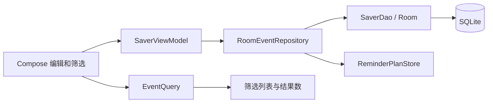

# 数据与信息组织架构核查

日期：2026-10-30。范围为付泽文负责的 FR-14、FR-18、FR-19 及数据保存、迁移；基于本地 `1f456d1` 代码和[专项需求](data-requirements.md)。这是静态核查，不代表本轮重新构建、运行测试或设备验收。其他需求边界仍待整体审核。

## 数据流与关系

事项、来源、标签分别保存；事项通过 `sourceId` 指向一个来源，通过 `event_tags` 关联多个标签；`custom_fields` 以事项 ID 与字段 ID 组合区分字段，`position` 保存顺序。附件数据与文件分开，数据库保存附件元数据。字段同名不等于字段标识相同。实体见[Entities.kt](../app/src/main/java/cn/edu/hust/ddlsaver/data/Entities.kt)。

## 需求到代码

| 需求 | 实际代码与静态观察 | 已有测试入口 / 后续核验 |
| --- | --- | --- |
| 分类名称、停用与历史关联 | [RoomEventRepository.kt](../app/src/main/java/cn/edu/hust/ddlsaver/data/RoomEventRepository.kt) 的 `saveSource`、`saveTag` 去空白并在各自目录判重；`validateRelations` 允许保留已有停用关联，阻止新增停用关联 | [RoundTwoRepositoryTest.kt](../app/src/test/java/cn/edu/hust/ddlsaver/data/RoundTwoRepositoryTest.kt) 有改名、停用及判重测试；需结合 DA-01—03 核对跨类同名、恢复及重开完整链 |
| 同名字段、内容、顺序 | [EventValidation.kt](../app/src/main/java/cn/edu/hust/ddlsaver/domain/EventValidation.kt) 对字段名判空，不对名称判重；Repository 保存字段 ID、文本和位置，实体映射按位置排序；[EditorExtras.kt](../app/src/main/java/cn/edu/hust/ddlsaver/ui/EditorExtras.kt) 以字段 ID 更新各条记录 | 现有 `customFieldsBelongToEachEventEvenWhenTheirIdsMatch` 侧重不同事项；同一事项同名且一个为空的保存、修改、删除和重开应按 DA-04／05 核实覆盖并执行 |
| 关键词与多标签交集 | [EventQuery.kt](../app/src/main/java/cn/edu/hust/ddlsaver/domain/EventQuery.kt) 匹配标题、描述和字段名／内容，`containsAll` 要求全部所选标签；其他筛选条件使用 AND，结果按截止时间及 ID 排序 | [EventQueryTest.kt](../app/src/test/java/cn/edu/hust/ddlsaver/domain/EventQueryTest.kt) 已有字段搜索、交集和稳定排序测试；应补核 DA-06—08 的完整组合与页面路径 |
| 列表及首页统计 | [HomeScreen.kt](../app/src/main/java/cn/edu/hust/ddlsaver/ui/HomeScreen.kt) 用全部活动事项计算今日／危险期数量，筛选列表单独调用 `EventQuery.select` | 需按 DA-09／10 检查完成、归档、日期及筛选后列表和统计，特别是设备上的交互表现 |
| 保存一致性和旧编辑冲突 | [SaverDao.kt](../app/src/main/java/cn/edu/hust/ddlsaver/data/SaverDao.kt) 用事务读取关系快照；Repository 的 `reminderTransaction` 将事项关系更新和提醒计划重建放在 Room 事务中，并检查 `expectedRevision` | 现有仓库测试包含旧编辑、批量事务失败和关系快照；DA-11 的具体保存失败、草稿可恢复和用户提示仍须结合界面验证 |
| 旧数据迁移 | [SaverDatabase.kt](../app/src/main/java/cn/edu/hust/ddlsaver/data/SaverDatabase.kt) 声明 schema 4 及 1→2→3→4 显式迁移，未配置破坏性重建回退 | [SaverDatabaseMigrationTest.kt](../app/src/test/java/cn/edu/hust/ddlsaver/data/SaverDatabaseMigrationTest.kt) 建立 v1／v2 旧库；[CharacterStylePersistenceTest.kt](../app/src/test/java/cn/edu/hust/ddlsaver/data/CharacterStylePersistenceTest.kt) 建立 v3 旧库。需核对三条路径对 DA-12 所列各自可表示数据的断言，并实际运行 |

## 需继续处理的事项

1. **需求边界**：本次确认的是五组摘要。关键词是否按连续子串匹配、同截止时间的排序细节、分类重名处理等尚未因摘要确认而全部定稿；实现核查不能替代需求确认。
2. **同名字段端到端**：仓库现有跨事项字段隔离测试不自动证明同一事项两条同名字段、空内容、编辑／删除及重开全流程；先检查现有测试实际覆盖，再为缺失场景编写有效测试。
3. **迁移断言范围**：已找到真实 v1、v2、v3 旧库测试入口，但仅凭方法名不能断言 DA-12 每项数据在每条适用路径上均已验证；需逐项核对并运行。
4. **数据完整性边界**：`event_tags`、`custom_fields` 等关系声明外键；`EventEntity.sourceId` 当前没有声明 Room 外键，来源存在性在 Repository 保存时校验。当前没有永久删除来源的公开操作，因此不能据此断定现有功能存在缺陷；后续若增加外部写入或永久删除来源，应重新审视约束与迁移。
5. **既有证据限制**：先前保存的本机报告不等于本轮运行结果。仓库原开发环境中的 `.local-tools` 不随克隆提供，后续执行前应配置本机 JDK 17 和 Android SDK，详见[开发说明](development.md)。

本轮只核查设计与代码映射，未修改产品代码、自动测试或数据库 schema。后续先处理已明确的测试缺口和实际缺陷；测试不通过时保留失败记录，修复后复测。

## 后续测试覆盖核对（2026-10-30）

- `RoundTwoRepositoryTest` 原有跨事项同 ID 字段隔离测试、分类停用／恢复测试、事务回滚和旧编辑冲突测试；`EventQueryTest` 原有关键词、组合筛选和稳定排序测试。
- `SaverDatabaseMigrationTest` 使用真实 v1／v2 schema 创建旧库，v2 样本涵盖来源、标签、字段、附件元数据及设置；`CharacterStylePersistenceTest` 使用真实 v3 schema，原样本涵盖事项、设置及提醒账本，但未断言分类、字段和附件关联。
- 新增 `sameNamedFieldsAndEmptyContentRemainIndependentAcrossEditsAndReopen`，检查同一事项两条同名字段及空内容在重开、编辑和移除后的独立性，并检查另一事项不变；扩展 v3→v4 迁移样本，检查来源、标签、字段和附件元数据并重开。
- 当前电脑 `JAVA_HOME` 指向 JDK 8，未发现已配置的 Android SDK 或本工程的本地 SDK；尚未在本机执行新增测试。迁移测试检查数据库中的附件元数据，不等于验证真实图片文件在设备覆盖安装后完整保留。
- 新增测试的 CI／本机执行结果以对应提交的实际运行记录为准，不将代码已加入等同测试通过；需求 DA-01—DA-13 的完整验收状态保持不变。

## 分类与失败回滚检查

后续复核发现，已有测试分别覆盖分类停用、筛选交集与批量回滚，但仍需将以下场景连贯验证：来源和标签允许跨类型同名，停用后原关联可筛选，移除后不能重新选择，恢复后可重新关联并在重开后保持；事项保存过程中字段写入失败时，事项内容、分类关联和提醒计划应整体回滚。

`RoundTwoRepositoryTest` 新增两个测试分别覆盖这些情形；失败测试通过 SQLite 触发器制造字段写入错误，检查失败前后数据及重开状态。测试运行结果以对应提交的 GitHub Actions 为准，不因新增用例直接认定通过；不涉及实机操作或生产数据。
