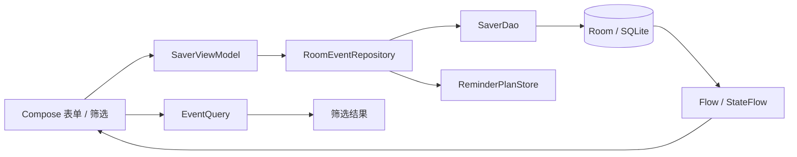

# 数据与信息组织模块说明与答辩准备

负责人：付泽文。整理日期：2026-10-31。本稿由 AI 助手根据实际需求答复、仓库代码与测试证据辅助整理，供本人学习、核对和小组汇总，不作为最终课程验收结论。项目整体选题、其他模块和最终测试结果由小组统一整理。

## 1. 模块目标与范围

本模块帮助用户按来源和标签整理 DDL，给每项事项补充独立的文本字段，并通过关键词和组合筛选快速查找。覆盖 FR-14、FR-18、FR-19，关联数据保存与升级需求 FR-15；具体规则见[专项需求](data-requirements.md)，需求、代码和测试的逐项对应见[追踪清单](data-test-traceability.md)。

业务示例：用户为“软件实验报告”选择来源“学习”、标签“课程”和“需提交”，添加“地点＝东九”和“联系人＝助教”；另一项事项可有同名“联系人”字段，其内容独立。选中两个标签时，结果必须同时具有两者。停用分类后，既有事项保留关联，历史事项仍可通过该分类筛选。

截至本稿，本人已确认名称判重、多标签交集、同名字段可空、分类停用、搜索字段、数据保留，以及英文大小写不敏感的连续搜索、相同截止时间稳定排序和停用分类筛选等选项。数量与性能暂不设具体值；未涉及的细节和项目整体需求仍需审核。

## 2. 模块设计与数据流

项目为单 App 模块的 Android 应用，使用 Kotlin、Jetpack Compose、ViewModel、Room／SQLite 和 Kotlin Coroutines／Flow。数据组织代码主要在 `ui`、`domain` 和 `data` 包中，提醒和图片属于协作边界，均位于同一应用。

事项通过 `sourceId` 关联至一个可选来源，事项与标签通过 `event_tags` 建立多对多关系。每个自定义字段保存事件 ID、字段 ID、名称、内容和顺序；联合标识使不同字段可同名且彼此独立。附件文件存放在应用私有目录，数据库保存附件元数据，不应把文件字节直接说成数据库字段。

保存时页面将草稿交给 ViewModel，仓库进行校验、检查打开时的修订号，并在事务内保存事项、分类关联、文本字段、附件元数据和提醒计划。成功后 Room 的 Flow 更新界面；旧修订号遇到冲突时拒绝保存。仓库统一处理事务，图片文件清理由相关平台与 ViewModel 流程另行协调，文件操作不属于 Room 事务。

搜索在 `EventQuery.select` 中处理，组合条件取交集，多标签要求全部匹配；关键词匹配标题、描述、自定义字段名和内容，按完整连续文字匹配且不区分英文大小写。结果按截止时间升序，同一时间通过内部 ID 保持稳定顺序。业务日期展示和日期筛选使用北京时间。

当前数据库 schema 为 4，`SaverDatabase` 注册 1→2→3→4 显式迁移。来源的存在性在 Repository 中校验；当前 `sourceId` 没有 Room 外键，已有公开路径不支持永久删除来源。若将来新增其他写入或删除路径，应重新评估完整性。

## 3. 功能与代码入口

| 功能或流程 | 入口 | 答辩时需要解释 |
| --- | --- | --- |
| 表单输入、分类与字段 | [EventEditor.kt](../app/src/main/java/cn/edu/hust/ddlsaver/ui/EventEditor.kt)、[EditorExtras.kt](../app/src/main/java/cn/edu/hust/ddlsaver/ui/EditorExtras.kt) | 从用户输入形成草稿；字段以自身 ID 分别编辑 |
| 数据操作与状态 | [SaverViewModel.kt](../app/src/main/java/cn/edu/hust/ddlsaver/ui/SaverViewModel.kt) | 发起保存、显示错误并观察数据更新；不直接执行 SQL |
| 分类维护、事项与关联保存 | [RoomEventRepository.kt](../app/src/main/java/cn/edu/hust/ddlsaver/data/RoomEventRepository.kt) | 名称校验、停用关联约束、修订号、事务与计划重建 |
| 表结构与关系 | [Entities.kt](../app/src/main/java/cn/edu/hust/ddlsaver/data/Entities.kt)、[SaverDao.kt](../app/src/main/java/cn/edu/hust/ddlsaver/data/SaverDao.kt) | 多对多关联、字段的事项归属、事务化读取 |
| 查询和筛选 | [EventQuery.kt](../app/src/main/java/cn/edu/hust/ddlsaver/domain/EventQuery.kt) | 多标签 `containsAll`、筛选交集、关键词及排序 |
| 输入校验 | [EventValidation.kt](../app/src/main/java/cn/edu/hust/ddlsaver/domain/EventValidation.kt) | 字段名不能为空、字段 ID 唯一；不限制同名字段 |
| 数据库升级 | [SaverDatabase.kt](../app/src/main/java/cn/edu/hust/ddlsaver/data/SaverDatabase.kt)、[历史 schema](../app/schemas/cn.edu.hust.ddlsaver.data.SaverDatabase/) | 明确迁移链，解释如何验证旧数据保留 |

## 4. 验证结果与限制

仓库已有数据层、查询层、界面和迁移测试。与本模块直接相关的新增或扩展测试包括：同名字段及空内容的编辑与重开、v3→v4 时分类字段与附件元数据保留、分类停用恢复和失败回滚、编辑冲突草稿保留，以及字段写入失败后的界面重试。

[PR #6 的 CI 报告复核](test-evidence/RUN-20261030-DATA-CI/summary.json)中，22 组 JUnit XML 有 137 个不同方法、156 次执行，失败／错误／跳过均为 0；Lint 0 Error、17 Warning。该报告对应 PR 测试用临时合并提交 `73245d6d9e5889004544e5787298a06894fa1834`，分支头为 `5ee1128d1a1f77c1d6dedb39590fe12b4b606214`，两个标识不可混同。CI 成功是该次自动检查证据，不代表所有功能、所有手机或 DA／TC 整例全部通过。

真实 v1／v2／v3 schema 迁移测试各有代表数据；附件迁移自动测试核验的是数据库元数据。真实附件文件的覆盖升级、完整页面组合及实机验收按照本人要求留到最后。

2026-10-31，[PR #8 的 CI 41212064529](https://github.com/zidodo1124/hust26_software_engineering_homework/actions/runs/41212064529) 对分支头 `b1b5e9e0d3ecfdcc0b6a31098fd7003af4f508f7` 对应的临时合并版本执行检查；报告 XML 中新增连续多词搜索测试为通过，全部 138 个方法／157 次执行无失败、错误或跳过，Lint 0 Error／17 Warning。报告产物、临时合并 SHA 与范围见[搜索 CI 摘要](test-evidence/RUN-20261031-SEARCH-CI/summary.json)。两个批次不能累计为新增测试方法数或实机次数。

## 5. 个人参与与提交记录

付泽文在本次协作中明确负责方向与工作顺序，确认数据组织业务规则，并授权以本人 Git 身份提交。需求、代码核查和测试由 AI 助手辅助整理与实现；不能把项目早期 AI 辅助实现描述为本人独立编写。以下 Git 记录可以追溯，个人在报告中应根据实际阅读、操作、复核和承担的工作准确表述。

| 提交 | 本次记录的工作范围 |
| --- | --- |
| `1f456d1` | 数据组织需求细化初稿及已确认规则 |
| `de4d900` | 记录五组摘要确认并进行数据架构静态核查 |
| `02634c7` | 同事项同名／空字段及 v3 旧库升级测试 |
| `2edc4f5` | 分类恢复与保存回滚测试 |
| `e78cb64` | 旧编辑冲突时保留草稿的界面测试 |
| `5ee1128` | 写入失败后保留草稿并重试的界面测试 |
| `56e80bf` | 数据需求、代码与测试证据追踪 |

更详细的实际互动与 AI 辅助分工见[交互记录](../interaction-records/付泽文/2026-10-30.md)。是否符合教师对个人贡献的要求应以课程规则及本人实际工作为准，提交数量不自动等于个人贡献大小。

## 6. 答辩准备问题

1. **来源与标签有什么不同？** 一个事项最多选择一个来源，可以有多个标签；标签通过关联表表示，筛选时多个标签要求全部满足。
2. **两个事项都有“联系人”，为什么不会互相覆盖？** 字段归属于各自事项，数据库使用事件 ID 与字段 ID 标识；同一事项的同名字段也有各自 ID。
3. **用户停用来源后旧事项会消失吗？** 不会。停用保留旧关联并可筛选历史事项；不能给其他事项新增停用分类，恢复后可重新选择。
4. **用户修改了别处已更新的事项会怎样？** 编辑草稿携带打开时的修订号；Repository 比对数据库当前修订号，不一致时拒绝覆盖，界面提示并保留草稿。若需继续应用草稿，用户仍需按界面实际操作重新打开并处理冲突。
5. **为什么要 Room 事务？** 一次事项保存可能同时修改主记录、分类、字段和提醒计划；事务保证数据库中的这些改动共同提交或回滚。应用私有图片文件操作不在这项数据库事务内。
6. **升级数据库为什么不能直接清库？** 已有用户数据会丢失。项目保留历史 schema 并注册显式迁移，测试通过旧 schema 建库、填入可表示的数据，升级并核对结果。
7. **自动测试通过能否证明手机一定正常？** 不能。Robolectric 和 CI 验证指定代码及环境，实际系统权限、厂商行为、图片来源与设备升级还需要最终实机检查。

## 7. 剩余工作

- 按[测试追踪](data-test-traceability.md)补齐确有价值的未覆盖路径，并将新测试的 CI 结果回填。
- 审核尚未确认的业务边界与最终项目报告；按实际情况同步需求、设计及测试材料。
- 梳理本人能解释的代码与数据流，准备与其他模块负责人联调。
- 最终阶段再执行实机业务流程和兼容签名的覆盖升级，验证真实附件文件与旧数据；未执行前不登记为通过。
