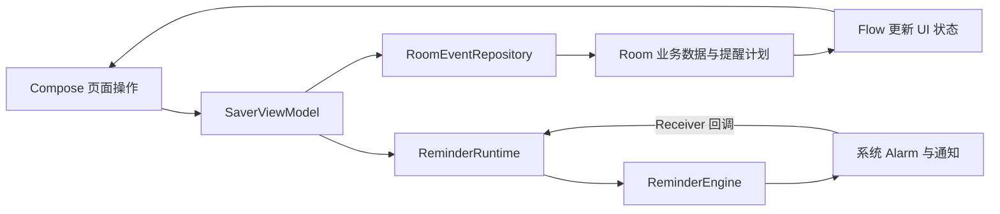

# 0.3.5 演示交付与代码阅读

文档更新：2026-11-02（America/Los_Angeles）；任务于当地 11 月 1 日启动。**0.3.5 本机完整构建与本轮荣耀 X50 日历实机验收已完成：224 次测试执行通过，Lint 0 错误／16 警告；最终 18 项审计通过，5 条 QA 已清理，原数据保持，手机可断开。** 准确范围和已知限制见[本轮证据](test-evidence/RUN-20261101-CALENDAR-FINAL/README.md)。

## 本次锁定范围

| 项目 | 内容 |
| --- | --- |
| 演示分支 | `codex/demo-final-20261101`，基于 `5df4320`，产品源码冻结为 `f024ecea4b287c7a8768c2dc62af9be9228c9ae6`；已推送同名远程分支，尚无本轮新分支 CI 结果；后续主分支的新功能不自动进入此包 |
| 目标版本 | 0.3.5／versionCode 8，Room schema 4，依赖不变；最终 APK 为 15,551,000 字节，SHA-256 `e689b896156514a9da7b8be57c67b3399e51e244328782f4f73ca2595fde2cd4`，签名与旧包一致；手机实际安装包已独立核对匹配 |
| 日历增量 | PR #11 的月历日期格数量、PR #12 的周／日视图与周期导航 |
| 本轮修复 | 周范围判断已移除对面板展开状态 `calendarOpen` 的依赖；新增页面用例先复现“整周 2 条退成单日 1 条”，修改后定向及完整本机回归通过；手机周范围 3→折叠 3→直接重开 3 已通过 |
| 重复任务 | PR #13 仅提供周期计算基础，尚不是可在界面新建、保存或管理的重复任务功能；PR #14 数据迁移不纳入此演示包 |

既有功能包括事项创建／编辑、来源与多标签、自定义字段、图片附件、搜索与筛选、完成／归档及批量操作、分级提醒、经典／Q 版角色。具体操作见[使用手册](user-guide.md)。本轮重点验证新增日历，并保留旧功能的既有测试边界；没有执行的完整业务用例不补记为通过。

当前开发机安装包位于 `.local-tools/demo-delivery-0.3.5/DDL-Saver-0.3.5.apk`，该交付副本已重新核对与正式构建哈希一致；此本机文件不随 Git 克隆分发。[安全归档入口](test-evidence/RUN-20261101-CALENDAR-FINAL/README.md#已归档证据入口)集中保存构建与实际验收证据。07:59:33 UTC 完成手机最终审计，距任务开始约 41 分钟；最终文档提交与推送以实际交付记录为准。

## 本次 5 分钟演示入口

正式功能展示限 **5 分钟**，样本和图片提前准备。按[演示说明书](acceptance-demo/README.md)展示编辑保存、图片、搜索、月／周／日历及完成状态；现场用[5 分钟速查卡](acceptance-demo/03-five-minute-cue-card.md)，详细步骤见[操作脚本](acceptance-demo/02-demo-script.md)。功能与收尾计划到 4 分 40 秒，保留 20 秒缓冲；具体用时需要演示者提前排练。

源码、架构、测试和技术取舍在功能演示结束后、老师提问时查[教学与答辩入口](acceptance-code-guide/README.md)。下面的代码阅读内容留作提前自学和问答参考，不占用功能展示的 5 分钟。此安排替代原 7 分钟方案。

## 代码先按一条保存路径阅读

| 顺序 | 文件与入口 | 阅读时要回答的问题 |
| --- | --- | --- |
| 1 | [MainActivity](../app/src/main/java/cn/edu/hust/ddlsaver/MainActivity.kt) 的 `onCreate`、`handleReminderIntent`；[SaverApp](../app/src/main/java/cn/edu/hust/ddlsaver/ui/SaverApp.kt) | Activity 如何建立界面，普通进入和通知进入如何路由，编辑草稿如何避免被新通知直接覆盖？ |
| 2 | [EventEditor](../app/src/main/java/cn/edu/hust/ddlsaver/ui/EventEditor.kt)、[SaverViewModel](../app/src/main/java/cn/edu/hust/ddlsaver/ui/SaverViewModel.kt) 的 `save`、`perform`、`reload` | 用户输入何时仍是草稿，何时调用保存；忙碌、失败和保存成功如何回到界面？ |
| 3 | [RoomEventRepository](../app/src/main/java/cn/edu/hust/ddlsaver/data/RoomEventRepository.kt) 的 `save`、`reminderTransaction`；[SaverDatabase](../app/src/main/java/cn/edu/hust/ddlsaver/data/SaverDatabase.kt) | 业务变更与提醒计划重建如何放在同一事务中；数据如何通过 Flow 回到 ViewModel？ |
| 4 | [HomeScreen](../app/src/main/java/cn/edu/hust/ddlsaver/ui/HomeScreen.kt)、[EventQuery](../app/src/main/java/cn/edu/hust/ddlsaver/domain/EventQuery.kt) | 列表过滤、日期格数量和首页总数分别用哪些数据，为什么不能共用一个已经缩成单日的结果？ |
| 5 | [ReminderRuntime](../app/src/main/java/cn/edu/hust/ddlsaver/reminders/ReminderRuntime.kt)、[ReminderEngine](../app/src/main/java/cn/edu/hust/ddlsaver/reminders/ReminderEngine.kt)、[AndroidReminderPlatform](../app/src/main/java/cn/edu/hust/ddlsaver/reminders/AndroidReminderPlatform.kt) | 如何按当前持久数据校对计划、撤销失效通知、发送到期项并安排下一次 Alarm？ |
| 6 | [AttachmentStore](../app/src/main/java/cn/edu/hust/ddlsaver/platform/AttachmentStore.kt)、[CharacterFeedback](../app/src/main/java/cn/edu/hust/ddlsaver/domain/CharacterFeedback.kt) | 图片为何要复制到应用私有目录；角色为何关注全局事项而不是当前筛选列表？ |

### 日历讲解可聚焦这五处

1. `EventQuery.select` 先按待办／完成／归档、关键词、来源、标签、日期和危险期筛选，并按截止时间排序。
2. `HomeScreen` 的 `calendarCounts` 按北京时间日期分组；它保留关键词与分类条件，但不受当前选中单日缩减。
3. `calendarAnchor`、`weekStart` 和 `CalendarPeriod` 决定周／日导航；一周范围是周一到下一个周一之前。月份网格由 `MonthCalendar`、`calendarWeeks` 生成。
4. `calendarOpen` 只控制面板显示；查询周期由 `calendarView` 等筛选状态决定。本轮新增“周内两天＋周外一天，折叠／展开后结果保持”的页面测试，在旧生产行上失败、修复后定向及完整回归通过；手机已独立核对周范围 3→折叠 3→直接重开 3；其他未测条件仍分别保留。
5. `rememberSaveable` 与 `SaverApp` 的首页状态保存支持页面状态恢复，不能据此承诺独立冷启动后的永久日历偏好保存。实际返回行为以本轮真机结果为准。

对照测试读：[SaverAppFlowTest](../app/src/test/java/cn/edu/hust/ddlsaver/ui/SaverAppFlowTest.kt) 的组合筛选、日历跨月和新增周折叠用例；[CalendarGridTest](../app/src/test/java/cn/edu/hust/ddlsaver/ui/CalendarGridTest.kt) 核对月份网格。自动化页面测试和手机操作覆盖不同条件，应分别说明。

## 演示前必须知道的边界

- **OBS-02 尚未解决：** 0.3.4 的荣耀 X50 实测中，重启后不打开 App 的完整窗口没有恢复 Alarm／通知；普通打开后补发并重排。演示前先打开 App 检查提醒，本轮日历验证不自动关闭此问题。
- **OBS-01 尚未解决：** 旧图片来源许可可能失效。重新复制图片后再粘贴，或从相册重新选择；已有明确提示和草稿保护，不代表所有来源兼容或授权机制已修复。
- 本轮来源实测仅为空交集 4→0→4；跨年只核对 12 月月格、跨年周与向前日导航，未验 1 月月份网格、反向跨年或正向来源／多标签交集。
- 不宣称已有重复任务界面、账号同步、应用内备份／恢复或在线聊天。完整锁屏、自然 Doze、每日汇总真实点击等未测项继续按[既有报告](test-report.md)保留。
- 月格数量、周／日界面来自付泽文的阶段增量；本轮缺陷修复、中央构建与实机验证按实际记录登记。讲解人应能自行解释代码，不把未发生的个人开发或验收填入贡献记录。
