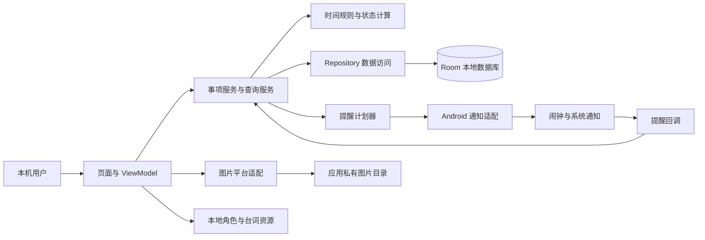
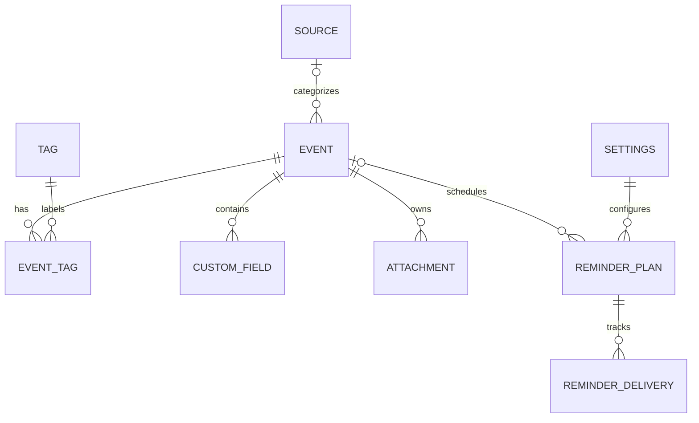
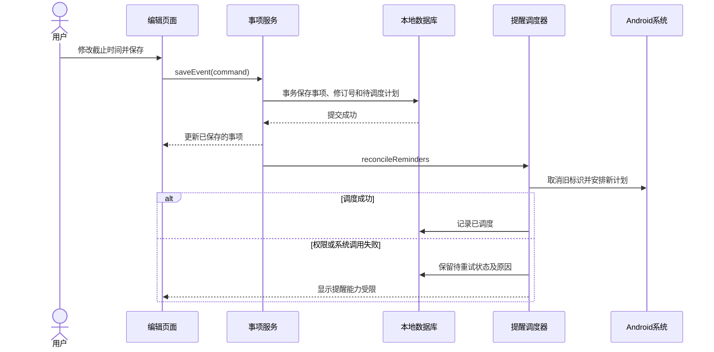

# HUSTer's DDL Saver 软件设计文档

| 项目 | 内容 |
| --- | --- |
| 文档版本 | v0.3 |
| 文档状态 | 完整目标设计及第二轮代码映射；构建与测试结论见测试报告，实机未测 |
| 更新日期 | 2026-10-27 |
| 项目小组 | 花园鳗：支盟渊、付泽文、岳羽泉、石倚铭 |
| 需求依据 | [需求分析 v0.2](requirements.md)，整体审核尚未完成 |
| 适用范围 | Android 离线单机应用；荣耀 X50 本轮暂不连接，实际系统后续登记；依赖与分工已有独立记录 |

## 1. 文档目的与设计依据

需求分析说明“用户需要什么”，本文件说明“软件准备怎样满足这些需求”。**概要设计**描述系统边界、主要模块及其协作关系；**详细设计**进一步说明数据结构、接口、计算规则和异常处理。本项目将两部分合并为一份文档，便于实现、评审及课程答辩时查阅。术语参考 [SWEBOK 软件设计章节](https://ieeecs-media.computer.org/media/education/swebok/swebok-v4.pdf)。

文档按 [arc42 提纲](https://arc42.org/overview/)裁剪，采用模块图、数据关系图和关键时序图解释方案。[C4 官方说明](https://c4model.com/diagrams)并不要求项目绘制全部层级；本文件也不以图的数量代替设计内容。参考标准的公开信息不代表已逐条遵循完整标准；[ISO/IEC/IEEE 42010:2022 公开摘要](https://www.iso.org/standard/74393.html)亦未规定唯一的文档格式。

用户已授权选择技术方案，并要求按计划开展第二轮，补齐来源标签、自定义字段、日历、批量管理和图片附件。小组熟悉 Python、C++、Java，演示设备为荣耀 X50；用户暂不连接实机。当前采用的依赖及版本见[技术清单](technology-stack.md)，任务分配见[小组任务板](../team/README.md)。后续结构调整应记录理由。本文不新增账号、服务器、云同步、OCR、AI 对话或多角色切换等功能。

### 1.1 待审核的业务假设

下列假设来自需求文档第 6 节的建议项。它们可以用于推演设计，但在用户确认前，不能写成已批准的验收结论。

| 标识 | 本稿采用的待审假设 |
| --- | --- |
| A-01 | 当前时间等于截止时间时即视为过期；速通时间填写正时长，空值表示不启用 |
| A-02 | 今日统计及每日汇总包含今天到期但已过期的未完成、未归档事项；没有事项时不发空汇总 |
| A-03 | 归档与恢复归档保留原完成标记；过期处理提供默认灰显保留和自动归档两种方式 |
| A-04 | 同事项同截止时间的同类提醒去重；危险期与临近提醒同刻合并；新建或恢复后已临近的有效事项立即提醒一次；通知点击分别进入今日列表或详情 |
| A-05 | 标题去除首尾空白后非空；重要程度默认中；来源与标签可维护；搜索包含标题、描述和自定义文本，不同筛选条件取交集 |

### 1.2 第二轮实际代码与完整目标的关系

第二轮应用版本为 `0.2.0`，`versionCode = 2`，数据库为 schema v2。本轮延续首轮基础流程，增加分类、组合筛选、日历、批量处理、过期整理和图片附件，具体范围见[实现计划](implementation-plan.md)。第 7—8 节的系统通知和角色资源仍是后续目标，不能据设计内容判断已经实现。本轮构建、自动测试和 CI 的实际结论以[测试报告](test-report.md)及[测试记录](test-records.md)为准；荣耀 X50 尚未进行实机验证。

| 设计职责 | 第二轮实际代码 | 当前范围及后续衔接 |
| --- | --- | --- |
| 入口与页面，D-01 / D-04 | [MainActivity](../app/src/main/java/cn/edu/hust/ddlsaver/MainActivity.kt)、[SaverApp](../app/src/main/java/cn/edu/hust/ddlsaver/ui/SaverApp.kt)、[HomeScreen](../app/src/main/java/cn/edu/hust/ddlsaver/ui/HomeScreen.kt)、[EventEditor](../app/src/main/java/cn/edu/hust/ddlsaver/ui/EventEditor.kt)、[CategoryManager](../app/src/main/java/cn/edu/hust/ddlsaver/ui/CategoryManager.kt) | 创建、详情、待办／完成／归档、分类管理、日历、组合筛选、批量操作和设置 |
| 操作与界面状态，D-04 / D-08 | [SaverViewModel](../app/src/main/java/cn/edu/hust/ddlsaver/ui/SaverViewModel.kt) | 观察数据、协调保存与状态操作、图片导入及清理、过期整理；错误保留输入，观察到保存后的修订再进入详情；草稿保存与返回确认由 Compose 管理 |
| 模型与校验，D-02 / D-03 | [EventModels](../app/src/main/java/cn/edu/hust/ddlsaver/domain/EventModels.kt)、[EventValidation](../app/src/main/java/cn/edu/hust/ddlsaver/domain/EventValidation.kt) | 原有事项字段及来源、标签、自定义文本、附件元数据、过期策略；校验分类名称、字段标识及安全附件文件名 |
| 时间与查询，D-03 / D-04 | [UrgencyRules](../app/src/main/java/cn/edu/hust/ddlsaver/domain/UrgencyRules.kt)、[EventQuery](../app/src/main/java/cn/edu/hust/ddlsaver/domain/EventQuery.kt) | 北京时间日期、普通紧急与危险期、逾期；统一组合筛选与截止时间排序 |
| 数据访问，D-02 / D-08 | [EventRepository](../app/src/main/java/cn/edu/hust/ddlsaver/domain/EventRepository.kt)、[RoomEventRepository](../app/src/main/java/cn/edu/hust/ddlsaver/data/RoomEventRepository.kt) | 关系保存、分类维护、批量事务、设置原子保存及过期整理；修订号防止旧编辑覆盖新信息，已删除事项不重新创建 |
| 数据库，D-02 | [SaverDatabase](../app/src/main/java/cn/edu/hust/ddlsaver/data/SaverDatabase.kt)、[Entities](../app/src/main/java/cn/edu/hust/ddlsaver/data/Entities.kt)、[SaverDao](../app/src/main/java/cn/edu/hust/ddlsaver/data/SaverDao.kt) | schema v2，显式 `MIGRATION_1_2` 保留旧数据；关联列表使用事务查询 |
| 图片，D-05 | [AttachmentStore](../app/src/main/java/cn/edu/hust/ddlsaver/platform/AttachmentStore.kt)、[AttachmentUi](../app/src/main/java/cn/edu/hust/ddlsaver/ui/AttachmentUi.kt) | 系统相册多选、主动粘贴图片 URI、私有副本、缩略图／预览、取消编辑与删除后的文件回收 |
| 提醒与角色，D-06 / D-07 | 尚未接入 | 保留为后续轮次目标；不宣称已经具备后台提醒或角色反馈 |

本轮沿用 A-01 的时间和输入规则、A-02 的今日计数范围，并实现 A-03 的完成标记保留与可选自动归档、A-05 的分类和自定义文本查询；这些待审细节仍可调整。A-04 的通知规则尚未实现。搜索覆盖标题、描述、自定义字段名称及内容。

## 2. D-01 总体架构与离线运行

本次设计选用 **Kotlin + Jetpack Compose** 构建原生 Android 界面，以 **Room / SQLite** 保存结构化数据，用应用私有目录保存图片副本，并通过 Android 系统接口安排与展示通知。选择原生方案是为了直接处理手机通知、权限和图片访问，减少跨平台适配范围；小组仍需熟悉 Kotlin 与 Compose 的使用方式，并在荣耀 X50 上验证关键能力。

代码采用单个 App 工程，现有 `ui`、`domain`、`data`、`platform` 四个分包。分包用于划分职责，不要求拆成多个独立构建模块。界面负责呈现和输入，ViewModel 协调数据操作及图片生命周期，领域层提供纯规则与查询，数据层负责数据库事务，平台层封装图片文件与解码。下图包含后续提醒和角色模块；实际已落地范围以第 1.2 节为准。这一组织方式参考 [Android 架构指南](https://developer.android.com/topic/architecture)，具体模块划分由本项目决定。

数据库中的有效事项是业务数据的统一依据。界面缓存和后续系统闹钟都不能独立决定事项状态；回调必须重新查询数据。正常使用不请求网络服务，角色和台词接入时保存在本地。最终交付形态为 Android 安装包；首轮构建工具与依赖版本已锁定，声明 `minSdk 26`、`targetSdk 35`、`compileSdk 35`。荣耀 X50 的实际 Android／MagicOS 版本与运行结果仍待连接后登记，不能从手机型号推断。

## 3. D-02 数据模型与持久化

### 3.1 主要数据对象

下表区分 schema v2 已保存的数据与后续提醒设计。[Room 官方文档](https://developer.android.com/training/data-storage/room)将本地数据组织为数据库、实体和数据访问对象；实际映射见第 1.2 节。

| 对象 | 主要字段与约束 | 关系及用途 |
| --- | --- | --- |
| Event 事项 | `id`：UUID；`title`；`deadlineAt`：时间戳；`sprintMinutes`：可空正分钟数；`importance`；`description`；`sourceId`；`completedAt`、`archivedAt`：独立可空时间；`revision`；`createdAt`、`updatedAt` | 保存用户录入的事实；完成与归档互不替代，过期和紧急度由时间计算 |
| Source 来源 | `id`、`name`、`isActive` | v2 已建表；停用保留关联，改名同步显示到关联事项，不复制旧名称 |
| Tag 标签 | `id`、`name`、`isActive` | v2 已建表；多对多关联；停用与改名同来源规则 |
| EventTag | `eventId`、`tagId`，联合唯一 | 表达事项与标签的多对多关系 |
| CustomField 自定义字段 | `id`、`eventId`、`label`、`value`、`position` | 一个事项可有多组名称与文本，按顺序显示；不跨事项复用 |
| Attachment 图片附件 | `id`、`eventId`、`relativePath`、`mimeType`、`displayName`、`byteSize`、`width`、`height`、`position` | v2 已建表；相对路径为安全的 `UUID.img` 文件名，路径唯一，不保存外部临时 URI |
| Settings 应用设置 | 单例 `id = 1`；`urgentMinutes`；`expiredPolicy` | v2 已保存；默认 1440 分钟及 `KEEP`；每日汇总时刻、提前提醒量和设置修订号待后续扩展 |
| ReminderPlan 调度计划 | `planId`；事项或每日汇总标识；`kind`；`triggerAt`；事项与设置修订号；`deadlineSnapshot`；`scheduleState`；`lastError` | 尚未建表；目标状态区分待调度、已调度、待取消、已取消和待重试；事项删除后仍可暂存取消所需快照 |
| ReminderDelivery 发送记录 | `deliveryKey`；`notificationId`；`attemptState`；`attemptedAt`；`submittedAt`；`lastError` | 尚未建表；用于去重与故障排查，提交给系统不等于用户已看到或阅读 |

图中的提醒关系是业务关联：每日汇总没有单个事项，发送记录需保留其去重依据，不能一律随调度计划重建而删除。具体外键约束应与这一生命周期一致。

### 3.2 保存与删除规则

- 创建或修改事项时，同一数据库事务保存事项、标签关联、自定义字段和附件元数据。关联 Flow 使用 `@Transaction` 读取，避免页面观察到字段已更新而图片列表尚未更新的中间状态。
- 编辑必须携带打开时的 `expectedRevision`。保存和实际完成／归档状态变化递增 `revision`；旧编辑被拒绝，不能覆盖新字段、图片或状态。重复请求同一状态不重复递增。
- 来源和标签名称去首尾空白且非空，同类名称不区分大小写判重，停用项也参加判重。停用后不能新增关联，原事项编辑可保留原关联；重新启用后恢复可选。改名在原 ID 上更新，关联事项展示最新名称。
- 自定义字段使用 `(eventId, id)` 联合主键，按 `position` 保存顺序；同事项字段 ID 不重复，名称非空，文本可为空。不同事项即使字段 ID 相同，也不会相互覆盖。
- 附件相对路径必须等于自身 UUID 标识加 `.img`，ID 与相对路径不能借用其他事项的关联，同事项也不能重复。永久删除通过外键级联删除标签关联、自定义字段和附件元数据；分类目录保留。
- 批量操作冻结所选 ID，在事务中先验证所有事项仍存在，再执行完成、归档或删除；任一缺失或执行异常均不部分提交。归档保留完成标记，删除仍由页面明确确认。
- `saveSettings(AppSettings)` 先校验再原子保存两项设置；旧单项设置接口各自保留另一项。执行自动归档使用独立、可重试的 `applyExpiredPolicy()`，设置保存成功不被后续整理失败改写为保存失败。
- 数据库事务不包含文件系统调用。ViewModel 在保存或删除提交后，按最新数据库引用清理应用图片副本；文件清理失败单独提示，后续重试，不删除相册原图。

后续接入提醒时，保存事务还需记录待调度计划，完成／归档／删除事务记录待取消状态。调度计划保留取消所需标识与截止快照，不随事项级联删除；系统调用成功后再更新计划状态。设置修订号、发送去重记录及恢复流程属于第 7 节后续设计，本轮尚未实现。

### 3.3 schema v1 → v2 升级

`SaverDatabase.MIGRATION_1_2` 在原 `events` 表增加可空 `sourceId`，在原 `settings` 表增加默认值为 `KEEP` 的 `expiredPolicy`，建立 `sources`、`tags`、`event_tags`、`custom_fields`、`attachments` 表及所需索引。原事项 ID、文字、截止时间、速通时长、重要程度、完成／归档标记、创建／更新时间、修订号及普通紧急阈值均保留。未使用破坏性重建回退。

历史 [1.json](../app/schemas/cn.edu.hust.ddlsaver.data.SaverDatabase/1.json) 保持不变，v2 schema 由 KSP 导出。迁移测试按该历史文件实际创建 v1 SQLite 数据库，经过 Room 升级和结构校验后，检查旧数据、增补关联并关闭重开；执行结果见测试报告。保留历史 schema 和测试真实升级路径的依据见 [Room 数据库迁移说明](https://developer.android.com/training/data-storage/room/migrating-db-versions)。

## 4. D-03 时间规则与事项状态

所有截止时间以绝对时间戳保存，输入和展示统一转换为 `Asia/Shanghai`。截止时间精确到分钟，保存时秒与毫秒归零；时间来源通过可替换的 `Clock` 接口提供，界面、统计和通知使用同一套规则。

令 `r = deadlineAt - now`、`s = sprintMinutes`、`u = urgentMinutes`，运算前统一单位：

1. 已删除事项不参与计算；已完成或已归档事项不参与首页待办计数和截止前提醒。
2. 按 A-01，`r <= 0` 为过期，默认灰显；不会自动视为已完成。
3. 若 `s` 已填写且 `0 < r <= s`，为红色危险期；该条件优先于普通紧急度，即使 `s > u` 也成立。
4. 不满足危险期且 `0 < r <= u`，为橙色普通紧急；其余未到期事项使用普通样式。重要程度不改变上述结果。

例如截止时间为北京时间 18:00、速通时间为 120 分钟：15:59 尚未进入危险期，16:00 进入，18:00 按 A-01 转为过期。未填写速通时间的事项不会进入危险期。

今日范围采用北京时间当天零点至次日零点的左闭右开区间。首页计数、对应列表和每日汇总复用查询条件，排除完成与归档事项；是否计入当天逾期事项按 A-02。日历改为查询所选日期，不能把该日期误当作“今日”。

| 操作 | 数据变化 | 后续行为 |
| --- | --- | --- |
| 完成／恢复未完成 | 设置／清空 `completedAt` | 重算列表与计数，取消或重新评估提醒 |
| 归档／恢复归档 | 设置／清空 `archivedAt` | 归档后停止提醒并移出首页；恢复时按当前时间计算，按 A-03 保留完成标记 |
| 修改截止时间或速通时间 | 更新字段并递增修订号 | 重算紧急度，取消旧计划并生成新计划 |
| 过期自动归档 | 设置为 `AUTO_ARCHIVE` 时，仅归档已过期、未完成、未归档事项并递增修订号 | 启动、恢复前台及应用运行期间每分钟刷新时执行；设置保存后也尝试执行，失败可重试 |
| 一键清理过期 | 将全部已过期且未归档事项归档并递增修订号，包括已完成事项 | 保留原完成标记；当前页面明确确认后执行，不永久删除 |

前台页面在分钟边界、返回前台和数据变化后更新显示。当前时间不长期缓存为固定值；后台被停止或进程退出时不保证执行整理，下次打开会按当前时间重新评估。本轮没有后台定时服务。后续接入系统时间变更与提醒恢复时复用相同规则；普通紧急阈值与未来的临近通知提前量分别计算。

## 5. D-04 页面、导航与内部接口

### 5.1 页面与操作入口

| 页面 | 主要内容与入口 |
| --- | --- |
| 首页 | 时钟、今日／危险期计数、待办卡片；提供创建、搜索、筛选、日历和批量选择入口；角色后续接入 |
| 创建／编辑 | 标题与日期时间必填；其余字段按需填写；附件导入、自定义文本字段、保存或取消 |
| 事项详情 | 完整文字、分类、自定义字段与图片；可复制文本，进入编辑、完成／恢复、归档／恢复或删除确认；角色提示后续接入 |
| 日历与筛选列表 | 按日期、来源、标签和关键词组织事项；列表与统计共用查询服务 |
| 历史／归档 | 分别提供完成事项和归档事项的查看及恢复入口；可区分同时完成且归档的事项 |
| 设置 | 已有普通紧急阈值和过期处理；每日汇总时刻、临近提醒提前量、通知权限状态与素材说明为后续目标 |

页面路由只传事项 ID、日期或筛选参数，进入时重新取数，不通过路由携带可能过期的完整事项副本。删除后收到旧通知点击时，按 A-04 返回列表并说明事项已不存在。

### 5.2 当前接口契约与后续衔接

下列为第二轮实际内部接口；应用没有网络服务端。界面、日历与分类筛选复用 `EventQuery.select`，避免分别实现时间或筛选规则。

| 接口 | 输入 → 输出 | 失败或边界处理 |
| --- | --- | --- |
| `EventRepository.save(EventDraft)` | 字段、来源／标签 ID、字段与附件列表、旧修订号 → 完整 `DdlEvent` | 校验或版本冲突保留表单；数据库事务回滚；保存成功后再清理无引用副本 |
| `EventQuery.select(events, filter, now, settings)` | 数据快照、筛选、时刻与设置 → 有序事项列表 | 列表模式、日期、来源、标签、关键词、危险期条件均取 AND；选中多个标签必须全部匹配；空结果正常 |
| `setCompleted(id, completed)` / `setArchived(id, archived)` | 单项 ID 与目标状态 → 完成操作 | 两个状态独立，重复请求幂等，已删除事项报错 |
| `applyBatch(ids, operation)` | 冻结的 ID 集合，`COMPLETE`／`ARCHIVE`／`DELETE` → 完成操作 | 全部存在才执行，事务失败回滚；删除确认由 UI 提供，数据层不弹框 |
| `saveSource` / `saveTag` / `setSourceActive` / `setTagActive` | 分类 ID、名称或启用状态 → 分类／完成操作 | 去空白、同类重名校验；目录 Flow 包含停用项 |
| `saveSettings(settings)` | 紧急阈值和过期策略 → 完成操作 | 校验失败不修改任何设置；设置保存与过期整理分别处理结果 |
| `archiveExpired()` / `applyExpiredPolicy()` | 当前时钟及保存策略 → 本次归档数量 | 手动整理包括已完成的过期事项，自动整理只处理未完成；重复执行不重复变更 |
| `UrgencyRules.classify(event, now, urgentMinutes)` | 事项、时刻、普通紧急阈值 → `Urgency` | 纯函数，完成、归档、过期及未填速通时间有明确分支 |
| `AttachmentStore.importImages` / `discardUnreferenced` / `cleanupOrphans` | URI／候选附件／当前引用 → 私有副本或清理结果 | 文件 IO 在平台层；取消、导入失败和延迟清理见第 6 节 |

列表模式为 `TODO`、`COMPLETED`、`ARCHIVED`：待办排除完成与归档；完成列表排除归档；归档列表保留其中的完成事项。关键词去首尾空白后，不区分大小写匹配标题、描述、自定义字段名称或内容；日期按北京时间截止日期匹配。结果先按 `deadlineAt`、再按 ID 排序。筛选不会改变数据库或自动扩展批量选择范围。

后续提醒层拟提供 `reconcileReminders(reason)`，读取最新数据库后生成或取消计划，失败留待重试，不改写已保存事项；本轮没有该接口的实现。

## 6. D-05 图片导入与附件生命周期

第二轮由 `AttachmentUi`、`SaverViewModel` 和 `AttachmentStore` 协作实现。数据库只保存附件元数据，文件操作统一在平台层执行，不引入新的图片库。

相册入口使用已有 Activity 依赖的 `PickMultipleVisualMedia` 与 `ImageOnly` 请求。该契约在设备没有 Photo Picker 时可回退到系统文档选择路径，只访问用户选中的图片，不申请整个相册的读取权限。方案依据 [Android Photo Picker](https://developer.android.com/training/data-storage/shared/photo-picker)，实际选择器和多选交互仍需在荣耀 X50 验证。

粘贴入口由用户主动触发，检查剪贴板是否提供可读取的图片 URI，并通过内容解析器读取。Android 对复杂剪贴板内容采用引用与内容提供者机制，不能把任意复制文字或图片链接视为已取得图片数据。[Android 复制粘贴说明](https://developer.android.com/develop/ui/views/touch-and-input/copy-paste)支持这一接口边界。

1. 读取 `content://` 或可读取的 `file://` URI，校验声明类型，流式写入 `filesDir/attachments/UUID.part`。完成后检查真实图片边界和小尺寸解码，再改名为 `UUID.img`；数据库不保存来源 URI，也不依赖长期 URI 权限。
2. 一次多图导入由文件互斥锁协调，IO 在后台调度器执行；任一导入失败或协程取消，回收本批新建文件。原有附件和表单文本保留，不能把失败图片当成已导入。
3. 编辑会话在 ViewModel 中登记原附件和新增候选副本；Activity 重建不自行取消仍在进行的导入。保存先提交数据库关系；随后查询当前引用，回收已移除的原副本和未采用候选。数据库保存失败时保留草稿及导入副本，允许重试或取消。
4. 取消编辑仅清理本会话新增且未被引用的副本；删除事项或批量删除先完成数据库事务，再清理候选文件。所有清理限制在应用附件目录，检查安全文件名和实际父目录并拒绝符号链接，不修改或删除相册原图。
5. 应用载入后进行一次孤儿文件检查；若恢复到编辑页，先登记原附件和恢复草稿的当前引用，再发起检查。仅清理无数据库引用、无受保护草稿引用且已满 24 小时的受管 `.img`／`.part` 文件。清理失败单独提示并留待后续启动重试；该过程不是常驻后台维护服务。
6. 缩略图和详情预览读取私有副本，先检查边界，再按目标尺寸采样解码，并处理平台 EXIF 方向。图片损坏或缺失显示局部错误，事项文字与操作仍可使用。采样方案参考 [Android 大图加载说明](https://developer.android.com/topic/performance/graphics/load-bitmap)。

当前工程保护值为：单张不超过 **20 MiB**、像素总数不超过 **100 MP（1 亿像素）**；缩略图采样目标最长边 **320 像素**，详情预览 **1600 像素**；孤儿文件保留 **24 小时**后才回收。原始导入副本不因预览采样而缩小。这些值是本轮控制存储、解码内存与误删风险的工程决定，**不是用户已确认的业务限制或 Android 平台统一上限**，需根据荣耀 X50 实测及用户审核调整。未设置应用级图片总张数上限，系统选择器本身可能有选择数量限制。

## 7. D-06 通知计划、触发与恢复

本节为后续实现目标，第二轮尚未接入系统闹钟或通知，也不声称会在后台提醒。

### 7.1 三类计划

| 类型 | 期望触发时刻 | 业务检查与点击目标 |
| --- | --- | --- |
| 每日汇总 | 北京时间设置时刻，默认 08:00 | 查询今日有效事项；按 A-02 决定空汇总及逾期范围；按 A-04 进入今日列表 |
| 危险期提醒 | `deadlineAt - sprintMinutes` | 仅适用于填写速通时间的未完成、未归档事项；点击详情 |
| 临近截止提醒 | `deadlineAt - leadMinutes` | 与普通紧急阈值独立；点击详情 |

每日汇总计算下一次北京时间触发时刻，使用一次性计划，在触发或恢复时安排下一次；不把每隔 24 小时的后台任务当作固定北京时间调度。新建或恢复时目标时刻已过但截止尚未到，按 A-04 生成一次即时提醒；过期事项不补发截止前提醒。

同一事项同一截止时刻的同类发送键采用 `(eventId, deadlineAt, kind)`，每日汇总采用北京时间日期作为发送键。危险期与临近提醒同时触发时，按 A-04 合并展示，但分别保存两个原因的发送状态；不同事项的提醒不因同刻触发而混成同一事项。

### 7.2 保存与系统调度的衔接

系统闹钟使用稳定且可重建的标识，例如包含事项 ID 与提醒类型的 Intent 数据 URI；更新时取消旧标识，避免只更改时间却留下旧任务。回调必须重新读取最新有效的 `ReminderPlan`、相关事项和设置，不能只信任回调携带的修订号或截止快照：稳定 `PendingIntent` 更新后，迟到的旧回调可能携带新的附加数据。计划不存在或已取消、修订不符，或单项提醒对应的事项不存在、已完成、已归档、已过期时，结束该回调并按需要校对计划。

发送前必须满足 `now >= 最新计划的 triggerAt`，并按最新事项与设置重新确认当前仍在对应的危险期或临近截止范围；尚未到新触发时刻时直接退出并校对未来计划，不提前发送。每日汇总同样核对最新计划的北京时间日期及目标时刻，并检查该日发送记录，避免提前或重复汇总。检查通过后，以唯一发送键原子领取待发记录，同一事项的回调串行处理；同刻合并时一次领取两类发送键，避免分别发出通知。提交系统通知后保存提交状态，失败则记录原因以供重试。数据库更新与系统通知不构成同一事务，进程崩溃可能留下未确定的发送窗口，不能宣称严格“恰好发送一次”。恢复时使用稳定通知 ID 重试仍可能重复提示，因此该窗口及恢复行为必须实测。

### 7.3 Android 运行条件

定时能力拟由 `AlarmManager` 适配器封装。Android 对精确闹钟有特殊权限要求，调用前需检查能力；设备重启后原闹钟需要重建。申请何种能力及可接受延迟须结合用途与设备验证，不能以普通后台任务替代分钟级时刻保证。[Android 闹钟官方说明](https://developer.android.com/develop/background-work/services/alarms)。

| 条件 | 设计处理与验证要求 |
| --- | --- |
| 通知权限未授予或通知被关闭 | 保留事项功能，说明无法展示系统通知；授权后重新核对有效计划，不批量补发历史无效提醒 |
| 精确调度能力不可用 | 不静默声称已设置精确提醒；显示当前能力，候选降级为可能延迟的非精确提醒，需用户审核可接受程度 |
| 锁屏、后台或省电模式 | 使用系统调度接口并实机测量触发延迟，不以应用前台测试代替后台验证 |
| 设备重启、系统时间调整 | 在系统允许接收的相应事件及应用启动时，从数据库重建计划；重新按北京时间计算日界线 |
| 用户强制停止应用 | 不保证继续送达；再次主动打开后执行恢复检查，并说明需检查系统设置 |

Android 13 及以上的常规通知涉及 `POST_NOTIFICATIONS` 运行时权限，应与精确闹钟权限分开检查。[Android 通知权限说明](https://developer.android.com/develop/ui/compose/notifications/notification-permission)。`WorkManager` 可作为后续非精确维护任务的候选，不作为准点提醒的承诺；本稿不要求引入常驻前台服务。

## 8. D-07 角色资源与台词

第一版目标采用一个角色及多种表情，图片和预设台词在本地读取；第二轮尚未集成角色资源。资源清单按状态映射到表情与台词集合，例如普通、临近、危险、完成反馈；显示规则由 D-03 的结果驱动，不能另写一套紧急度算法。台词选择可记录上次使用项，减少连续重复；用户仍需审核风格、数量和语气。

具体鲸鱼娘素材尚未选定，来源与许可依据见[角色素材调研](character-assets.md)。入库时保存文件名、来源、许可和修改说明，在应用说明页提供署名；许可核对与表情资源缺失检查属于验收准备。资源加载失败时仍显示事项信息和文本提示，角色动画不作为核心提醒的前提。

## 9. D-08 异常处理与可测试性

| 关注点 | 设计措施 | 验证方式 |
| --- | --- | --- |
| 数据一致性 | UI 观察数据库结果；业务操作统一经过服务；失败不显示虚假成功 | 模拟事务失败、重开应用、批量操作中断 |
| 时间边界 | `Clock` 可替换，状态计算为纯函数 | 精确构造阈值前、等于阈值、过期及北京时间跨日 |
| 平台差异 | 图片与提醒接口由适配器隔离，权限状态可读取 | 单元测试使用替代实现，通知与图片粘贴另做真机测试 |
| 内容可读性 | 长文本可滚动、标题可查看完整内容、紧急状态不只依赖颜色 | 长标题、多图、字体放大及不同状态人工检查 |
| 操作冲突 | 保存检查旧修订号；对同一事项串行提交业务变更 | 编辑与提醒触发交错，延后截止时间后旧回调不得提前通知，完成／删除后旧回调到达 |
| 运行证据 | 记录构建版本、设备、实际时间、操作、结果和必要错误信息 | 使用[测试计划](test-plan.md)与[测试记录](test-records.md)，不预填通过结果 |

## 10. 需求追踪与设计决定

| 需求范围 | 主要设计标识 | 对应验证重点 |
| --- | --- | --- |
| FR-01、FR-15；NFR-01、NFR-07 | D-01、D-02、D-08 | 安装、离线运行、重启持久化与设备兼容 |
| FR-02、FR-03、FR-14、FR-19 | D-02、D-04、D-05 | 必填校验、编辑、分类信息与独立文本字段 |
| FR-04、FR-07、FR-08、FR-09 | D-03、D-04、D-07 | 时间边界、日历、统计和视觉表现一致 |
| FR-05 | D-02、D-04、D-05 | 相册／粘贴、多图查看、文本复制及失败处理 |
| FR-18 | D-02、D-04、D-08 | 关键词、来源与标签筛选、排序及默认列表范围 |
| FR-06；NFR-02、NFR-03、NFR-04 | D-04、D-07、D-08 | 角色提示、可读性、离线资源与许可记录 |
| FR-10、FR-11、FR-16、FR-17 | D-02、D-03、D-04、D-06 | 批量范围、状态独立、取消提醒、归档与恢复 |
| FR-12、FR-13、FR-20；NFR-05、NFR-06 | D-02、D-03、D-06、D-08 | 提醒去重重排、设置独立、权限与异常一致性 |

采用本地数据库统一业务事实，是为了让首页、详情、统计和通知使用相同数据；状态按时间派生，是为了避免事项过期后存储值与界面不一致；附件保存应用副本，是为了避免外部临时访问失效；通知由平台适配器封装，是为了单独验证系统权限和设备差异。这些均为本项目方案理由，不是官方模板强制指定的实现。

## 11. 待确认与后续验证

- 根据小组已提供的 Python、C++、Java 基础熟悉首轮 Kotlin／Compose 代码；依赖与 SDK 声明已登记，荣耀 X50 的实际系统及电量管理设置在后续连接时核对。
- 审核 A-01 至 A-05，确认提示延迟可接受范围，以及权限受限时的降级方式。
- 优先验证通知授权、锁屏与重启恢复、图片选择和粘贴路径，再补充实测限制及必要数据上限。
- 确定角色文件与台词方案；成员按[任务板](../team/README.md)领取任务，形成实际修改、验证和个人提交。

后续实现若与本稿不同，应记录原因并同步设计、需求追踪和测试用例。实际测试结果及遗留问题写入测试记录与测试报告，不能用设计推演代替执行证据。

## 12. 修订记录

| 版本 | 日期 | 内容 | 状态 |
| --- | --- | --- | --- |
| v0.1 | 2026-10-27 | 根据需求 v0.2、官方资料及用户提供的语言经验和荣耀 X50 设备信息，形成总体及关键模块设计并选用技术路线 | 设计草案，待审核和验证 |
| v0.2 | 2026-10-27 | 按用户授权开展首轮实现，补充实际代码映射、依赖与 SDK 声明，并区分后续目标模块 | 首轮本机构建与自动检查完成；维护提示已记录，本轮暂不连接实机 |
| v0.3 | 2026-10-27 | 同步第二轮 0.2.0、schema v2、显式迁移、分类和字段、统一查询、批量事务、过期整理及图片生命周期；保留后续通知与角色目标 | 工程保护值待实机验证及审核；执行结论见测试报告 |
