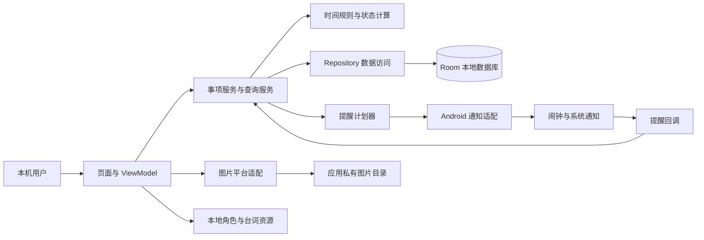
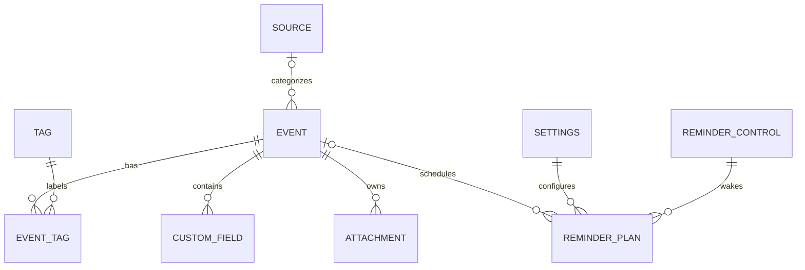
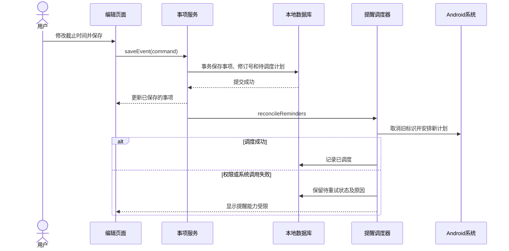

# HUSTer's DDL Saver 软件设计文档

| 项目 | 内容 |
| --- | --- |
| 文档版本 | v0.9 |
| 文档状态 | 已实现功能及图片导入诊断的代码映射；本机检查及设备结果分别记录 |
| 更新日期 | 2026-11-01 |
| 项目小组 | 花园鳗：支盟渊、付泽文、岳羽泉（当前 3 人） |
| 需求依据 | [需求分析 v0.8](requirements.md)，整体审核尚未完成 |
| 适用范围 | Android 离线单机；荣耀 X50 已记录 Android 15／API 35、MagicOS 9.0.0；v0.3.0 已有设备分项证据；0.3.2 已取得设备界面分项，v0.3.3 修复版已在同机覆盖、复验并完成收尾 |

## 1. 文档目的与设计依据

需求分析说明“用户需要什么”，本文件说明“软件准备怎样满足这些需求”。**概要设计**描述系统边界、主要模块及其协作关系；**详细设计**进一步说明数据结构、接口、计算规则和异常处理。本项目将两部分合并为一份文档，便于实现、评审及课程答辩时查阅。术语参考 [SWEBOK 软件设计章节](https://ieeecs-media.computer.org/media/education/swebok/swebok-v4.pdf)。

文档按 [arc42 提纲](https://arc42.org/overview/)裁剪，采用模块图、数据关系图和关键时序图解释方案。[C4 官方说明](https://c4model.com/diagrams)并不要求项目绘制全部层级；本文件也不以图的数量代替设计内容。参考标准的公开信息不代表已逐条遵循完整标准；[ISO/IEC/IEEE 42010:2022 公开摘要](https://www.iso.org/standard/74393.html)亦未规定唯一的文档格式。

用户已授权选择技术方案，并要求按计划继续第三轮提醒、角色表情和台词。第二轮信息组织与图片已取得本机及实机证据；小组熟悉 Python、C++、Java，演示设备为荣耀 X50，第三轮需要实机时另行通知连接。当前采用的依赖及版本见[技术清单](technology-stack.md)，任务分配见[小组任务板](../team/README.md)。后续结构调整应记录理由。本文不新增账号、服务器、云同步、OCR、AI 对话或多角色切换等功能。

### 1.1 待审核的业务假设

下列假设来自需求文档第 6 节的建议项。它们可以用于推演设计，但在用户确认前，不能写成已批准的验收结论。

| 标识 | 本稿采用的待审假设 |
| --- | --- |
| A-01 | 当前时间等于截止时间时即视为过期；速通时间填写正时长，空值表示不启用 |
| A-02 | 今日统计及每日汇总包含今天到期但已过期的未完成、未归档事项；没有事项时不发空汇总 |
| A-03 | 归档与恢复归档保留原完成标记；过期处理提供默认灰显保留和自动归档两种方式 |
| A-04 | 同事项同截止时间的同类提醒去重；危险期与临近提醒同刻合并；新建或恢复后已临近的有效事项立即提醒一次；通知点击分别进入今日列表或详情 |
| A-05 | 标题去除首尾空白后非空；重要程度默认中；来源与标签可维护；搜索包含标题、描述和自定义文本，不同筛选条件取交集 |

### 1.2 第三轮实际代码与验证范围

第三轮目标版本为 `0.3.0`、`versionCode = 3`、schema v3，保留前两轮事项、分类、日历、批量和图片流程，并接入第 7—8 节提醒与角色。源码 [857ca5f](https://github.com/zidodo1124/hust26_software_engineering_homework/commit/857ca5faf29af4c2b861bf4529634ec66e3e13bd) 已通过 RUN-005 的本机构建与 132 次自动执行；以下表示实际职责，不扩大为完整设备验证。v0.3.0 后续设备分项结果见 RUN-20261028-001。本批已测工程 `bdcd76f` 为 0.3.4／versionCode 7、schema 4，完整本机 179 方法／218 次检查通过；荣耀 X50 已同签名覆盖为 0.3.4／7，原数据保持及本样本图片提示／重试／回滚分项通过，本批设备分项及收尾已完成，自动重启恢复仍未通过，完整验收另行进行。界面保留经典／Q 版与预设台词气泡，并修复真机发现的 Q 版表情边缘残片；本机和目标机的实际范围分别记录，不复用旧截图代替修复版复验。具体操作见[用户使用手册](user-guide.md)。

| 设计职责 | 当前代码 | 当前范围及衔接 |
| --- | --- | --- |
| 入口与页面，D-01 / D-04 | [MainActivity](../app/src/main/java/cn/edu/hust/ddlsaver/MainActivity.kt)、[SaverApp](../app/src/main/java/cn/edu/hust/ddlsaver/ui/SaverApp.kt)、[HomeScreen](../app/src/main/java/cn/edu/hust/ddlsaver/ui/HomeScreen.kt)、[EventEditor](../app/src/main/java/cn/edu/hust/ddlsaver/ui/EventEditor.kt)、[CategoryManager](../app/src/main/java/cn/edu/hust/ddlsaver/ui/CategoryManager.kt) | 创建、详情、待办／完成／归档、分类管理、日历、组合筛选、批量操作和设置 |
| 操作与界面状态，D-04 / D-08 | [SaverViewModel](../app/src/main/java/cn/edu/hust/ddlsaver/ui/SaverViewModel.kt) | 观察数据、协调保存与状态操作、图片导入及清理、过期整理；错误保留输入，观察到保存后的修订再进入详情；草稿保存与返回确认由 Compose 管理 |
| 模型与校验，D-02 / D-03 | [EventModels](../app/src/main/java/cn/edu/hust/ddlsaver/domain/EventModels.kt)、[EventValidation](../app/src/main/java/cn/edu/hust/ddlsaver/domain/EventValidation.kt) | 原有事项字段及来源、标签、自定义文本、附件元数据、过期策略；校验分类名称、字段标识及安全附件文件名 |
| 时间与查询，D-03 / D-04 | [UrgencyRules](../app/src/main/java/cn/edu/hust/ddlsaver/domain/UrgencyRules.kt)、[EventQuery](../app/src/main/java/cn/edu/hust/ddlsaver/domain/EventQuery.kt) | 北京时间日期、普通紧急与危险期、逾期；统一组合筛选与截止时间排序 |
| 数据访问，D-02 / D-08 | [EventRepository](../app/src/main/java/cn/edu/hust/ddlsaver/domain/EventRepository.kt)、[RoomEventRepository](../app/src/main/java/cn/edu/hust/ddlsaver/data/RoomEventRepository.kt) | 关系保存、分类维护、批量事务、设置原子保存及过期整理；修订号防止旧编辑覆盖新信息，已删除事项不重新创建 |
| 数据库，D-02 | [SaverDatabase](../app/src/main/java/cn/edu/hust/ddlsaver/data/SaverDatabase.kt)、[Entities](../app/src/main/java/cn/edu/hust/ddlsaver/data/Entities.kt)、[SaverDao](../app/src/main/java/cn/edu/hust/ddlsaver/data/SaverDao.kt) | schema v4，保留 `MIGRATION_1_2`、`MIGRATION_2_3`、`MIGRATION_3_4`；关联与提醒重建使用事务；0.3.2／0.3.3 不改变数据库结构 |
| 图片，D-05 | [AttachmentStore](../app/src/main/java/cn/edu/hust/ddlsaver/platform/AttachmentStore.kt)、[AttachmentUi](../app/src/main/java/cn/edu/hust/ddlsaver/ui/AttachmentUi.kt) | 系统相册多选、主动粘贴图片 URI、私有副本、缩略图／预览、取消编辑与删除后的文件回收 |
| 提醒，D-06 / D-08 | [ReminderModels](../app/src/main/java/cn/edu/hust/ddlsaver/reminders/ReminderModels.kt)、[ReminderPlanStore](../app/src/main/java/cn/edu/hust/ddlsaver/reminders/ReminderPlanStore.kt)、[ReminderEngine](../app/src/main/java/cn/edu/hust/ddlsaver/reminders/ReminderEngine.kt) | 持久化计划兼发送键、同事务重建、当前数据复核、同刻合并与失败状态 |
| Android 调度，D-06 | [AndroidReminderPlatform](../app/src/main/java/cn/edu/hust/ddlsaver/reminders/AndroidReminderPlatform.kt)、[ReminderRuntime](../app/src/main/java/cn/edu/hust/ddlsaver/reminders/ReminderRuntime.kt) | 单一最早 Alarm、通知通道、能力检查、两个 Receiver 和应用级串行恢复 |
| 设置与角色，D-04 / D-07 | [ReminderSettingsPanel](../app/src/main/java/cn/edu/hust/ddlsaver/ui/ReminderSettingsPanel.kt)、[CharacterFeedback](../app/src/main/java/cn/edu/hust/ddlsaver/domain/CharacterFeedback.kt)、[CharacterPanel](../app/src/main/java/cn/edu/hust/ddlsaver/ui/CharacterPanel.kt) | 提醒设置、权限入口、经典／Q 版选择、四表情、36 条预设台词气泡与素材署名 |

本轮沿用 A-01 的时间和输入规则、A-02 的今日计数范围，并实现 A-03 的完成标记保留与可选自动归档、A-05 的分类和自定义文本查询；这些待审细节仍可调整。A-04 对应提醒代码在第三轮加入，实际覆盖与边界由测试记录说明。搜索覆盖标题、描述、自定义字段名称及内容。

## 2. D-01 总体架构与离线运行

本次设计选用 **Kotlin + Jetpack Compose** 构建原生 Android 界面，以 **Room / SQLite** 保存结构化数据，用应用私有目录保存图片副本，并通过 Android 系统接口安排与展示通知。选择原生方案是为了直接处理手机通知、权限和图片访问，减少跨平台适配范围；小组仍需熟悉 Kotlin 与 Compose 的使用方式，并在荣耀 X50 上验证关键能力。

代码采用单个 App 工程，现有 `ui`、`domain`、`data`、`platform`、`reminders` 分包。分包用于划分职责，不要求拆成多个独立构建模块。界面负责呈现和输入，ViewModel 协调数据操作及图片生命周期，领域层提供纯规则与查询，数据层负责数据库事务，平台层封装图片文件与解码。下图包含第三轮提醒和角色模块；实际已落地范围以第 1.2 节为准。这一组织方式参考 [Android 架构指南](https://developer.android.com/topic/architecture)，具体模块划分由本项目决定。

数据库中的有效事项是业务数据的统一依据。界面缓存和系统闹钟都不能独立决定事项状态；回调必须重新查询数据。正常使用不请求网络服务，角色和台词保存在本地。最终交付形态为 Android 安装包；首轮构建工具与依赖版本已锁定，声明 `minSdk 26`、`targetSdk 35`、`compileSdk 35`。荣耀 X50 已实际记录 Android 15／API 35、MagicOS 9.0.0；本轮新版本的通知和后台表现仍需独立验证。

## 3. D-02 数据模型与持久化

### 3.1 主要数据对象

下表列出 schema v4 的实际数据对象。[Room 官方文档](https://developer.android.com/training/data-storage/room)将本地数据组织为数据库、实体和数据访问对象；实际映射见第 1.2 节。

| 对象 | 主要字段与约束 | 关系及用途 |
| --- | --- | --- |
| Event 事项 | `id`：UUID；`title`；`deadlineAt`：时间戳；`sprintMinutes`：可空正分钟数；`importance`；`description`；`sourceId`；`completedAt`、`archivedAt`：独立可空时间；`revision`；`createdAt`、`updatedAt` | 保存用户录入的事实；完成与归档互不替代，过期和紧急度由时间计算 |
| Source 来源 | `id`、`name`、`isActive` | v2 已建表；停用保留关联，改名同步显示到关联事项，不复制旧名称 |
| Tag 标签 | `id`、`name`、`isActive` | v2 已建表；多对多关联；停用与改名同来源规则 |
| EventTag | `eventId`、`tagId`，联合唯一 | 表达事项与标签的多对多关系 |
| CustomField 自定义字段 | `id`、`eventId`、`label`、`value`、`position` | 一个事项可有多组名称与文本，按顺序显示；不跨事项复用 |
| Attachment 图片附件 | `id`、`eventId`、`relativePath`、`mimeType`、`displayName`、`byteSize`、`width`、`height`、`position` | v2 已建表；相对路径为安全的 `UUID.img` 文件名，路径唯一，不保存外部临时 URI |
| Settings 应用设置 | 单例 `id = 1`；普通阈值、过期策略；每日开关及分钟时刻、危险开关、临近开关及提前分钟数；`characterStyle` | 新提醒默认开启、08:00／60 分钟；形象默认 CLASSIC；普通阈值独立；发送前读取当前设置，不另存虚构的设置修订号 |
| ReminderPlan 计划及发送账本 | `key`、`kind`、`eventId`、`deadlineAt`、`eventRevision`、`triggerAt`、`day`、`notificationTag`、`active`、`state`、尝试时间／错误、`cancelPending` | `reminder_plans`；每个业务原因稳定主键兼去重依据；取消或发送后保留记录，不随事项级联删除 |
| ReminderControl 系统调度状态 | 单例 `id = 1`；固定 Alarm 标识；每日目标日期／时刻、系统已排时间、期望时间、实际模式、脏标记和错误 | `reminder_control`；统一最早唤醒与取消／重排失败快照，不为每个事项单独建立系统 Alarm |

图中的提醒关系是业务关联，不为计划设置随事项级联删除的外键。每日汇总没有单个事项；计划本身保留发送和取消依据，重建时不清空账本。

### 3.2 保存与删除规则

- 创建或修改事项时，同一数据库事务保存事项、标签关联、自定义字段和附件元数据。关联 Flow 使用 `@Transaction` 读取，避免页面观察到字段已更新而图片列表尚未更新的中间状态。
- 编辑必须携带打开时的 `expectedRevision`。保存和实际完成／归档状态变化递增 `revision`；旧编辑被拒绝，不能覆盖新字段、图片或状态。重复请求同一状态不重复递增。
- 来源和标签名称去首尾空白且非空，同类名称不区分大小写判重，停用项也参加判重。停用后不能新增关联，原事项编辑可保留原关联；重新启用后恢复可选。改名在原 ID 上更新，关联事项展示最新名称。
- 自定义字段使用 `(eventId, id)` 联合主键，按 `position` 保存顺序；同事项字段 ID 不重复，名称非空，文本可为空。不同事项即使字段 ID 相同，也不会相互覆盖。
- 附件相对路径必须等于自身 UUID 标识加 `.img`，ID 与相对路径不能借用其他事项的关联，同事项也不能重复。永久删除通过外键级联删除标签关联、自定义字段和附件元数据；分类目录保留。
- 批量操作冻结所选 ID，在事务中先验证所有事项仍存在，再执行完成、归档或删除；任一缺失或执行异常均不部分提交。归档保留完成标记，删除仍由页面明确确认。
- `saveSettings(AppSettings)` 先校验再原子保存完整设置；旧单项设置接口保留其他设置。执行自动归档使用独立、可重试的 `applyExpiredPolicy()`，设置保存成功不被后续整理失败改写为保存失败。
- 数据库事务不包含文件系统调用。ViewModel 在保存或删除提交后，按最新数据库引用清理应用图片副本；文件清理失败单独提示，后续重试，不删除相册原图。

第三轮保存、完成／归档／删除及相关设置变更在同一 Room 事务调用 `ReminderPlanStore.rebuild`；取消所需标识与截止快照不随事项删除。事务提交后再请求系统校对，保存成功与通知安排失败分别反馈；发送与取消的细节见第 7 节。

### 3.3 schema v1 → v2 → v3 → v4 升级

`SaverDatabase.MIGRATION_1_2` 在原 `events` 表增加可空 `sourceId`，在原 `settings` 表增加默认值为 `KEEP` 的 `expiredPolicy`，建立 `sources`、`tags`、`event_tags`、`custom_fields`、`attachments` 表及所需索引。原事项 ID、文字、截止时间、速通时长、重要程度、完成／归档标记、创建／更新时间、修订号及普通紧急阈值均保留。未使用破坏性重建回退。

历史 [1.json](../app/schemas/cn.edu.hust.ddlsaver.data.SaverDatabase/1.json) 保持不变，v2 schema 由 KSP 导出。迁移测试按该历史文件实际创建 v1 SQLite 数据库，经过 Room 升级和结构校验后，检查旧数据、增补关联并关闭重开；执行结果见测试报告。保留历史 schema 和测试真实升级路径的依据见 [Room 数据库迁移说明](https://developer.android.com/training/data-storage/room/migrating-db-versions)。

`MIGRATION_2_3` 在 settings 增加三类开关、每日分钟时刻、临近提前量，建立 `reminder_plans` 和 `reminder_control`；原表、附件路径和原设置均保留。提醒计划由迁移后首次恢复从当前数据重建，不靠升级时的旧闹钟快照发送。真实 v2 文件迁移、默认值和重开结果须由 RUN-005 核验，不以迁移代码存在代替通过。

`MIGRATION_3_4` 只在 settings 增加 `characterStyle TEXT NOT NULL DEFAULT 'CLASSIC'`。可选值为 CLASSIC／CHIBI，未知值读取时回退 CLASSIC；不清空通知账本，不改事项和附件表。历史 schema 1、2、3 原文件保留，新 [4.json](../app/schemas/cn.edu.hust.ddlsaver.data.SaverDatabase/4.json) 由 KSP 导出。真实旧库、无设置行、两种形象保存与重开以及切换不重复提醒的结果见 [RUN-20261028-002](test-evidence/RUN-20261028-002/README.md)。

## 4. D-03 时间规则与事项状态

所有截止时间以绝对时间戳保存，输入和展示统一转换为 `Asia/Shanghai`。截止时间精确到分钟，保存时秒与毫秒归零；时间来源通过可替换的 `Clock` 接口提供，界面、统计和通知使用同一套规则。

令 `r = deadlineAt - now`、`s = sprintMinutes`、`u = urgentMinutes`，运算前统一单位：

1. 已删除事项不参与计算；已完成或已归档事项不参与首页待办计数和截止前提醒。
2. 按 A-01，`r <= 0` 为过期，默认灰显；不会自动视为已完成。
3. 若 `s` 已填写且 `0 < r <= s`，为红色危险期；该条件优先于普通紧急度，即使 `s > u` 也成立。
4. 不满足危险期且 `0 < r <= u`，为橙色普通紧急；其余未到期事项使用普通样式。重要程度不改变上述结果。

例如截止时间为北京时间 18:00、速通时间为 120 分钟：15:59 尚未进入危险期，16:00 进入，18:00 按 A-01 转为过期。未填写速通时间的事项不会进入危险期。

今日范围采用北京时间当天零点至次日零点的左闭右开区间。首页计数、对应列表和每日汇总复用查询条件，排除完成与归档事项；是否计入当天逾期事项按 A-02。日历改为查询所选日期，不能把该日期误当作“今日”。

| 操作 | 数据变化 | 后续行为 |
| --- | --- | --- |
| 完成／恢复未完成 | 设置／清空 `completedAt` | 重算列表与计数，取消或重新评估提醒 |
| 归档／恢复归档 | 设置／清空 `archivedAt` | 归档后停止提醒并移出首页；恢复时按当前时间计算，按 A-03 保留完成标记 |
| 修改截止时间或速通时间 | 更新字段并递增修订号 | 重算紧急度，取消旧计划并生成新计划 |
| 过期自动归档 | 设置为 `AUTO_ARCHIVE` 时，仅归档已过期、未完成、未归档事项并递增修订号 | 启动、恢复前台及应用运行期间每分钟刷新时执行；设置保存后也尝试执行，失败可重试；后台通知 Receiver 不自动归档 |
| 一键清理过期 | 将全部已过期且未归档事项归档并递增修订号，包括已完成事项 | 保留原完成标记；当前页面明确确认后执行，不永久删除 |

前台页面在分钟边界、返回前台和数据变化后更新显示。当前时间不长期缓存为固定值；后台被停止或进程退出时不保证执行整理，下次打开会按当前时间重新评估。本轮通过系统闹钟回调触发提醒校对，不运行常驻后台服务；时间变更及恢复复用相同规则；普通紧急阈值与未来的临近通知提前量分别计算。

## 5. D-04 页面、导航与内部接口

### 5.1 页面与操作入口

| 页面 | 主要内容与入口 |
| --- | --- |
| 首页 | 时钟、今日／危险期计数、待办卡片；提供创建、搜索、筛选、日历和批量选择入口；第三轮接入角色卡片 |
| 创建／编辑 | 标题与日期时间必填；其余字段按需填写；附件导入、自定义文本字段、保存或取消 |
| 事项详情 | 完整文字、分类、自定义字段与图片；可复制文本，进入编辑、完成／恢复、归档／恢复或删除确认；角色反馈复用首页全局状态 |
| 日历与筛选列表 | 按日期、来源、标签和关键词组织事项；列表与统计共用查询服务 |
| 历史／归档 | 分别提供完成事项和归档事项的查看及恢复入口；可区分同时完成且归档的事项 |
| 设置 | 普通紧急阈值、过期策略、三类提醒开关、每日时刻、临近提前量、通知／精确能力状态、角色形象预览与选择、署名入口 |

页面路由只传事项 ID、日期或筛选参数，进入时重新取数，不通过路由携带可能过期的完整事项副本。删除后收到旧通知点击时，按 A-04 返回列表并说明事项已不存在。

### 5.2 当前接口契约与后续衔接

下列为延续第二轮并扩展的实际内部接口；应用没有网络服务端。界面、日历与分类筛选复用 `EventQuery.select`，避免分别实现时间或筛选规则。

| 接口 | 输入 → 输出 | 失败或边界处理 |
| --- | --- | --- |
| `EventRepository.save(EventDraft)` | 字段、来源／标签 ID、字段与附件列表、旧修订号 → 完整 `DdlEvent` | 校验或版本冲突保留表单；数据库事务回滚；保存成功后再清理无引用副本 |
| `EventQuery.select(events, filter, now, settings)` | 数据快照、筛选、时刻与设置 → 有序事项列表 | 列表模式、日期、来源、标签、关键词、危险期条件均取 AND；选中多个标签必须全部匹配；空结果正常 |
| `setCompleted(id, completed)` / `setArchived(id, archived)` | 单项 ID 与目标状态 → 完成操作 | 两个状态独立，重复请求幂等，已删除事项报错 |
| `applyBatch(ids, operation)` | 冻结的 ID 集合，`COMPLETE`／`ARCHIVE`／`DELETE` → 完成操作 | 全部存在才执行，事务失败回滚；删除确认由 UI 提供，数据层不弹框 |
| `saveSource` / `saveTag` / `setSourceActive` / `setTagActive` | 分类 ID、名称或启用状态 → 分类／完成操作 | 去空白、同类重名校验；目录 Flow 包含停用项 |
| `saveSettings(settings)` | 紧急阈值、过期策略及三类提醒设置 → 完成操作 | 完整校验，保存和计划重建同事务；过期整理与系统调度失败分别处理 |
| `archiveExpired()` / `applyExpiredPolicy()` | 当前时钟及保存策略 → 本次归档数量 | 手动整理包括已完成的过期事项，自动整理只处理未完成；重复执行不重复变更 |
| `UrgencyRules.classify(event, now, urgentMinutes)` | 事项、时刻、普通紧急阈值 → `Urgency` | 纯函数，完成、归档、过期及未填速通时间有明确分支 |
| `AttachmentStore.importImages` / `discardUnreferenced` / `cleanupOrphans` | URI／候选附件／当前引用 → 私有副本或清理结果 | 文件 IO 在平台层；取消、导入失败和延迟清理见第 6 节 |

列表模式为 `TODO`、`COMPLETED`、`ARCHIVED`：待办排除完成与归档；完成列表排除归档；归档列表保留其中的完成事项。关键词去首尾空白后，不区分大小写匹配标题、描述、自定义字段名称或内容；日期按北京时间截止日期匹配。结果先按 `deadlineAt`、再按 ID 排序。筛选不会改变数据库或自动扩展批量选择范围。

提醒入口为 `ReminderRuntime.requestReconcile()`／`reconcileNow()`。业务提交、应用前台恢复、权限结果、系统闹钟和恢复广播触发校对；引擎读取最新数据库，失败保留状态，不改写已经保存的事项。

## 6. D-05 图片导入与附件生命周期

第二轮由 `AttachmentUi`、`SaverViewModel` 和 `AttachmentStore` 协作实现。数据库只保存附件元数据，文件操作统一在平台层执行，不引入新的图片库。

相册入口使用已有 Activity 依赖的 `PickMultipleVisualMedia` 与 `ImageOnly` 请求。该契约在设备没有 Photo Picker 时可回退到系统文档选择路径，只访问用户选中的图片，不申请整个相册的读取权限。方案依据 [Android Photo Picker](https://developer.android.com/training/data-storage/shared/photo-picker)，实际选择器和多选交互仍需在荣耀 X50 验证。

粘贴入口由用户主动触发，检查剪贴板是否提供可读取的图片 URI，并通过内容解析器读取。Android 对复杂剪贴板内容采用引用与内容提供者机制，不能把任意复制文字或图片链接视为已取得图片数据。[Android 复制粘贴说明](https://developer.android.com/develop/ui/views/touch-and-input/copy-paste)支持这一接口边界。

1. 读取 `content://` 或可读取的 `file://` URI，校验声明类型，流式写入 `filesDir/attachments/UUID.part`。完成后检查真实图片边界和小尺寸解码，再改名为 `UUID.img`；数据库不保存来源 URI，也不依赖长期 URI 权限。
2. 一次多图导入由文件互斥锁协调，IO 在后台调度器执行；任一导入失败或协程取消，回收本批新建文件。原有附件和表单文本保留，不能把失败图片当成已导入。
3. 编辑会话在 ViewModel 中登记原附件和新增候选副本；Activity 重建不自行取消仍在进行的导入。保存先提交数据库关系；随后查询当前引用，回收已移除的原副本和未采用候选。数据库保存失败时保留草稿及导入副本，允许重试或取消。
4. 取消编辑仅清理本会话新增且未被引用的副本；删除事项或批量删除先完成数据库事务，再清理候选文件。所有清理限制在应用附件目录，检查安全文件名和实际父目录并拒绝符号链接，不修改或删除相册原图。
5. 应用载入后进行一次孤儿文件检查；若恢复到编辑页，先登记原附件和恢复草稿的当前引用，再发起检查。仅清理无数据库引用、无受保护草稿引用且已满 24 小时的受管 `.img`／`.part` 文件。清理失败单独提示并留待后续启动重试；该过程不是常驻后台维护服务。
6. 缩略图和详情预览读取私有副本，先检查边界，再按目标尺寸采样解码，并处理平台 EXIF 方向。图片损坏或缺失显示局部错误，事项文字与操作仍可使用。采样方案参考 [Android 大图加载说明](https://developer.android.com/topic/performance/graphics/load-bitmap)。

当前工程保护值为：单张不超过 **20 MiB**、像素总数不超过 **100 MP（1 亿像素）**；缩略图采样目标最长边 **320 像素**，详情预览 **1600 像素**；孤儿文件保留 **24 小时**后才回收。原始导入副本不因预览采样而缩小。这些值是本轮控制存储、解码内存与误删风险的工程决定，**不是用户已确认的业务限制或 Android 平台统一上限**，需根据荣耀 X50 实测及用户审核调整。未设置应用级图片总张数上限，系统选择器本身可能有选择数量限制。

2026-11-01 在上述导入流程加入 [AttachmentImportDiagnostics](../app/src/main/java/cn/edu/hust/ddlsaver/platform/AttachmentImportDiagnostics.kt)，为尚未稳定复现的 OBS-01 准备下一次设备取证。仅当应用带 `FLAG_DEBUGGABLE` 时，以 `DDLSaver.Attachment` 标签输出失败记录；阶段 `stage`、URI 类型 `scheme` 和原因分类 `category` 都来自固定枚举，另记本批图片序号 `item`、批次数量 `count` 及回滚失败数量 `rollback_failures`。不输出来源 URI、authority、路径、文件名、异常消息或堆栈；成功及协程取消不输出诊断。日志失败也不能覆盖原导入异常，原有用户提示与本批文件回滚行为保留。诊断只能缩小故障发生阶段，不能单凭枚举分类判定真实设备根因；本机模拟故障通过不关闭 OBS-01。设备采集步骤见[演示与验收准备](demo-and-acceptance.md#obs-01-的下次诊断采集)。

0.3.4 在来源元信息／打开／读取／关闭阶段捕获到 `SecurityException` 时提供重新复制或重新选择图片的提示，保留原始 cause 供内部诊断；内部写入、解码等其他失败不自动归类为来源授权失效。原有副本回滚、取消传播及未保存草稿保持语义经过本机验证。该提示改善恢复操作，不代表 OBS-01 的最终授权失效机制已查明。

## 7. D-06 通知计划、触发与恢复

第三轮实现采用 `reminders/` 五个文件及 schema v3。系统只保留最早一次到期 Alarm，其余业务计划与发送状态保存在 Room；开发机和手机证据分别登记，不能据代码推演声称设备已准时提醒。

### 7.1 三类计划

| 类型 | 期望触发时刻 | 业务检查与点击目标 |
| --- | --- | --- |
| 每日汇总 | 北京时间设置时刻，默认 08:00 | 查询今日有效事项；按 A-02 决定空汇总及逾期范围；按 A-04 进入今日列表 |
| 危险期提醒 | `deadlineAt - sprintMinutes` | 仅适用于填写速通时间的未完成、未归档事项；点击详情 |
| 临近截止提醒 | `deadlineAt - leadMinutes` | 与普通紧急阈值独立；点击详情 |

每日汇总按当时数据库中的有效状态查询，可包含今天已逾期但未完成、未归档的事项；后台回调不为生成汇总而额外归档或修改业务状态。计算下一次北京时间触发时刻，使用一次性计划，在触发或恢复时安排下一次；不把每隔 24 小时的后台任务当作固定北京时间调度。新建或恢复时目标时刻已过但截止尚未到，按 A-04 生成一次即时提醒；过期事项不补发截止前提醒。

每日目标游标须与当前北京时间最近一次候选时刻核对，不能在系统时间跨日回拨后继续保留更远未来日期。当天已经发送的汇总在安排次日计划时继续保留显示；跨日或关闭每日提醒时再取消。当日已消费的发送键不因改设置而重复发送。

同一事项同一截止时刻的同类发送键采用 `(eventId, deadlineAt, kind)`，每日汇总采用北京时间日期作为发送键。危险期与临近提醒同时触发时，按 A-04 合并展示，但分别保存两个原因的发送状态；不同事项的提醒不因同刻触发而混成同一事项。

### 7.2 保存与系统调度的衔接

系统闹钟使用固定 `ddl-saver://reminders/wake` 数据 URI 和不可变 PendingIntent；每次只安排所有有效计划中最早一次唤醒，到期后处理该批并安排下一次。回调只表示需要校对，不携带可信的事项快照或修订号；事项级发送键仍独立保存，稳定通知 tag 防止将不同事项混为一条；取消／重新设置失败时保留 `scheduledTriggerAt`、期望时间、脏标记和错误，后续打开或回调重试。回调必须重新读取最新有效的 `ReminderPlan`、相关事项和设置，不能只信任回调携带的修订号或截止快照：稳定 `PendingIntent` 更新后，迟到的旧回调可能携带新的附加数据。计划不存在或已取消、修订不符，或单项提醒对应的事项不存在、已完成、已归档、已过期时，结束该回调并按需要校对计划。

发送前必须满足 `now >= 最新计划的 triggerAt`，并按最新事项与设置重新确认当前仍在对应的危险期或临近截止范围；尚未到新触发时刻时直接退出并校对未来计划，不提前发送。每日汇总同样核对最新计划的北京时间日期及目标时刻，并检查该日发送记录，避免提前或重复汇总。检查通过后，以唯一发送键原子领取待发记录，同一事项的回调串行处理；同刻合并时一次领取两类发送键，避免分别发出通知。提交系统通知后保存提交状态，失败则记录原因以供重试。数据库更新与系统通知不构成同一事务，进程崩溃可能留下未确定的发送窗口，不能宣称严格“恰好发送一次”。恢复时使用稳定通知 ID 重试仍可能重复提示，因此该窗口及恢复行为必须实测。

计划的 `state` 兼作持久发送记录：PENDING 等待，CLAIMED 已领取但提交尚未确定，SENT 已向系统提交或当日空汇总已消费，FAILED 待重试。FAILED／CLAIMED 按至少 5 分钟间隔再评估，不能因不断刷新而密集提交；同事项、截止时间、原因的 SENT 键不会因普通编辑或恢复而清空。系统通知使用稳定 tag，危险和临近在不同时刻各自提示、同刻才合并；同一未确定发送尝试重试复用标识，不把更新通知条目等同于用户只响铃一次。

`cancelPending` 与发送状态分开保存。事项删除后仍保留原因、截止快照和通知 tag；取消失败不丢弃记录，后续校对继续尝试。通知权限或通道关闭时保留业务计划并暂停系统 Alarm，避免无意义定时唤醒；用户授权并返回应用后重新核对当前有效计划。系统调用与 Room 提交边界均记录失败，原业务保存不因平台失败变成虚假失败。

### 7.3 Android 运行条件

定时能力由 `AndroidReminderPlatform` 的 `AlarmManager` 适配器封装。Android 对精确闹钟有特殊权限要求，调用前需检查能力；设备重启后原闹钟需要重建。申请何种能力及可接受延迟须结合用途与设备验证，不能以普通后台任务替代分钟级时刻保证。[Android 闹钟官方说明](https://developer.android.com/develop/background-work/services/alarms)。

| 条件 | 设计处理与验证要求 |
| --- | --- |
| 通知权限未授予或通知被关闭 | 保留事项功能，说明无法展示系统通知；运行时申请之外提供本包通知系统设置入口，覆盖不再弹框的拒绝状态；授权后重新核对有效计划，不批量补发历史无效提醒 |
| 精确调度能力不可用 | 不静默声称已设置精确提醒；显示当前能力，采用明确标示可能延迟的非精确提醒；时间偏差及验收容忍度仍待设备观察和审核 |
| 锁屏、后台或省电模式 | 使用系统调度接口并实机测量触发延迟，不以应用前台测试代替后台验证 |
| 设备重启、系统时间调整 | 在系统允许接收的相应事件及应用启动时，从数据库重建计划；重新按北京时间计算日界线 |
| 用户强制停止应用 | 不保证继续送达；再次主动打开后执行恢复检查，并说明需检查系统设置 |

Android 13 及以上的常规通知涉及 `POST_NOTIFICATIONS` 运行时权限，应与精确闹钟权限分开检查。[Android 通知权限说明](https://developer.android.com/develop/ui/compose/notifications/notification-permission)。本轮未引入 WorkManager 或常驻前台服务。恢复 Receiver 使用受限异步执行，未完成任务仍在数据库中；Android 15 强停会取消 PendingIntent，用户主动恢复后重新注册，见[系统说明](https://developer.android.com/about/versions/15/behavior-changes-all#stopped-state)。稳定标识仍需按 [PendingIntent](https://developer.android.com/reference/android/app/PendingIntent) 的匹配规则构造，Doze 条件见[低电耗模式说明](https://developer.android.com/training/monitoring-device-state/doze-standby)。

### 7.4 0.3.4 恢复诊断与设备边界

[ReminderRecoveryDiagnostics](../app/src/main/java/cn/edu/hust/ddlsaver/reminders/ReminderRecoveryDiagnostics.kt) 仅在调试包中写入应用私有偏好文件；以固定触发来源为键保留最近阶段，BOOT 不被后续 Alarm 或其他来源覆盖，容量有界。记录接收、开始、结束和固定结果枚举，以及时刻、能力、待处理数量和错误布尔值；不写业务内容或异常文本。独立单写入器最多保留 6 个待写来源槽和 1 个在途写入，业务恢复与 Receiver 收尾不等待磁盘；同来源中间阶段可合并，进程退出可能丢失未写记录，属于尽力留证，不承诺持久化必达。记录失败不影响恢复和 PendingResult 收尾；原同步写入的静态 P2 已整改，独立复审通过。记录完成不等于系统 Alarm 保持或通知送达；缺少记录也不能直接证明广播未交付。

设置页增加重启／强停后主动打开并重新检查提醒的说明。荣耀 X50 的 OBS-02 仍为开放问题，暂不修改发送规则或声称修复自动恢复；0.3.4 完整本机检查已通过，新包设备验证待完成。相关结果见 [RUN-20261101-DEMO-STABILITY](test-evidence/RUN-20261101-DEMO-STABILITY/README.md)。

## 8. D-07 角色资源与台词

经典立绘保留第三轮的四张原字节鲸鱼娘 WebP；0.3.1 新增 Q 版图集及持久化形象选择，统一角色名“蓝色大肥鱼”。两种形象共用 36 条本项目预设台词。`selectCharacterFeedback` 复用 D-03，排除完成／归档后按危险、逾期、紧急、普通选取全局状态，成功完成操作短暂显示快乐反馈。台词由状态、稳定事项 ID 及 10 分钟时段决定，不联网、不使用随机数；历史已完成记录不会自动庆祝。

四张具体素材与上游完整提交、SHA-256、字节数和 CC BY-NC-SA 4.0 署名链见[角色素材记录](character-assets.md)。应用内署名弹框说明同人、非官方及徽记边界；`CharacterPanel` 在 IO 线程采样解码，图片缺失时仍显示状态与台词，不把角色图片当作系统通知必达的前提。当前形象设置与预览、配色和窄屏策略见[界面方案](ui-visual-design.md)。schema 4 在设置中增加 characterStyle，3→4 默认 CLASSIC，未知值安全回退；原通知计划与发送账本保留。Q 版图集只在显示时读取选定区域，经典原图不变。实际视觉和语气继续接受审核。

0.3.2 沿用现有 Compose 组件，将台词显示为圆角聊天气泡，气泡指向角色图片，名称和状态标题单独呈现。可用宽度不足或系统字号较大时，图片与气泡改为纵向排列；台词允许换行并随内容增高，避免省略完整提醒。两种形象共用该布局和 36 条润色后的本地台词，状态优先级与选择规则保持不变。完成反馈只表示事项被标记完成，不声称作业已提交。该界面没有对话输入、模型服务或联网生成，不新增依赖及数据库字段。

0.3.3 处理部分 Q 版源帧内的边缘残片：`CharacterArtworkSpec` 为已审阅的快乐、危险和认真帧登记固定排除矩形，解码后在可写位图副本上将这些像素置透明。保持 192×208 帧尺寸、人物位置与排除区外像素；普通帧不作此处理，经典立绘及所有上游资源文件不改动。矩形须通过帧内边界校验，源帧与整图仍按原生命周期释放。API 28／35 回归同时检查污染点被清除、邻近头发保留和其余像素一致；视觉选择依据与设备复验见 BUG-UI-001 记录。

## 9. D-08 异常处理与可测试性

| 关注点 | 设计措施 | 验证方式 |
| --- | --- | --- |
| 数据一致性 | UI 观察数据库结果；业务操作统一经过服务；失败不显示虚假成功 | 模拟事务失败、重开应用、批量操作中断 |
| 时间边界 | `Clock` 可替换，状态计算为纯函数 | 精确构造阈值前、等于阈值、过期及北京时间跨日 |
| 平台差异 | 图片与提醒接口由适配器隔离，权限状态可读取 | 单元测试使用替代实现，通知与图片粘贴另做真机测试 |
| 内容可读性 | 长文本可滚动、标题可查看完整内容、紧急状态不只依赖颜色 | 长标题、多图、字体放大及不同状态人工检查 |
| 操作冲突 | 保存检查旧修订号；对同一事项串行提交业务变更 | 编辑与提醒触发交错，延后截止时间后旧回调不得提前通知，完成／删除后旧回调到达 |
| 运行证据 | 记录构建版本、设备、实际时间、操作、结果和必要错误信息 | 使用[测试计划](test-plan.md)与[测试记录](test-records.md)，不预填通过结果 |

## 10. 需求追踪与设计决定

| 需求范围 | 主要设计标识 | 对应验证重点 |
| --- | --- | --- |
| FR-01、FR-15；NFR-01、NFR-07 | D-01、D-02、D-08 | 安装、离线运行、重启持久化与设备兼容 |
| FR-02、FR-03、FR-14、FR-19 | D-02、D-04、D-05 | 必填校验、编辑、分类信息与独立文本字段 |
| FR-04、FR-07、FR-08、FR-09 | D-03、D-04、D-07 | 时间边界、日历、统计和视觉表现一致 |
| FR-05 | D-02、D-04、D-05 | 相册／粘贴、多图查看、文本复制及失败处理 |
| FR-18 | D-02、D-04、D-08 | 关键词、来源与标签筛选、排序及默认列表范围 |
| FR-06；NFR-02、NFR-03、NFR-04 | D-04、D-07、D-08 | 角色提示、可读性、离线资源与许可记录 |
| FR-10、FR-11、FR-16、FR-17 | D-02、D-03、D-04、D-06 | 批量范围、状态独立、取消提醒、归档与恢复 |
| FR-12、FR-13、FR-20；NFR-05、NFR-06 | D-02、D-03、D-06、D-08 | 提醒去重重排、设置独立、权限与异常一致性 |

采用本地数据库统一业务事实，是为了让首页、详情、统计和通知使用相同数据；状态按时间派生，是为了避免事项过期后存储值与界面不一致；附件保存应用副本，是为了避免外部临时访问失效；通知由平台适配器封装，是为了单独验证系统权限和设备差异。这些均为本项目方案理由，不是官方模板强制指定的实现。

## 11. 待确认与后续验证

- 根据小组已提供的 Python、C++、Java 基础熟悉首轮 Kotlin／Compose 代码；依赖与 SDK 声明已登记，荣耀 X50 系统版本已记录，第三轮权限及电量管理设置在再次连接时核对。
- 审核 A-01 至 A-05，确认提示延迟可接受范围，以及权限受限时的降级方式。
- 优先验证通知授权、锁屏与重启恢复、图片选择和粘贴路径，再补充实测限制及必要数据上限。
- 审核已入库角色文件与台词在设备上的表现；成员按[任务板](../team/README.md)领取任务，形成实际修改、验证和个人提交。

后续实现若与本稿不同，应记录原因并同步设计、需求追踪和测试用例。实际测试结果及遗留问题写入测试记录与测试报告，不能用设计推演代替执行证据。

## 12. 修订记录

| 版本 | 日期 | 内容 | 状态 |
| --- | --- | --- | --- |
| v0.1 | 2026-10-27 | 根据需求 v0.2、官方资料及用户提供的语言经验和荣耀 X50 设备信息，形成总体及关键模块设计并选用技术路线 | 设计草案，待审核和验证 |
| v0.2 | 2026-10-27 | 按用户授权开展首轮实现，补充实际代码映射、依赖与 SDK 声明，并区分后续目标模块 | 首轮本机构建与自动检查完成；维护提示已记录，本轮暂不连接实机 |
| v0.3 | 2026-10-27 | 同步第二轮 0.2.0、schema v2、显式迁移、分类和字段、统一查询、批量事务、过期整理及图片生命周期；保留后续通知与角色目标 | 工程保护值待实机验证及审核；执行结论见测试报告 |
| v0.4 | 2026-10-27 | 同步第三轮 schema 3、持久计划兼发送账本、统一最早 Alarm、能力与恢复、角色四表情及 36 台词；前轮实机环境据实更新 | 源码 857ca5f 本机 116 方法／132 次执行通过；设备下次继续 |
| v0.5 | 2026-10-28 | 同步海蓝主题、经典／Q 版选择与预览、schema 4、原数据保留及本地渲染检查 | 0.3.1 源码 1a44059 本机 127 方法／145 次执行通过；新版设备检查待进行 |
| v0.6 | 2026-10-28 | 同步 0.3.2 界面提示、36 条预设台词润色、两种形象的聊天气泡及用户使用手册；schema 4 与依赖不变 | 首次本机 131 方法／149 次执行通过；最终文字回归另见本批测试报告，0.3.2 尚未真机复验 |
| v0.7 | 2026-10-28 | 同步 0.3.3 固定排除区的运行时透明处理，保留原图、画布与人物位置；无新依赖及数据库变化 | 本机 132 方法／151 次执行通过，设备二次覆盖、表情／字号分项及恢复收尾完成，见 RUN-20261028-004 |
| v0.8 | 2026-11-01 | 补充仅调试包启用的图片导入失败阶段与脱敏原因诊断；保留原提示、回滚与取消语义，版本和 schema 不变 | 本机结果见测试报告；本轮无设备采集，OBS-01 保持待复现 |
| v0.9 | 2026-11-01 | 同步 0.3.4 的来源权限提示、调试包有界恢复记录和重启说明；schema 4 与依赖不变 | 完整本机 179 方法／218 次执行通过，新包设备待验，OBS-01／OBS-02 保持开放 |

## 后续远程月历数量增量

远程 main [646eaa3](https://github.com/zidodo1124/hust26_software_engineering_homework/commit/646eaa3) 已合入付泽文 [PR #11](https://github.com/zidodo1124/hust26_software_engineering_homework/pull/11) 的既有月历日期格数量显示，按列表、关键词、来源／标签、危险期筛选计算，不随所选日期缩减；版本及 schema 未变。随后队友已合入 [PR #12](https://github.com/zidodo1124/hust26_software_engineering_homework/pull/12) 周／日周期界面，06:58:10 UTC 的远程 main 为 `99490e6`。这里登记已核对的职责增量，不把它计入 `bdcd76f` 本批手机结果，也不代表 PX-01／PA-01 整体完成。
