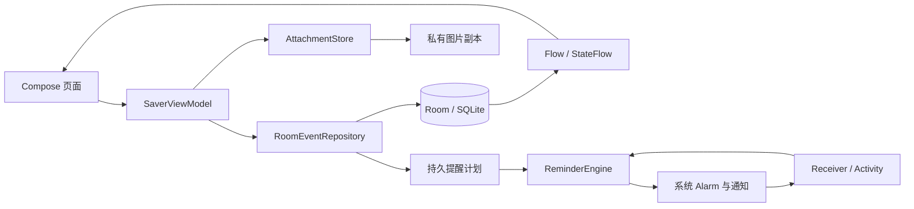

# HUSTer's DDL Saver 项目报告汇编

更新日期：2026-11-02。小组：花园鳗。**状态：待小组最终审核及课程验收。** 本稿汇集已有选题、需求、设计、实现和测试材料，不代替老师指定模板，也不将尚未进行的手机验证或成员审核写为完成。

当前使用冻结演示分支 `codex/demo-final-20261101`，产品源码 `f024ecea4b287c7a8768c2dc62af9be9228c9ae6`，版本 **0.3.5／versionCode 8、Room schema 4**。本机完整构建成功，29 份 XML／185 个不同方法／224 次执行全部通过，失败／错误／跳过各 0，Lint 0 错误／16 警告；荣耀 X50 已完成同签名覆盖和正常首启；实际包版本、APK 哈希与证书匹配，原六表、4 附件、设置、33 条提醒及原 14 条 SENT 保持。月格、周／日、折叠重开、空周期、跨年及关键词分项已通过；完成状态、详情返回和来源空交集也已通过；07:59:33 UTC 最终 18 项审计全部通过，5 条 QA 已清理，原数据／附件／设置及全部原 33 条提醒保持；新分支远程 CI 尚无结果。准确源码、APK SHA-256、安装与验证边界见[本轮证据](test-evidence/RUN-20261101-CALENDAR-FINAL/README.md)，演示和代码阅读见[0.3.5 交付页](demo-final-0.3.5.md)。

主线持续变化，不能以 main 当前内容或旧 CI 推断演示包。此包基于 `5df4320`，纳入 PR #11 月格数量、PR #12 周／日周期界面和 PR #13 重复周期计算基础；本轮另修复周视图折叠后误缩为单日。PR #14 数据迁移不纳入；重复任务创建／管理不是已实现的用户功能。前轮 0.3.4 的 218 次执行和手机分项按原证据保留，不挪作新版本通过。

## 1. 选题与目标

大学生的作业、报告、活动报名等截止信息常分散在不同通知中，事项说明、图片材料和处理状态也不易集中查看。HUSTer's DDL Saver 将截止事项、分类、自定义文本和图片放在同一条记录中，提供时间紧迫度、完成／归档管理和三类系统提醒。

目标用户是使用 Android 手机、需要管理多类期限的大学生。应用采用离线单机方式，无账号注册、服务器和云同步；当前不提供 OCR、联网 AI 对话或应用内备份恢复。选题来源见[原始想法](../idea.md)，课程交付依据见[课程要求记录](../task_finish_tips.md)。

## 2. 需求与范围

独立交付的[需求分析](requirements.md)保留需求编号、来源及确认状态；[数据组织专项需求](data-requirements.md)补充具体规则和 DA 场景。已实现不等于需求文档已获整体批准。PR #10 的[规划扩展讨论稿](planning-extension-requirements.md)按阶段推进：0.3.5 已含月格数量及周／日视图，本轮设备月格、周／日、跨年及关键词分项通过，完成状态、详情返回与来源空交集也已通过，本轮最终 18 项清理审计通过，原数据保持；PR #13 仅为重复周期计算基础。局部实现与分项验证不等于 PX-01—PX-07 全部需求确认或完整验收。

| 范围 | 当前实现 | 确认与验收边界 |
| --- | --- | --- |
| 事项与状态 | 标题、北京时间截止、描述、重要程度、可选速通时间；完成与归档独立，支持恢复及确认删除 | 核心目标已确认；完整输入和异常场景继续按 TC 执行 |
| 信息组织 | 来源、多个标签、每事项独立文本字段；搜索、日期与分类条件取交集 | 已确认多标签全部满足、同名字段可空、连续文字搜索等局部规则；其余细节仍待审核 |
| 日历 | 月／周／日视图、月份数量、前后周期、今天与日期筛选；周从周一开始，折叠保留周期 | 本机回归通过；本轮手机月／周／日、跨年和关键词分项通过；完成状态、详情返回与来源空交集也已通过，本轮最终 18 项清理审计通过，原数据保持 |
| 图片 | 相册多选、主动粘贴可读取图片 URI、私有副本及预览 | 合成来源的增量粘贴、旧 URI 失败及重试已有设备证据，更多真实来源与最终授权失效机制仍待确认；20 MiB／100 MP 是工程保护值 |
| 提醒 | 每日汇总、危险期、临近截止；去重、同刻合并、权限说明与恢复 | 实际时间和可达性受系统条件影响；不承诺任何状态下必达或跨系统严格恰好一次 |
| 角色反馈 | 经典／Q 版“蓝色大肥鱼”、四表情、36 条本地台词气泡 | 资源许可与署名随包保留；整体视觉仍待最终审核 |

仍需确认完整需求及 README、质量边界、准确验收日期与时刻，以及老师是否另有模板和文件格式要求。2026-10-27 的“约剩 5.5 天”只作为历史表述，不用作当前倒计时。

## 3. 设计与技术方案

项目是单 App 模块的原生 Android 工程，采用 Kotlin、Jetpack Compose／Material 3、ViewModel、Room／SQLite、Coroutines／Flow，以及 AlarmManager／NotificationManager。实际依赖版本和配置见[技术清单](technology-stack.md)，完整概要及详细设计见[设计文档](design.md)。

保存操作以数据库事务保持事项、关联和提醒计划一致；修订号用于拒绝过时编辑。图片文件与系统通知不属于同一数据库事务，分别通过副本生命周期、回滚、发送账本和失败状态处理。数据库保留 1→2→3→4 显式迁移及历史 schema，不以清空用户数据解决升级问题。

### 功能与代码入口

| 演示功能或设计问题 | 主要代码入口 | 应能说明的要点 |
| --- | --- | --- |
| 创建、详情、编辑与草稿 | [SaverApp](../app/src/main/java/cn/edu/hust/ddlsaver/ui/SaverApp.kt)、[EventEditor](../app/src/main/java/cn/edu/hust/ddlsaver/ui/EventEditor.kt)、[SaverViewModel](../app/src/main/java/cn/edu/hust/ddlsaver/ui/SaverViewModel.kt) | 输入如何形成草稿，何时保存，失败与取消如何保持原数据 |
| 搜索、日期与今日统计 | [EventQuery](../app/src/main/java/cn/edu/hust/ddlsaver/domain/EventQuery.kt)、[HomeScreen](../app/src/main/java/cn/edu/hust/ddlsaver/ui/HomeScreen.kt) | AND 条件、连续文字匹配、稳定排序及北京时间日期 |
| 分类、字段、迁移与事务 | [RoomEventRepository](../app/src/main/java/cn/edu/hust/ddlsaver/data/RoomEventRepository.kt)、[SaverDatabase](../app/src/main/java/cn/edu/hust/ddlsaver/data/SaverDatabase.kt) | 同名字段按 ID 独立、事务回滚、修订号、旧库数据保留 |
| 图片添加、取消与删除 | [AttachmentStore](../app/src/main/java/cn/edu/hust/ddlsaver/platform/AttachmentStore.kt)、[AttachmentUi](../app/src/main/java/cn/edu/hust/ddlsaver/ui/AttachmentUi.kt) | 外部 URI 和私有副本的区别、增量添加、整批失败回滚及原图保护 |
| 图片导入故障取证 | [AttachmentImportDiagnostics](../app/src/main/java/cn/edu/hust/ddlsaver/platform/AttachmentImportDiagnostics.kt) | 仅调试包记录失败阶段、固定原因枚举和批次计数；不输出用户来源或异常内容，不以模拟故障认定真实根因 |
| 提醒计算、发送与恢复 | [ReminderPlanStore](../app/src/main/java/cn/edu/hust/ddlsaver/reminders/ReminderPlanStore.kt)、[ReminderEngine](../app/src/main/java/cn/edu/hust/ddlsaver/reminders/ReminderEngine.kt)、[ReminderRuntime](../app/src/main/java/cn/edu/hust/ddlsaver/reminders/ReminderRuntime.kt) | 稳定发送键、同刻合并、旧计划失效、系统能力与恢复入口 |
| 通知平台及权限文案 | [AndroidReminderPlatform](../app/src/main/java/cn/edu/hust/ddlsaver/reminders/AndroidReminderPlatform.kt)、[ReminderStatusCopy](../app/src/main/java/cn/edu/hust/ddlsaver/reminders/ReminderStatusCopy.kt) | 通知权限、总开关、通道与精确访问各自影响什么 |
| 角色状态与形象 | [CharacterFeedback](../app/src/main/java/cn/edu/hust/ddlsaver/domain/CharacterFeedback.kt)、[CharacterPanel](../app/src/main/java/cn/edu/hust/ddlsaver/ui/CharacterPanel.kt) | 状态来自全体有效事项，台词为本地预设，形象切换不改变提醒规则 |

## 4. 测试与已知限制

测试按本机规则／存储／平台／页面集成、GitHub CI 和真实设备三个来源分别留证。独立[测试报告](test-report.md)、[执行记录](test-records.md)及[测试计划](test-plan.md)是详细结果来源，自动方法数不等同于 30 个完整 TC。

| 证据批次 | 已核实结果 | 边界 |
| --- | --- | --- |
| [0.3.5 冻结演示版](test-evidence/RUN-20261101-CALENDAR-FINAL/README.md) | 29 XML／185 方法／224 执行通过、Lint 0／16；手机同签名升级和首启原数据保持 | 日历导航等分项通过，完成状态、详情返回与来源空交集通过，07:59:33 UTC 最终 18 项审计全部通过，5 条 QA 已清理，原数据／附件／设置及全部原 33 条提醒保持，新分支 CI 尚无结果；OBS-01／OBS-02 开放 |
| 历史远程 `ac1d978`，[CI #42](https://github.com/zidodo1124/hust26_software_engineering_homework/actions/runs/41288003667) | APK、169 次执行与 Lint 通过；失败／错误／跳过各 0；Lint 0／17 | 不包含其后新增的本机测试 |
| [2026-11-01 独立界面补测](test-evidence/RUN-20261101-INDEPENDENT-UI/README.md) | 构建成功，155 个方法／174 次执行通过，Lint 0／16；新增 5 项页面流程 | 本机 Robolectric，重开指返回列表再进详情；不代表设备验收 |
| [2026-11-01 恢复与诊断](test-evidence/RUN-20261101-RECOVERY-DIAGNOSTICS/README.md) | 最终构建成功，167 个方法／194 次执行通过，Lint 0／16；新增 12 方法／20 执行 | 保留首轮定向 8 次失败与测试修正；执行时未提交，相关源码现存本地 `778429e`；该本机批次未安装设备 |
| [2026-11-01 0.3.3 实机分项（已收尾）](test-evidence/RUN-20261101-DEVICE-ACCEPTANCE/README.md) | 同签名覆盖的数据／附件保持；单项通知冷启动、权限与强停恢复、受控 idle 实际送达及图片失败／恢复、来源卸载后副本保持已有证据 | 普通样本 USB 充电、deviceidle ACTIVE；强制 idle 另记且中间亮屏，不等于自然 Doze；每日汇总及其余场景仍保留边界，真实重启自动恢复子项未通过（OBS-02），主动打开恢复；16 项收尾检查通过、原数据保持，未完成整体验收 |
| [0.3.4 最终本机检查](test-evidence/RUN-20261101-DEMO-STABILITY/README.md) | 28 XML／179 方法／218 执行全部通过，Lint 0／16，APK／签名及源码前后哈希一致 | 保留首轮 2 失败；该本机批次未安装，历史 CI #45 原因未定；随后 CI #46 的 218 次执行通过，Lint 0／17 |
| [0.3.4 独立设备复验](test-evidence/RUN-20261101-DEVICE-034/README.md) | 同签名覆盖、正常首启、原六表／4 附件／设置／提醒行保持；本样本图片提示／重试／回滚通过 | 来源卸载后普通重开 3 副本保持、角色双向保存也已通过；普通后台通知与完成撤销分项通过；亮屏 USB 条件不覆盖锁屏／Doze，真实重启自动窗口未通过，普通打开恢复成功；17项收尾通过、三个QA清理且原数据保持，OBS-01／OBS-02 开放 |
| [荣耀 X50 0.3.3 复验](test-evidence/RUN-20261028-004/README.md) | 同签名覆盖、原数据与附件保留、角色修复和部分字号检查有证据 | 结论限该设备及实际操作，不覆盖所有环境 |

此前 0.3.3 本机批次覆盖支持广播的真实恢复链路、每日汇总 PendingIntent 冷启动及图片导入诊断，所有批次分别统计。该批 APK SHA-256 为 `6f30078bf0dfa95731afe9fae0c08f06dd19d048eb815fd2236022c90e19e65b`，与此前设备包同签名，已在随后独立实机批次同签名覆盖安装；7 份变动源码哈希与产物详情见本机批次证据，实际设备结果另行记录。

前一轮 PR 合并基线通过 194 次执行，随后[0.3.4 稳定性批次](test-evidence/RUN-20261101-DEMO-STABILITY/README.md)最终完整构建成功，**28 份 JUnit XML、179 个不同方法／218 次执行，失败／错误／跳过各 0，Lint 0 错误／16 警告**。警告总数仍为 16：新增恢复诊断 SharedPreferences.edit 的 1 条 UseKtx，原 ReminderRuntime 的 1 条 InlinedApi 消失，不能称为全部既有警告。 本轮已改善图片来源权限失败提示、加入恢复诊断及重启／强停说明，并完成静态 P2 整改复审。首轮定向 2／108 失败及历史 [CI #45](https://github.com/zidodo1124/hust26_software_engineering_homework/actions/runs/41387758880) 的 1／169 次失败原始证据保留；旧 CI 等待超时根因未定，不由本机通过抵销。该本机批次未安装设备；随后[独立 0.3.4 设备复验](test-evidence/RUN-20261101-DEVICE-034/README.md)已完成升级、原数据保持及本样本图片分项，本批分项及17项收尾审计已完成，未通过及未测范围保留。

**未关闭事项：** OBS-01 在 0.3.3 历史设备批次已复现来源打开时权限拒绝并验证重新复制恢复，实际 App 诊断是在本设备单 tag W 条件取得；0.3.4 本样本完整提示与重试通过，但图片诊断日志为空、未改日志属性，最终授权失效机制仍未确定。OBS-02 来自 0.3.3 真实重启后首解锁、未主动打开窗口未自动恢复 Alarm／提醒，普通打开后补发及调度恢复；原因尚未隔离，0.3.4 本样本再次观察到未开 App 的窗口跨过计划 +90 秒仍无 Alarm／通知，普通打开后补发与重排；旧诊断不能作为新 boot 证据，未出现新记录也不能独立判定广播未交付。持续锁屏、自然 Doze／省电、完整权限拒绝路径、近似送达延迟及真实每日汇总点击仍待补测；已完成的权限／通道／精确访问与强停恢复、受控 idle 子项见 0.3.3 历史证据。模拟异常仅能证明受控失败恢复，不能推断真实设备根因。完整 DA／TC 步骤、更多输入／图片来源／字号和最终视觉审核也尚未完成。

## 5. 团队参与与版本记录

当前小组成员为支盟渊、付泽文、岳羽泉，共 3 人（2026-11-01 按[用户确认](../interaction-records/支盟渊/2026-11-01.md)更新）。实际分工及领取状态见[任务板](../team/README.md)，交互过程见[交互记录索引](../interaction-records/README.md)。项目早期代码由 AI 辅助推进，不能将此前实现或本次中央补测全部归入某个成员的独立成果。

- 支盟渊已有产品方向反馈、设备连接、权限与通知点击等协助记录；2026-11-01 明确接手页面、图片与角色的后续实现、复核、兼容验证和演示，状态为已领取／进行中，同时继续统筹审核与集成。
- 付泽文已有数据需求确认、架构核查、自动测试及模块报告，PR #1—#9 已合入，PR #10 的规划提案另按讨论稿合入；实际个人决策和 AI 辅助范围见[模块报告](data-module-report.md)。
- 岳羽泉已有领取、设计复核、11 项 Kotlin 测试及权限文案工作，5 项内容提交经 5 次直接 merge 合入。合并核查与 CI 见[审核记录 R-014](review-log.md#r-014岳羽泉直接合并核查与本机后续授权)，未发现需重写历史的问题。

页面、图片和角色资源方向现由支盟渊负责；原成员任务登记仅作为历史保留。接手不改变既有 AI 辅助实现或中央验证的归属，新工作按实际提交和验证记录，不预填完成或通过。

成员应依据真实参与补充个人说明，能解释自己承担的代码与整体方案；提交数量不自动等于贡献大小。本稿整理和后续本机工作不代替成员本人答辩准备。

## 6. 交付清单与完成条件

| 交付项 | 现有材料 | 提交前仍需完成 |
| --- | --- | --- |
| 可运行软件与源码 | 本机构建的 Debug APK；GitHub 仓库；[构建说明](development.md) | 选定最终源码状态、重新核对 APK 哈希／签名与目标机安装，不混用不同签名包 |
| 选题及项目汇编 | 本文件、[项目介绍](../README.md) | 小组审核与老师模板适配 |
| 独立需求分析 | [requirements.md](requirements.md) | 整体需求审核及剩余边界确认 |
| 独立设计材料 | [design.md](design.md)、[技术清单](technology-stack.md) | 与最终源码及本轮诊断增量对应 |
| 独立测试材料 | [test-report.md](test-report.md)、[test-records.md](test-records.md)、[测试追踪](data-test-traceability.md) | 完成必要设备补测，保留未解决问题与原始失败记录 |
| 演示与答辩 | [演示及验收安排](demo-and-acceptance.md)、个人模块材料 | 实际演练、分配讲解、确认时长与设备；不能把方案当作演练完成 |

准确验收日期、时刻和老师要求的最终文件格式尚未确认。下一次实际提交前，应核对代码、证据和文档指向同一被测状态；本机未提交工作不能宣称已经上传 GitHub。
