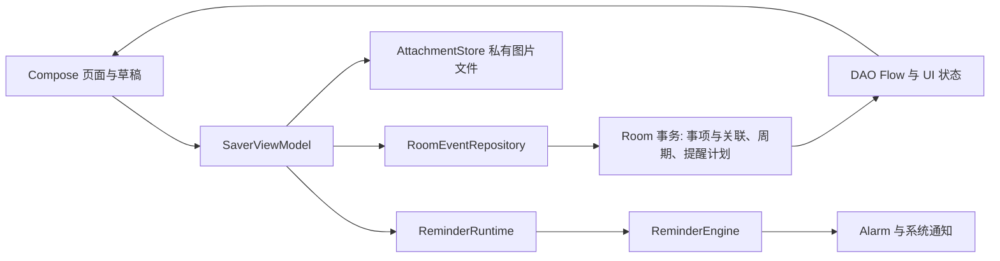

# 当前本地源码导航：功能、文件与调用关系

更新：2026-11-02（America/Los_Angeles）。这份导航供你在电脑上按功能定位源码，先看第 2、3 节的表格；老师追问实现时，再按第 5 节的调用顺序阅读。返回[文档总入口](README.md)，同步和验证结果见[项目状态](project/STATUS.md)。

## 1. 先确认正在读哪个版本

| 对象 | 对应内容 | 使用哪份材料 |
| --- | --- | --- |
| 当前本地工作区 | `codex/local-sync-20261102` 已合入远程 `main` 的 PR #14（`eaa9a59`），保留周历折叠修复；本地产品代码为 `295fb57`，版号 **0.3.7／10、Room schema 5**，本轮更新用户文案 | 本页：包括重复事项的新功能与当前文件行号；远程发布记录见[项目状态](project/STATUS.md) |
| 当前手机包 | 荣耀 X50 已同签名覆盖 **0.3.7／10、schema 5**，产品与本地 `295fb57` 一致；正常首启及 4→5 迁移通过，原数据保持 | 当前代码用本页，设备抽查进展见[项目状态](project/STATUS.md) |
| 历史演示包 | `demo-v0.3.5`／8、Room schema 4；没有重复事项创建与管理界面 | [五分钟演示](acceptance-demo/README.md)与[0.3.5 答辩材料](acceptance-code-guide/README.md) |

本页行号按当前工作区实读核对，产品文件位置以项目根目录 `C:\Users\lx\Desktop\sw_teamwork` 为起点。点击文件链接后，在 IDE 用 **Ctrl+G** 输入所列行号；页面中的 `#L` 也便于支持行锚点的代码查看器定位。后续改代码可能使行号变化，**同一格的函数名是第二个定位依据**。本页链接打开当前文件；旧教学材料的固定标签链接对应历史 0.3.5 实现，当前手机版应按本页定位。

本轮文案更新的本机构建、测试与 Lint 已通过，执行数与证据见第 6 节及[项目状态](project/STATUS.md)。**0.3.7 已安装到荣耀 X50**；本机测试与手机安装、迁移、文案抽查分别记录。全部新台词和主要提示见[文案清单](ui-copy-guide.md)。

## 2. 主要功能从哪段代码开始看

表中的 F 编号是本页的查找标记；手机五分钟脚本仍使用 D01—D09。先读页面入口，再顺着右侧函数看数据变化。

| 标记／主要功能 | 页面或规则入口：完整路径与函数 | 后续实现与要讲清的关系 |
| --- | --- | --- |
| **F01 启动、首页与页面切换** | [app/src/main/java/cn/edu/hust/ddlsaver/MainActivity.kt](../app/src/main/java/cn/edu/hust/ddlsaver/MainActivity.kt#L17) L17 `onCreate`；[app/src/main/java/cn/edu/hust/ddlsaver/ui/SaverApp.kt](../app/src/main/java/cn/edu/hust/ddlsaver/ui/SaverApp.kt#L86) L86 `SaverApp` | 建立 ViewModel，收集 UI 状态，在首页／编辑／详情／设置／分类页面之间切换。是单 Activity 和手工页面状态，不是多个 Activity 各自存一份事项。 |
| **F02 新建、编辑、校验和保存** | [app/src/main/java/cn/edu/hust/ddlsaver/ui/EventEditor.kt](../app/src/main/java/cn/edu/hust/ddlsaver/ui/EventEditor.kt#L61) L61 `EventEditor`；[app/src/main/java/cn/edu/hust/ddlsaver/domain/EventValidation.kt](../app/src/main/java/cn/edu/hust/ddlsaver/domain/EventValidation.kt#L7) L7 `normalize` | 草稿提交到 [app/src/main/java/cn/edu/hust/ddlsaver/ui/SaverViewModel.kt](../app/src/main/java/cn/edu/hust/ddlsaver/ui/SaverViewModel.kt#L178) L178 `save`，再到 [app/src/main/java/cn/edu/hust/ddlsaver/data/RoomEventRepository.kt](../app/src/main/java/cn/edu/hust/ddlsaver/data/RoomEventRepository.kt#L87) L87 `save`。普通保存写事项及关联；新重复事项会走第 3 节的分支。 |
| **F03 来源、标签、自定义字段** | [app/src/main/java/cn/edu/hust/ddlsaver/ui/CategoryManager.kt](../app/src/main/java/cn/edu/hust/ddlsaver/ui/CategoryManager.kt#L18) L18 `CategoryManager`；[app/src/main/java/cn/edu/hust/ddlsaver/ui/EditorExtras.kt](../app/src/main/java/cn/edu/hust/ddlsaver/ui/EditorExtras.kt#L50) L50 `EventCategories`、同文件 L79 `CustomFieldEditor` | 来源单选、标签多选、字段属于事项；[app/src/main/java/cn/edu/hust/ddlsaver/data/RoomEventRepository.kt](../app/src/main/java/cn/edu/hust/ddlsaver/data/RoomEventRepository.kt#L409) L409 `saveSource` 与同文件 `saveTag`、`setSourceActive`、`setTagActive` 保存／停用目录。停用保留已有关系，不等于删除所有事项。 |
| **F04 图片导入、查看、移除和复制文本** | [app/src/main/java/cn/edu/hust/ddlsaver/ui/AttachmentUi.kt](../app/src/main/java/cn/edu/hust/ddlsaver/ui/AttachmentUi.kt#L58) L58 `AttachmentEditor`；同文件 L108 `AttachmentGallery`；[app/src/main/java/cn/edu/hust/ddlsaver/ui/SaverApp.kt](../app/src/main/java/cn/edu/hust/ddlsaver/ui/SaverApp.kt#L374) L374 `DetailScreen` | [app/src/main/java/cn/edu/hust/ddlsaver/platform/AttachmentStore.kt](../app/src/main/java/cn/edu/hust/ddlsaver/platform/AttachmentStore.kt#L33) L33 `importImages` → `importOne`（L135）验证并生成私有副本；[app/src/main/java/cn/edu/hust/ddlsaver/ui/SaverViewModel.kt](../app/src/main/java/cn/edu/hust/ddlsaver/ui/SaverViewModel.kt#L228) L228 `cleanCandidates` 按数据库引用清理。描述／字段文本复制在详情，图片不是把网址文本当作附件下载。重复事项不支持图片。 |
| **F05 搜索、来源和标签组合筛选** | [app/src/main/java/cn/edu/hust/ddlsaver/ui/HomeScreen.kt](../app/src/main/java/cn/edu/hust/ddlsaver/ui/HomeScreen.kt#L29) L29 `HomeScreen` 保存查询状态；[app/src/main/java/cn/edu/hust/ddlsaver/domain/EventQuery.kt](../app/src/main/java/cn/edu/hust/ddlsaver/domain/EventQuery.kt#L18) L18 `EventQuery.select` | 标题、描述、字段名和值按整段连续子串匹配且忽略大小写；来源、标签、日期等取交集，多标签用 `containsAll`。结果按截止时间、再按 ID 排序；查询不修改原记录。 |
| **F06 月／周／日历、数量和周期导航** | [app/src/main/java/cn/edu/hust/ddlsaver/ui/HomeScreen.kt](../app/src/main/java/cn/edu/hust/ddlsaver/ui/HomeScreen.kt#L61) L61 `inWeekView`；[app/src/main/java/cn/edu/hust/ddlsaver/ui/HomeScreen.kt](../app/src/main/java/cn/edu/hust/ddlsaver/ui/HomeScreen.kt#L70) L70 `calendarEvents`；[app/src/main/java/cn/edu/hust/ddlsaver/ui/HomeScreen.kt](../app/src/main/java/cn/edu/hust/ddlsaver/ui/HomeScreen.kt#L249) L249 `CalendarPeriod`；[app/src/main/java/cn/edu/hust/ddlsaver/ui/HomeScreen.kt](../app/src/main/java/cn/edu/hust/ddlsaver/ui/HomeScreen.kt#L295) L295 `MonthCalendar` | 选日列表与日期格分布分别计算；周从周一开始，日期用 `LocalDate` 运算。面板收起不取消周范围；周内点一天进入日视图。月格布局由同文件 L330 `calendarWeeks` 计算。 |
| **F07 完成、恢复、归档、删除、批量** | [app/src/main/java/cn/edu/hust/ddlsaver/ui/SaverApp.kt](../app/src/main/java/cn/edu/hust/ddlsaver/ui/SaverApp.kt#L374) L374 `DetailScreen`；[app/src/main/java/cn/edu/hust/ddlsaver/ui/SaverViewModel.kt](../app/src/main/java/cn/edu/hust/ddlsaver/ui/SaverViewModel.kt#L200) L200 `applyBatch` | [app/src/main/java/cn/edu/hust/ddlsaver/data/RoomEventRepository.kt](../app/src/main/java/cn/edu/hust/ddlsaver/data/RoomEventRepository.kt#L307) L307 `setCompleted`、同文件 L320 `setArchived`、L333 `delete`、L340 `applyBatch`；完成和归档是独立标记，批量在事务中处理。保存状态后详情不自动返回；批量成功由 `batchToken` 清选择并退出。 |
| **F08 过期整理、紧急程度与首页统计** | [app/src/main/java/cn/edu/hust/ddlsaver/domain/UrgencyRules.kt](../app/src/main/java/cn/edu/hust/ddlsaver/domain/UrgencyRules.kt#L10) L10 `classify`／`isActive`／`isToday`；[app/src/main/java/cn/edu/hust/ddlsaver/ui/HomeScreen.kt](../app/src/main/java/cn/edu/hust/ddlsaver/ui/HomeScreen.kt#L56) L56 `todayCount` | 重要程度、普通临近阈值、速通危险期分别处理；首页统计看全局有效事项。[app/src/main/java/cn/edu/hust/ddlsaver/data/RoomEventRepository.kt](../app/src/main/java/cn/edu/hust/ddlsaver/data/RoomEventRepository.kt#L391) L391 `applyExpiredPolicy` 与 L387 `archiveExpired` 实现自动／手工过期归档，默认保留并灰显。 |
| **F09 角色形象、本地台词、设置保存** | [app/src/main/java/cn/edu/hust/ddlsaver/domain/CharacterFeedback.kt](../app/src/main/java/cn/edu/hust/ddlsaver/domain/CharacterFeedback.kt#L17) L17 `selectCharacterFeedback`；[app/src/main/java/cn/edu/hust/ddlsaver/ui/CharacterPanel.kt](../app/src/main/java/cn/edu/hust/ddlsaver/ui/CharacterPanel.kt#L143) L143 `CharacterPanel`；[app/src/main/java/cn/edu/hust/ddlsaver/ui/ReminderSettingsPanel.kt](../app/src/main/java/cn/edu/hust/ddlsaver/ui/ReminderSettingsPanel.kt#L44) L44 `SettingsScreen` | 从全局事项选择状态与本地预设台词，经典／Q 版只换静态素材；设置草稿经 [app/src/main/java/cn/edu/hust/ddlsaver/ui/SaverViewModel.kt](../app/src/main/java/cn/edu/hust/ddlsaver/ui/SaverViewModel.kt#L211) L211 `saveSettings` 保存。不是在线 AI 聊天；完成鼓励是短暂状态。 |
| **F10 三类提醒、权限、通知点击** | [app/src/main/java/cn/edu/hust/ddlsaver/reminders/ReminderModels.kt](../app/src/main/java/cn/edu/hust/ddlsaver/reminders/ReminderModels.kt#L67) L67 `ReminderRules.eventPlans`；[app/src/main/java/cn/edu/hust/ddlsaver/reminders/ReminderPlanStore.kt](../app/src/main/java/cn/edu/hust/ddlsaver/reminders/ReminderPlanStore.kt#L11) L11 `rebuild`；[app/src/main/java/cn/edu/hust/ddlsaver/reminders/ReminderEngine.kt](../app/src/main/java/cn/edu/hust/ddlsaver/reminders/ReminderEngine.kt#L34) L34 `reconcile` | DAILY／DANGER／DEADLINE 的持久计划 → [app/src/main/java/cn/edu/hust/ddlsaver/reminders/AndroidReminderPlatform.kt](../app/src/main/java/cn/edu/hust/ddlsaver/reminders/AndroidReminderPlatform.kt#L46) L46 `scheduleAlarm` 与 L61 `post` → 系统通知。点击进入 [app/src/main/java/cn/edu/hust/ddlsaver/MainActivity.kt](../app/src/main/java/cn/edu/hust/ddlsaver/MainActivity.kt#L58) L58 `handleReminderIntent` → `SaverApp.openReminder`（L102），编辑页等会先保护草稿。 |
| **F11 重复事项及后续周期管理** | [app/src/main/java/cn/edu/hust/ddlsaver/ui/EventEditor.kt](../app/src/main/java/cn/edu/hust/ddlsaver/ui/EventEditor.kt#L200) L200 重复设置区；[app/src/main/java/cn/edu/hust/ddlsaver/domain/RecurrenceRules.kt](../app/src/main/java/cn/edu/hust/ddlsaver/domain/RecurrenceRules.kt#L37) L37 `occurrenceAt`；[app/src/main/java/cn/edu/hust/ddlsaver/data/RoomEventRepository.kt](../app/src/main/java/cn/edu/hust/ddlsaver/data/RoomEventRepository.kt#L42) L42 `createRecurrence` | 每天／每周／每月，可按次数或结束日期停止；生成的是独立事项并保留系列关联。新增、普通事项转系列、单次／后续修改、删除和停止的分支见下一节。 |

**五分钟演示后如何对应：** D01→F01／F08，D02→F02／F03，D03→F04，D04→F05，D05→F06，D06→F07。当前手机 0.3.7 的代码按本表阅读；若老师追问原 0.3.5 演示包，再回到 [0.3.5 固定源码对照](acceptance-code-guide/02-feature-source-map.md)打开标签链接。

## 3. PR #14 新增的重复事项：逐条定位

| 操作／设计 | 具体源码出处 | 实际实现与边界 |
| --- | --- | --- |
| 设置频率、次数、结束日和修改范围 | [app/src/main/java/cn/edu/hust/ddlsaver/ui/EventEditor.kt](../app/src/main/java/cn/edu/hust/ddlsaver/ui/EventEditor.kt#L200) L200 重复控件；[app/src/main/java/cn/edu/hust/ddlsaver/ui/EventEditor.kt](../app/src/main/java/cn/edu/hust/ddlsaver/ui/EventEditor.kt#L228) L228 范围控件；[app/src/main/java/cn/edu/hust/ddlsaver/domain/EventModels.kt](../app/src/main/java/cn/edu/hust/ddlsaver/domain/EventModels.kt#L11) L11 `RecurrenceSpec`、L12 `RecurrenceRef` | UI 提供每天／每周／每月，以及不结束／按次数／按日期；次数包含首次，结束日期包含当天。编辑已有系列时，只有当前事项未完成且未归档，才出现“仅本次／本次及后续”的范围选择。 |
| 新建系列并生成实际事项 | [app/src/main/java/cn/edu/hust/ddlsaver/data/RoomEventRepository.kt](../app/src/main/java/cn/edu/hust/ddlsaver/data/RoomEventRepository.kt#L42) L42 `createRecurrence`；[app/src/main/java/cn/edu/hust/ddlsaver/data/RoomEventRepository.kt](../app/src/main/java/cn/edu/hust/ddlsaver/data/RoomEventRepository.kt#L63) L63 `materializeRecurrence`；[app/src/main/java/cn/edu/hust/ddlsaver/data/RecurrenceTemplate.kt](../app/src/main/java/cn/edu/hust/ddlsaver/data/RecurrenceTemplate.kt#L12) L12 `encode`／L24 `decode` | 将标题、描述、分类、字段等模板保存，按周期生成独立 `events` 行及关联记录。保存分支的首次生成终点为 **max(首次截止, 当前时间)＋90 天**；不是一次性创建无限条，也不保证所有情况下只跨 90 天。 |
| 普通事项转为重复系列 | [app/src/main/java/cn/edu/hust/ddlsaver/data/RoomEventRepository.kt](../app/src/main/java/cn/edu/hust/ddlsaver/data/RoomEventRepository.kt#L168) L168 `convertToRecurrence` | 保留原事项 ID，把它作为第 0 次，新增系列并生成其余周期。该路径先复制成允许编码的模板。`RecurrenceTemplate.encode` 拒绝残留事项 ID 或图片的模板输入；0.3.7 已把这两类错误分别说明，正常转换入口仍然可用。提交转换草稿时必须无图片，可在同次编辑中移除附件后一次保存转换；普通事项已完成也可转换，不要与上行的系列修改范围条件混淆。 |
| 仅修改本次 | [app/src/main/java/cn/edu/hust/ddlsaver/ui/EventEditor.kt](../app/src/main/java/cn/edu/hust/ddlsaver/ui/EventEditor.kt#L277) L277 提交 `EventDraft`；[app/src/main/java/cn/edu/hust/ddlsaver/data/RoomEventRepository.kt](../app/src/main/java/cn/edu/hust/ddlsaver/data/RoomEventRepository.kt#L87) L87 `save` 的普通更新分支 | UI 不提交 `applyToFuture`，修改当前事项；系列的其他已生成项不随之逐个改写。旧编辑草稿仍使用事项 `revision` 做冲突检查。 |
| 修改本次及后续 | [app/src/main/java/cn/edu/hust/ddlsaver/data/RoomEventRepository.kt](../app/src/main/java/cn/edu/hust/ddlsaver/data/RoomEventRepository.kt#L183) L183 `updateSeriesFromOccurrence` | 更新系列模板、频率／结束条件／时间，重算从当前序号开始的未完成且未归档事项；已完成或归档的历史保留。每月规则保留锚定日，短月份按当月天数裁剪。无法表达的日期或结束范围会拒绝保存。 |
| 保留本次、停止后续重复 | [app/src/main/java/cn/edu/hust/ddlsaver/ui/EventEditor.kt](../app/src/main/java/cn/edu/hust/ddlsaver/ui/EventEditor.kt#L282) L282 `stopAfterThis`；[app/src/main/java/cn/edu/hust/ddlsaver/data/RoomEventRepository.kt](../app/src/main/java/cn/edu/hust/ddlsaver/data/RoomEventRepository.kt#L143) L143 `stopSeriesAfterOccurrence` | 在“本次及后续”范围选“停止后续重复”：保存本次，将系列结束次数截到本次之后，移除后续未完成未归档项；后续已完成或归档记录保留。 |
| 仅删除本次，防止下次补生回来 | [app/src/main/java/cn/edu/hust/ddlsaver/data/RoomEventRepository.kt](../app/src/main/java/cn/edu/hust/ddlsaver/data/RoomEventRepository.kt#L333) L333 `delete`；[app/src/main/java/cn/edu/hust/ddlsaver/data/SaverDao.kt](../app/src/main/java/cn/edu/hust/ddlsaver/data/SaverDao.kt#L46) L46 `skipOccurrenceForDeletedEvent`；[app/src/main/java/cn/edu/hust/ddlsaver/domain/RecurrenceRules.kt](../app/src/main/java/cn/edu/hust/ddlsaver/domain/RecurrenceRules.kt#L30) L30 `missingBetween` | 删除事项后保留该周期序号为已知／跳过记录；补生成时不把这一次当作缺失重新创建。 |
| 删除本次及后续 | [app/src/main/java/cn/edu/hust/ddlsaver/ui/SaverApp.kt](../app/src/main/java/cn/edu/hust/ddlsaver/ui/SaverApp.kt#L468) L468 确认按钮；[app/src/main/java/cn/edu/hust/ddlsaver/ui/SaverViewModel.kt](../app/src/main/java/cn/edu/hust/ddlsaver/ui/SaverViewModel.kt#L196) L196 `deleteFollowing`；[app/src/main/java/cn/edu/hust/ddlsaver/data/RoomEventRepository.kt](../app/src/main/java/cn/edu/hust/ddlsaver/data/RoomEventRepository.kt#L246) L246 `deleteRecurrenceFollowing` | 截断系列并删除从本次开始的未完成未归档记录；完成／归档历史保留。此入口只对未完成且未归档的系列事项开放。 |
| 打开或提醒协调时继续补生成 | [app/src/main/java/cn/edu/hust/ddlsaver/reminders/ReminderEngine.kt](../app/src/main/java/cn/edu/hust/ddlsaver/reminders/ReminderEngine.kt#L37) L37；[app/src/main/java/cn/edu/hust/ddlsaver/data/RoomEventRepository.kt](../app/src/main/java/cn/edu/hust/ddlsaver/data/RoomEventRepository.kt#L270) L270 `extendRecurrencesThrough` | 协调时向 **当前时间后 90 天** 扩展；已知序号避免重复生成。`RecurrenceRules.between` 单次规则查询上限为 10,000 条。能计算未来周期不等于后台永不受系统限制。 |
| 系列表、周期表与 4→5 迁移 | [app/src/main/java/cn/edu/hust/ddlsaver/data/RecurrenceEntities.kt](../app/src/main/java/cn/edu/hust/ddlsaver/data/RecurrenceEntities.kt#L10) L10 `RecurrenceSeriesEntity`／L29 `RecurrenceOccurrenceEntity`；[app/src/main/java/cn/edu/hust/ddlsaver/data/SaverDatabase.kt](../app/src/main/java/cn/edu/hust/ddlsaver/data/SaverDatabase.kt#L58) L58 `MIGRATION_4_5` | 新增 `recurrence_series` 与 `recurrence_occurrences`；系列＋序号是周期复合主键，`eventId` 有唯一索引。旧普通事项不用自动转换为系列，迁移保留原业务表。 |

**图片限制有双层保护：** 编辑页控制入口，Repository／模板编码再次拒绝重复事项的附件，避免只靠 UI 限制。普通事项仍可使用图片附件。重复任务的设备验证与本机测试证据应分开说明，不能用代码存在证明已在当前手机包中演示成功。

## 4. 架构、数据库和构建文件

| 目录／文件 | 职责和定位 |
| --- | --- |
| `app/src/main/java/cn/edu/hust/ddlsaver/ui/` | Compose 页面、编辑草稿、界面状态与动作协调；ViewModel 的 [app/src/main/java/cn/edu/hust/ddlsaver/ui/SaverViewModel.kt](../app/src/main/java/cn/edu/hust/ddlsaver/ui/SaverViewModel.kt#L75) L75 `reload` 观察数据，L235 `perform` 处理忙碌、成功、失败。 |
| `app/src/main/java/cn/edu/hust/ddlsaver/domain/` | 业务模型、查询、校验、时间和重复规则，以及 `EventRepository` 接口；这层说明业务判断而不直接绘制页面。 |
| `app/src/main/java/cn/edu/hust/ddlsaver/data/` | Room 实体、DAO、仓库事务、迁移、重复模板；[app/src/main/java/cn/edu/hust/ddlsaver/data/SaverDao.kt](../app/src/main/java/cn/edu/hust/ddlsaver/data/SaverDao.kt#L50) L50 `observeEvents` 发出带关联的快照。 |
| `app/src/main/java/cn/edu/hust/ddlsaver/platform/` | 外部图片读取、解码验证、私有副本与回收；数据库事务不等于文件系统也能自动回滚。 |
| `app/src/main/java/cn/edu/hust/ddlsaver/reminders/` | 持久提醒计划、协调、系统闹钟和通知、恢复 Receiver 与诊断。[app/src/main/java/cn/edu/hust/ddlsaver/reminders/ReminderRuntime.kt](../app/src/main/java/cn/edu/hust/ddlsaver/reminders/ReminderRuntime.kt#L77) L77 只证明恢复入口存在，不证明厂商后台限制已全部通过实机验收。 |
| [app/src/main/java/cn/edu/hust/ddlsaver/data/SaverDatabase.kt](../app/src/main/java/cn/edu/hust/ddlsaver/data/SaverDatabase.kt#L13) L13 | **schema 5 共 11 张表**：`events`、`sources`、`tags`、`event_tags`、`custom_fields`、`attachments`、`settings`、`reminder_plans`、`reminder_control`、`recurrence_series`、`recurrence_occurrences`。L66 `create` 注册 1→2→3→4→5 迁移。 |
| [app/src/main/java/cn/edu/hust/ddlsaver/data/RoomEventRepository.kt](../app/src/main/java/cn/edu/hust/ddlsaver/data/RoomEventRepository.kt#L455) L455 `reminderTransaction` | 将业务写入和 `ReminderPlanStore.rebuild` 放进同一个 Room 事务；图片候选副本另行补偿清理，系统通知也不属于 SQLite 的原子事务。 |
| [app/build.gradle.kts](../app/build.gradle.kts#L9) L9；[build.gradle.kts](../build.gradle.kts#L3) L3 | 单个 `:app` Android 模块，Kotlin 2.1.20、Compose／Material 3、ViewModel／Flow、Room 2.7.1／SQLite；Java／Kotlin 目标 17，minSdk 26、compile/targetSdk 35。完整依赖以构建文件为准。 |
| [app/src/main/AndroidManifest.xml](../app/src/main/AndroidManifest.xml) | Activity、通知／闹钟／恢复 Receiver 和权限声明；项目没有服务器或账号同步接口。 |

页面采用单 Activity、ViewModel／Repository 分层和状态驱动的 UI，可用 MVVM 思路解释；当前没有 Hilt、Navigation、Retrofit 或 WorkManager。讲解时指向实际依赖和调用链，不把讨论过的方案说成已经集成。

## 5. 三条最实用的阅读路线

### 路线 A：老师问“刚才保存是怎么实现的”

1. `EventEditor`：输入留在草稿；点击保存构造 `EventDraft`。
2. `SaverViewModel.save` → `RoomEventRepository.save` → `EventValidation.normalize`：验证标题、时间、字段、附件和版本，再按普通／重复分支处理。
3. `reminderTransaction`：主记录、关联及提醒计划一起提交；DAO Flow 发出最新结果。
4. [app/src/main/java/cn/edu/hust/ddlsaver/ui/SaverApp.kt](../app/src/main/java/cn/edu/hust/ddlsaver/ui/SaverApp.kt#L146) L146：观察到保存 ID 和至少该 revision 后，才切到详情。这样不会因数据流稍晚而先打开过时详情。

### 路线 B：老师问“日历、搜索和完成为什么能联动”

1. `HomeScreen` 保存关键词、来源、标签、模式、日期及日历视图。
2. `EventQuery.select` 得列表；`calendarEvents` 另算日期分布；首页统计另取全局有效事项。
3. 完成按钮走 `SaverViewModel.setCompleted` → Repository `setCompleted`，数据变化经 Flow 返回两类统计。
4. 看 `inWeekView`：它由周视图和快捷筛选决定，面板折叠只改变可见性；保留的回归测试见 [app/src/test/java/cn/edu/hust/ddlsaver/ui/SaverAppFlowTest.kt](../app/src/test/java/cn/edu/hust/ddlsaver/ui/SaverAppFlowTest.kt#L456) L456。

### 路线 C：老师问“重复任务为什么不会无限生成或删了又回来”

1. `EventEditor` 的重复设置生成 `RecurrenceSpec`，`save` 决定新建、转换、仅本次、后续修改或停止。
2. `RecurrenceRules.occurrenceAt` 按序号计算截止；`between` 限定区间与最多结果数，`missingBetween` 排除已知序号。
3. `RecurrenceSeriesEntity` 保存模板规则，`RecurrenceOccurrenceEntity` 保留周期身份与跳过记录，`materializeRecurrence` 生成独立事项。
4. `ReminderEngine.reconcile` 继续扩展有限窗口；修改／删除范围在 Repository 事务中处理，并保留规定的完成／归档历史。

以上只是按问题打开代码的顺序，不是给五分钟功能演示追加一段代码课。

## 6. 源码旁边可以找哪些验证

本轮 **0.3.7 本机完整构建、单元测试和 Lint 已通过**：29 份 XML／197 个不同方法／236 次执行全通过，失败／错误／跳过均 0；Lint 0 错误／16 警告，原周历折叠回归仍通过。验证期间 95 个产品输入文件的前后哈希一致，13 项核验均通过。准确范围及报告见[文案更新本机验证](test-evidence/RUN-20261102-COPY-REFRESH/README.md)；此前 [0.3.6 同步验证](test-evidence/RUN-20261102-LOCAL-SYNC/README.md)保留历史结果。236 是本机执行次数；手机安装和本轮抽查另见[项目状态](project/STATUS.md)。

| 范围 | 测试文件与定位 |
| --- | --- |
| 重复日期、月末／闰年、结束边界与跳过索引 | [app/src/test/java/cn/edu/hust/ddlsaver/domain/RecurrenceRulesTest.kt](../app/src/test/java/cn/edu/hust/ddlsaver/domain/RecurrenceRulesTest.kt#L12) L12；同文件包含短月锚点、次数含首次和结果上限测试。 |
| 系列持久化、转换、改后续、停止、删除和事务 | [app/src/test/java/cn/edu/hust/ddlsaver/data/RoundTwoRepositoryTest.kt](../app/src/test/java/cn/edu/hust/ddlsaver/data/RoundTwoRepositoryTest.kt#L192) L192；同文件 L210 修改频率／结束条件、L232 保留本次停止后续、L249 单次删除及计划失效。 |
| 旧库迁移 | [app/src/test/java/cn/edu/hust/ddlsaver/data/SaverDatabaseMigrationTest.kt](../app/src/test/java/cn/edu/hust/ddlsaver/data/SaverDatabaseMigrationTest.kt#L33) L33，另有 V1／V2 升级保留检查；[导出的 schema 5](../app/schemas/cn.edu.hust.ddlsaver.data.SaverDatabase/5.json)。 |
| 界面输入与真实页面状态 | [app/src/test/java/cn/edu/hust/ddlsaver/ui/SaverAppFlowTest.kt](../app/src/test/java/cn/edu/hust/ddlsaver/ui/SaverAppFlowTest.kt#L122) L122 每周系列创建；同文件保留保存冲突、筛选、日历折叠及批量等页面测试。 |
| 当前同步结果与手机证据 | [项目状态](project/STATUS.md)区分 0.3.7 本机验证、手机安装／迁移／抽查与 0.3.5 历史批次；[日历实机证据](test-evidence/RUN-20261101-CALENDAR-FINAL/README.md)仍只证明其标注的旧包分项。 |

本页将测试入口与本轮实际运行结果分别列出；没有被测试覆盖的条件不能因构建成功就记为通过。完整重复业务仍需单独做设备验收，手机的旧版证据保持原有范围。

## 7. 回答时保留的边界

- 当前源码和手机均为 0.3.7，已包含重复事项入口；本轮安装和迁移通过，不代替完整重复业务的设备验收。原 0.3.5 固定材料仍描述无重复界面的旧包。
- 重复系列不带图片，普通事项的图片功能仍保留；次数含首次，结束日按北京时间且包含当天。
- 时间以 `Asia/Shanghai` 解释；普通临近颜色、速通危险时间、通知提前量是不同参数。每月重复按规则锚定日计算，短月裁到月末。
- 来源／标签筛选和日期格不是全局统计；来源存在性由 Repository 校验，`events.sourceId` 没有在该实体上声明 Room 外键。
- 账号、云同步、在线 AI 对话和应用内备份恢复尚未实现。角色是本地规则和预设文本。
- 图片旧来源授权问题及荣耀 X50 重启后不打开 App 的提醒自动恢复仍有未关闭项。代码里存在恢复 Receiver、远程 CI 成功或本地生成 APK，都不等同于这些手机条件已通过。
