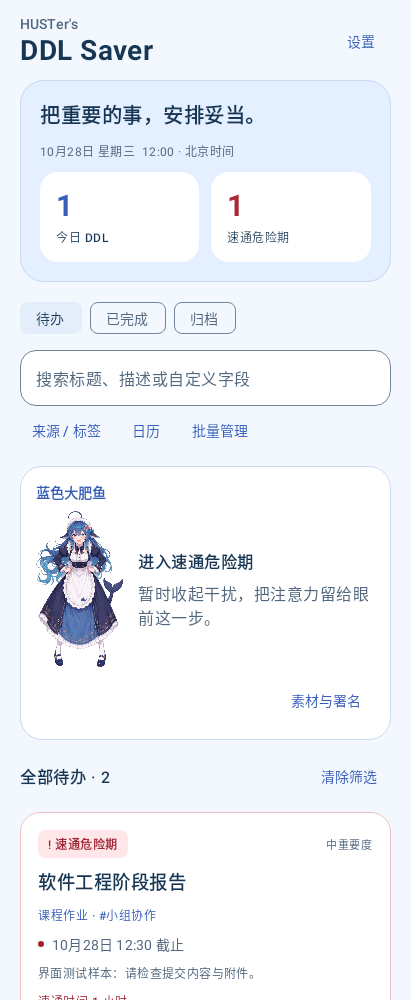
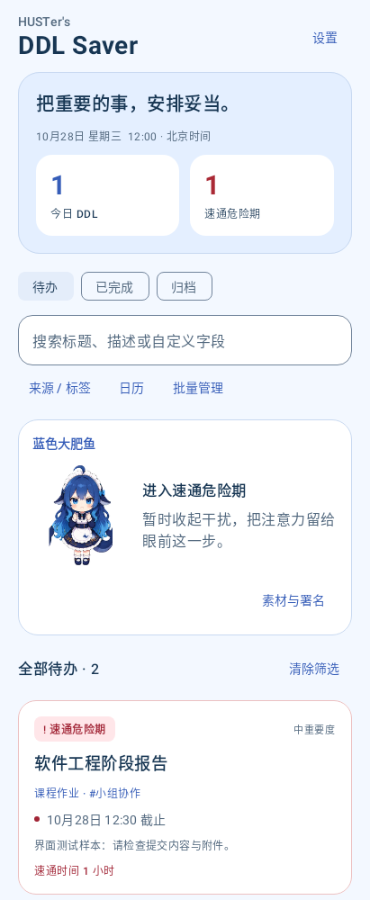

# RUN-20261028-002：海蓝主题与角色选择验证

2026-10-28；0.3.1／versionCode 4／Room schema 4。被测源码：[1a44059](https://github.com/zidodo1124/hust26_software_engineering_homework/commit/1a44059abc8bef12e8fdb648ad9c4353eba375d3)。

**最终结果：127 个不同测试方法／145 次执行全部通过，失败、错误、跳过均为 0；Debug APK 构建成功，Lint 0 错误／16 条维护警告。** 环境沿用 JDK 17、Gradle 8.11.1、Android SDK 35、Robolectric 4.14.1。此批没有连接手机或安装新 APK；不把旧版手机截图视为本版结果。

| 检查 | 实际范围 |
| --- | --- |
| 迁移与持久化 | 原 schema 1／2 迁移链、真实 schema 3 库升级、原设置／事项／通知账本、无设置行、两种形象重开保持、未知值回退 |
| 选择操作 | 预览不落库、放弃修改、保存、Activity 重建、切回经典立绘 |
| 通知回归 | 切换形象时已发账本、未来计划及事项保持，不重新发送已发提醒；既有提醒规则与路由测试重跑 |
| 图片 | 经典 7 份原文件、Q 版 4 份原文件的清单与 APK 哈希全部匹配；两种风格全部状态解码，API 28／35 对 Q 帧的 39,936 个像素逐一比对，四帧有区别；缺图、越界与错尺寸回退 |
| 视觉与可读性 | 真实 HomeScreen 的经典／Q 版渲染；320dp、150% 字体的统计竖排、逐行文字边界、无省略、完整字符和点击筛选；主题及状态文字对比度至少 4.5:1 |
| 构建与签名 | 包名 cn.edu.hust.ddlsaver、版本 0.3.1／4、minSdk 26／targetSdk 35；无 INTERNET 权限；签名证书与此前本机交付一致 |

APK：15,514,678 字节；SHA-256：`FB974CAEB73421CEBC42B623AA1D084532202F7C92DFD26B4AD50546D39C6BB2`。签名证书 SHA-256：`978833BCAF0FC001248F5D8501BFA1F9D1273922474ED601F2C60A4548A652B9`。同签名支持后续覆盖安装，但本批没有执行设备升级。

## 尝试与修复

| 批次 | 结果与处理 |
| --- | --- |
| attempt-01 | 沙箱无法访问已有 Gradle 缓存锁，编译未开始；后续使用获准的缓存访问执行 |
| attempt-02 | 144 次执行、8 失败，APK 和 Lint 完成。2 项 v3 夹具遗漏可选 indices；4 项区域解码检查遇到 Robolectric 的透明模拟结果；1 项截图等待重绘超时；1 项段落留白被误判为文字溢出 |
| render-attempt-03 | 2 次执行、1 失败。使用真实宿主 View 的 Canvas 绘制后成功输出图片；保留 79px 文本／208px 段落宽度诊断，实际文字完整 |
| attempt-04 | 11 次定向执行全部通过：修复夹具；使用固定图集的完整解码、内存帧复制及整图回收；文字改查每行边界、字符完整和无省略；截图等待当前形象加载完成 |
| attempt-05 | 冻结源码后运行完整构建、回归与 Lint，最终 145 次执行全部通过 |

Robolectric 区域解码限制由 [4.14.1 官方 ShadowBitmapRegionDecoder 源码](https://github.com/robolectric/robolectric/blob/robolectric-4.14.1/shadows/framework/src/main/java/org/robolectric/shadows/ShadowBitmapRegionDecoder.java)核对；不能据此认定真实手机区域接口损坏。最终代码不依赖该模拟接口：IO 中串行解码固定 1536×2288 图集，临时像素约 13.4 MiB，复制帧后回收整图；源文件仍为原字节。像素测试由抽样加强为整帧核对，没有删除图片质量检查。

日志中的坏图解码提示来自异常输入测试；最终以 JUnit XML 的失败／错误数区分结果。Lint 保留现有依赖更新、平台接口及维护建议，不表述为零警告。

## 实际页面渲染

以下是生产 HomeScreen 在本地 Robolectric 中的原始绘制结果，使用合成测试事项；不是手机截图，也不包含 MainActivity 的系统栏和 Scaffold 悬浮按钮。

| 经典立绘 | Q 版 |
| --- | --- |
|  |  |

[320dp／150% 字体渲染](final-results/home-320dp-font150.png)显示首屏可见部分，页面可以继续滚动；不据此宣称所有字号、横屏和屏幕规格都已验证。

## 证据与后续边界

[最终摘要](final-results/summary.json)列出各测试类、Lint、APK 和资源校验；[被测文件清单](final-results/tested-files.json)保存源码与资源 SHA-256。各 attempt 目录和日志保留实际失败及复测；[证据清单](evidence-manifest.json)保存本目录文件字节数与 SHA-256。

待继续：荣耀 X50 同签名升级、两种形象的硬件渲染／切换和字体检查，以及既有锁屏、Doze、设备重启通知分项与 OBS-01。当前结果不等于完整需求验收通过，也不登记小组成员人工验收或新版 CI 已通过。
