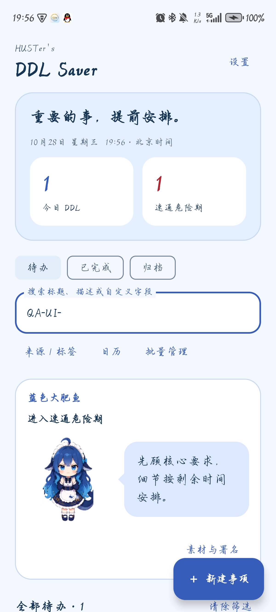

# HUSTer's DDL Saver 用户使用手册

**当前版本 1.0.0（2026-11-05）：** 安装包见[仓库安装包目录](../releases/android/README.md)。1.0.0 新增：速通时间和两项提醒提前量可按分钟、小时或天填写（见第 3 节和第 8 节）；底部导航可切换事项、月视图、周视图、日视图，周 / 日视图点击空白时段即可新建；设置页底部显示版本与小组信息。1.0.0 的真机检查结果见[测试报告](../deliverables/04-测试报告.md)。

**新版文案对照：** 下方正文部分保留已验收的 0.3.5 操作称呼；新版将“恢复归档”改为“移出归档”，“重新检查并安排提醒”改为“检查并安排提醒”，“普通紧急程度”设置标题改为“临近截止”，操作作用相同。首页标题与角色台词见[文案清单](ui-copy-guide.md)；重复事项的功能、限制和代码见[当前源码导航](source-navigation.md)。荣耀 X50 的 0.3.7 检查范围见[项目状态](project/STATUS.md)；含独立日历的 0.3.8 合并版需另行设备验证。

下方正文原验收基线：**0.3.5／8**，Room schema 4；演示分支 `codex/demo-final-20261101`，产品源码 `f024ece`。荣耀 X50 已核对同签名升级和正常首启原数据保持，月格、周／日与跨年等分项通过，完成状态、详情返回与来源空交集通过，07:59:33 UTC 最终 18 项审计全部通过，5 条 QA 已清理，原数据／附件／设置及全部原 33 条提醒保持；准确产物与结果见[本轮记录](test-evidence/RUN-20261101-CALENDAR-FINAL/README.md)，演示及代码阅读见[交付页](demo-final-0.3.5.md)。更新日期：2026-11-02。项目小组：花园鳗。

HUSTer's DDL Saver 用于集中记录作业、报告、活动报名等截止事项，保存相关说明与图片，并提供分级提醒。应用无需注册，数据保存在当前手机；日期、截止时间、日历及每日汇总统一采用**北京时间**。

初次使用可按“安装 → 设置通知 → 新建事项 → 保存并查看”完成第一条记录。日常操作可直接查阅下方对应章节。

## 1. 获取与安装

运行要求为 Android 8.0 及以上。已使用的演示机型是荣耀 X50；不同系统的安装、权限页面名称可能略有差异。

**获取安装包：** 直接下载仓库中的 [DDL-Saver-1.0.0.apk](../releases/android/DDL-Saver-1.0.0.apk)，或在仓库的 Releases 页面下载 v1.0.0 附带的同一文件。安装包说明和 SHA-256 校验值见[安装包目录](../releases/android/README.md)。

首次安装时，将 APK 传到手机，用文件管理器打开，按系统提示允许本次安装，完成后打开 **HUSTer's DDL Saver**。使用应用不需要开启 USB 调试。

**从 0.3.x 升级到 1.0.0 需要先卸载旧版。** 1.0.0 使用新的签名证书，不能直接覆盖 0.3.x；卸载会删除旧版中的事项和图片，如需保留请先记下重要内容。以后的版本会沿用 1.0.0 的签名，可以直接覆盖安装。一般规则：升级包需要与原安装包签名一致；小组成员本机构建的包和 GitHub Actions 的包可能采用不同签名。若提示“签名不一致”或无法更新，向原安装包提供者索取同签名新版。卸载应用或清除应用数据会删除本机事项、设置及应用内附件；当前没有账号同步或应用内备份、恢复功能。

## 2. 首次设置通知

在首页点击 **设置**，向下找到 **通知提醒**。

1. 按需开启“每日 DDL 汇总”“进入速通危险期时提醒”“临近截止时提醒”，修改时间后点击 **保存设置**。
2. 点击 **设置系统通知权限**，在手机系统页面允许本应用通知。如果仍提示未允许通知，点击 **打开系统通知设置**，检查应用通知和提醒类别是否开启。
3. 若页面提供 **允许精确提醒**，点击后在系统设置中允许，再返回应用。这项权限与通知权限分别设置；未允许时，应用使用可能延迟的近似提醒。
4. 返回应用后查看权限状态；也可点击 **重新检查并安排提醒**，重新检查尚未发送的有效提醒。

未允许通知时仍可记录和查看事项。系统省电、后台限制可能影响提醒送达；强制停止应用后，需要主动重新打开，才能恢复提醒安排。手机重启后也建议先打开一次应用，进入设置点击“重新检查并安排提醒”，再安排演示；荣耀 X50 的 0.3.3 与 0.3.4 历史复验均未在未打开 App 的窗口自动恢复，不能把自动恢复作为已经验证的保证。

## 3. 新建与编辑事项

1. 在首页点击 **＋ 新建事项**。
2. 填写 **事项标题**，例如“提交软件工程实验报告”。
3. 分别点击 **选择日期**、**选择时间**，填写北京时间的截止时刻。这两项和标题为必填内容。
4. 按需填写速通时间、重要程度、事项描述、来源、标签、自定义字段和图片附件。
5. 点击 **保存事项**。保存成功后进入 **事项详情**，核对标题、时间及附件。

在详情页点击 **编辑事项** 可修改记录，修改后仍需点击 **保存事项**。输入有误或保存失败时，按页面提示修正；返回或取消编辑时，如果已有修改，选择 **继续编辑** 或 **放弃修改**。放弃修改不会保存本次输入。

### 重复事项

新建事项或编辑普通事项时可选择每天、每周或每月重复，结束条件可选择次数、日期或不结束。次数包括第一次，结束日期包含当天；每月日期按首次日期计算，遇到短月份时使用当月最后一天。重复事项不支持图片附件，已有图片的事项需先移除图片。完成操作只影响本次；编辑和删除可选择“仅本次”或“本次及后续”，已完成或归档的后续事项会保留。修改本次及后续时可调整重复频率、结束条件和截止时间，或选择“停止后续重复”保留本次；结束条件无效时应用会提示并保留草稿。应用及提醒恢复时会补充未来周期，实际提醒仍受系统权限和后台条件影响。

### 速通时间与紧急程度

“速通时间”是你估计完成该事项至少需要的时长。填一个数字，再选单位“分钟”“小时”或“天”，可以带最多两位小数（例如 1.5 小时），最长 365 天；输入框下方会显示换算后的总时长。留空表示不为这条事项计算速通危险期。它不会启动倒计时任务或自动标记完成。

| 显示状态 | 含义 |
| --- | --- |
| 时间充裕（蓝色） | 距离截止尚未进入普通紧急范围，也未进入速通危险期 |
| 临近截止（橙色） | 默认剩余时间不超过 24 小时；可在设置的“普通紧急程度”中调整 |
| 速通危险期（红色） | 尚未截止，且剩余时间小于或等于本事项的速通时间；优先于橙色状态 |
| 已逾期（灰色） | 已到或超过截止时刻，且尚未完成、归档；不会自动当作完成 |

例如，截止时间为 18:00，速通时间填 `2` 并选“小时”，则从 16:00 起进入危险期，18:00 起显示已逾期。**重要程度**用于单独标记低、中、高优先级，不改变按时间计算的紧急状态。

## 4. 来源、标签与自定义字段

### 建立和维护分类

进入 **设置 → 分类管理：来源与标签**，选择 **来源管理** 或 **标签管理**，点击 **新增来源／新增标签**，输入名称后点击 **保存分类**。

- 来源用于说明事项出处，例如“软件工程”“班级通知”；每条事项选一个来源，也可保持“未指定”。
- 标签用于补充分类，例如“小组协作”“需上传附件”；一条事项可选择多个标签。
- 已有分类可 **重命名**、**停用** 或 **重新启用**。重命名会同步到关联事项；停用保留旧关联，新建事项不能再选用停用分类。

返回新建或编辑页，在“来源”和“标签”区域选择分类，再保存事项。

### 补充自定义字段

在事项编辑页点击 **添加自定义字段**，填写字段名称和文本内容，例如“地点＝东九楼”“联系人＝小组负责人”“网址＝提交页面地址”。字段名称必填，内容可以留空；继续点击添加按钮可增加多组。

自定义字段只属于当前事项，可编辑或 **移除字段**。在详情页点击 **复制**，或在编辑页点击 **复制内容**，可复制对应文本。网址按文本保存，当前不提供专门的链接跳转功能。

## 5. 添加与查看图片

在事项编辑页找到 **图片附件**：

| 操作 | 使用方式 |
| --- | --- |
| 从相册选择 | 打开系统图片选择器，选择一张或多张图片并确认；可再次添加 |
| 粘贴图片 | 先在支持“复制图片”的应用中复制图片，再回到本应用点击；复制图片网址或普通文字不能直接作为附件 |
| 查看大图 | 点击缩略图，使用“上一张／下一张”查看其他图片，点击“关闭”退出 |
| 移除图片 | 在编辑页点击对应图片下方“移除”，再保存事项；放弃编辑则不保存这次移除 |

图片添加完成后仍需点击 **保存事项**。取消或放弃编辑时，本次新增附件不会附加到原事项。应用保存导入图片的本机副本；移除应用内附件或删除事项不会删除相册原图。

若图片来源不再允许读取，先回到来源重新复制图片，再尝试粘贴，或改用“从相册选择”。导入失败时不要丢弃尚未保存的文字；0.3.4 已增加这类失败的明确提示，本次荣耀 X50 样本已确认完整提示可见、重新复制后可继续添加；这不表示来源授权失效机制已经解决。

单张图片限制为 **20 MiB、1 亿像素**。添加失败时可重新从相册选择、压缩图片，或重新复制后再粘贴；部分来源应用的图片访问许可会失效，不能保证所有应用复制的图片都可导入。

## 6. 首页、搜索与日历

首页提供 **待办／已完成／归档** 三个列表入口。未逾期待办按截止时间排列；逾期未完成事项在列表下方单独灰显展示。

**今日 DDL** 统计北京时间当天截止、尚未完成且未归档的事项，包含今天已经逾期的事项。**速通危险期** 统计当前仍未截止、已进入速通危险期的待办。两项数量均按全部有效事项计算；点击统计卡片会切到对应待办范围，并清除原有筛选。

| 查找方式 | 操作和范围 |
| --- | --- |
| 关键词搜索 | 输入标题、描述或自定义字段中的文字；字段名称和内容均可搜索 |
| 来源／标签 | 点击“来源 / 标签”；来源单选，标签可多选，结果须同时包含所有选中标签 |
| 首页日期筛选 | 点击“日期筛选”，按月、周或日选择范围，与首页关键词、来源及标签条件同时生效；日期格数量显示整月的筛选结果，收起或重开面板仍保留周范围 |
| 独立日历 | 在底部选择“月视图”“周视图”或“日视图”；左右箭头切换周期，“回到今天”返回北京时间当天。月格以不同颜色显示事项标题，点击日期查看完整列表，点击标题或卡片查看详情；选中日期后可点击“当天新建”，截止时间预填当天 23:59，可修改 |
| 周／日时间轴 | 按截止时间减速通时间显示时段；未填写速通时间的事项仅在日历中按 60 分钟展示，不改变危险期与提醒。跨天事项分别显示在对应日期，时间重叠时并排显示；周视图支持左右、上下滑动 |
| 时段快捷新建 | 点击周／日视图空白处，开始时刻按 15 分钟向下对齐，截止时间预填为一小时后，跨午夜时自动换日。编辑页可以改截止时间和速通时长；未填写速通时长仍保留为空。保存后进入详情，返回或取消编辑均回到原日历页面 |
| 当前时间与规则 | 今天的时间列显示红色当前时间线，按页面分钟刷新；“回到今天”同时定位当前时间附近。点击“时间规则”查看推算、默认时长、跨日及短时段加高的说明；编辑页和详情页均可核对推算时段 |
| 清除筛选 | 清空关键词、来源、标签、日期及快捷筛选，仍保留当前待办／已完成／归档列表类型 |

不同查找条件会**同时生效**。例如，选择来源“软件工程”、标签“小组协作”和一个日期后，只显示三项条件都符合的事项。找不到记录时，先检查列表类型，再点击 **清除筛选**。

## 7. 完成、归档与批量管理

打开事项详情，按实际情况操作：

| 操作 | 结果与恢复方式 |
| --- | --- |
| 标记完成 | 停止后续截止提醒，从待办移入“已完成”；点击“恢复为未完成”可撤回完成标记 |
| 归档 | 停止提醒，从首页统计移出，放入“归档”；点击“恢复归档”可移出归档列表 |
| 永久删除 | 确认后删除事项及其应用内附件，无法恢复；不删除相册原图 |

完成状态和归档状态分别保存：已完成事项也可以归档；恢复归档后，已完成事项回到“已完成”，未完成事项回到“待办”。恢复未完成、恢复归档或修改截止时间后，状态会按当前时间重新判断。

**批量操作：** 在首页点击 **批量管理**，逐条勾选，或点击 **全选当前结果**，再选择 **批量完成／批量归档／批量删除**。批量删除需再次确认。

切换筛选后，之前的选择仍会保留；“全选当前结果”会追加选择。执行前核对“已选”数量，只想处理当前结果时可先点击 **清空选择**。完成后可使用 **退出批量** 返回普通浏览。

**过期整理：** 默认采用“灰显保留”。在设置中可选择“自动归档过期未完成事项”，保存后生效，并在进入应用、运行中的分钟刷新时检查。若恢复了一条仍然逾期的未完成事项，它可能再次被自动归档；需要留在待办时，先改回“灰显保留”。

设置中的 **一键归档过期事项** 会在确认后归档所有已逾期、尚未归档的事项，包含已完成事项，并保留其完成标记。

## 8. 调整提醒与角色形象

### 提醒设置

| 设置 | 默认值与含义 |
| --- | --- |
| 截止前多久变橙色 | 1 天（24 小时）；只控制紧急状态显示，可按分钟、小时或天填写 |
| 每日 DDL 汇总 | 开启，北京时间 08:00；汇总今天截止的未完成、未归档事项，包含今天已逾期的事项；没有事项时不发空汇总 |
| 进入速通危险期时提醒 | 开启；按每条事项填写的速通时间计算，未填速通时间则没有这类提醒 |
| 临近截止时提醒 | 开启，默认提前 1 小时，可按分钟、小时或天填写；与橙色状态的阈值分别设置 |

每日汇总时间按 `HH:mm` 填写，例如 `08:30`；两项提前量填写正数并选择单位，最多两位小数。修改后点击 **保存设置**，重开应用后仍会保留。

同一事项的危险期提醒和临近提醒同刻触发时会合并。新建或恢复的事项如果已经进入提醒范围、但尚未截止，可能立即收到一次提醒。点击单项提醒可查看相应事项；已被删除等失效目标会返回列表并提示。点击每日汇总的目标是今日待办列表，具体设备验证范围见[测试报告](test-report.md)。

### “蓝色大肥鱼”与聊天气泡

进入 **设置 → 角色形象**，选择 **经典立绘** 或 **Q 版形象**，查看预览后点击 **保存设置**。默认是经典立绘；两种形象都保留，可随时切换。未保存时返回并选择“放弃修改”，会保留原选择。

首页角色以紧凑提示卡展示，根据全部未完成、未归档事项显示相应表情和简短提示；详情及形象预览保留聊天气泡，成功标记完成后会短暂显示鼓励。角色关注的是全局事项状态，不随当前搜索或日期筛选改变，因此筛选列表为空时仍可能提醒其他待办。

气泡显示本地预设台词，不提供输入框或在线聊天。两种形象使用相同的时间规则与台词，切换形象不会更改事项或提醒时间。点击 **素材与署名** 可查看当前形象的来源和许可。

上图为 0.3.3 在荣耀 X50 上的真机截图，保留用户原有手写字体；列表按专用 QA 前缀筛选，测试事项已在实测结束后清理。实际字号和字体会随手机设置变化。

## 9. 常见问题

| 遇到的情况 | 建议操作 |
| --- | --- |
| 保存按钮提示标题或时间不完整 | 填写标题，并分别选好截止日期与时间；速通时间可留空，填写时须为正数（最多两位小数）并选好单位，换算后至少 1 分钟、最长 365 天 |
| 事项保存后找不到 | 检查“待办／已完成／归档”入口、搜索和筛选；检查是否已逾期或被自动归档 |
| 没收到通知 | 检查三类开关是否保存、系统通知和提醒类别是否开启、精确提醒状态，以及事项是否已完成、归档或逾期；返回应用点击“重新检查并安排提醒” |
| 提醒安排失败，但事项已保存 | 按提示检查系统权限，再重新安排提醒；不必为了重试通知重复创建事项 |
| 重启或强制停止后没有提醒 | 主动打开应用，在设置中点击“重新检查并安排提醒”，再核对通知开关和权限 |
| 图片粘贴失败 | 重新复制图片本身后再粘贴，或改用“从相册选择”；图片网址不等于图片内容 |
| 设置里的新形象没有出现在首页 | 确认点击过“保存设置”；仅点选预览不会改变已保存的形象 |
| 字体放大后按钮不在首屏 | 上下滚动页面；来源、标签等横向选项和部分工具按钮可左右滑动查看 |

## 10. 小组演示前检查

1. 核对手机实际版本，先确认已有事项仍在；按上方新版文案对照查找按钮，并在当前包上预演。0.3.7 的设备验收不能代替 0.3.8 合并版的检查。
2. 创建一条专用演示事项，检查标题、北京时间、来源标签、自定义字段和图片保存后能重新打开。
3. 演示搜索、日历、标记完成和恢复；批量操作前核对选择数量，仅操作演示事项。
4. 切换经典／Q 版并保存，重新打开检查形象和气泡。
5. 检查通知权限与精确提醒状态；通知演示单独预留等待时间，结束后清理演示事项并恢复临时改动的设置。

荣耀 X50 已完成从 0.3.0 到 0.3.2，再到 0.3.3 的同签名覆盖升级，并核对原事项、设置与附件保留；两种形象、聊天气泡及临时 150% 字号分项已有设备记录，测试数据和临时设置已清理、恢复。随后独立的[0.3.4 复验](test-evidence/RUN-20261101-DEVICE-034/README.md)已完成同签名覆盖、原数据保持及本样本图片失败提示／重试／回滚检查，随后角色与普通提醒分项通过，真实重启自动恢复仍未通过；本批三个测试事项已清理，原数据和设置保持，正常主页及后续提醒已核对。实际构建、测试及设备检查情况以[项目状态](project/STATUS.md)和[测试报告](test-report.md)为准。需要自行构建或排查安装问题时，查阅[开发、构建与安装升级](development.md)。
