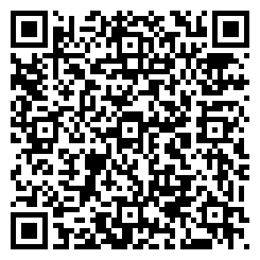

# DDL Saver 手机安装包

## 最新版本 1.0.0（推荐）

[下载 DDL-Saver-1.0.0.apk](https://github.com/zidodo1124/hust26_software_engineering_homework/raw/refs/heads/main/releases/android/DDL-Saver-1.0.0.apk) · [Releases 页面](https://github.com/zidodo1124/hust26_software_engineering_homework/releases/tag/v1.0.0) · [查看仓库内文件](DDL-Saver-1.0.0.apk)

手机扫码即可下载（二维码指向 Releases 中的同一个 APK）。适用于 **Android 8.0 及以上**。这是课程演示用的 debug 签名包，与 2026-11-05 在荣耀 X50 上完成真机验收的 APK 完全一致（见[验收记录](../../docs/test-evidence/RUN-20261105-FINAL-1.0.0/README.md)）。

### 怎么安装

1. 在手机浏览器中下载 `DDL-Saver-1.0.0.apk`（或在电脑下载后发到手机）。
2. 用手机的文件管理打开 APK；若系统询问，允许当前来源安装应用，然后点“安装”。
3. 打开 DDL Saver，进入“设置”，点“设置系统通知权限”允许通知；Android 12 及以上建议再点“允许精确提醒”，打开“闹钟和提醒”。

荣耀手机若出现“安全模式提醒您”，确认文件来自上述下载入口后，可点击提示正文中的蓝色“允许本次安装”，再由机主按系统要求验证指纹或锁屏密码。无需关闭安全模式；完成验证后继续安装。

不需要电脑、USB 调试、Android Studio 或注册账号；应用不联网，数据只保存在手机上。

### 从旧版本升级

1.0.0 使用新的签名证书，**不能直接覆盖此前公开发布的 0.3.x**（系统会提示签名不一致）。请先卸载旧版再安装 1.0.0；卸载会清除旧版中的事项和图片，如有重要内容请先记下。后续构建必须沿用 1.0.0 的签名，并提供兼容的数据迁移，才能覆盖升级并保留数据。本次迁移测试采用同一新签名重新构建的 0.3.5，和历史下载包不是同一个文件。

### 版本和校验

| 项目 | 值 |
| --- | --- |
| 应用包名 | `cn.edu.hust.ddlsaver` |
| 版本 | `1.0.0` / versionCode `12` |
| 数据库版本 | `5` |
| APK 大小 | `15,282,839` 字节 |
| 产品源码 | `main` 提交 [`3d8ee79`](https://github.com/zidodo1124/hust26_software_engineering_homework/commit/3d8ee79a8bf2e7fb3b474659b02612f0dfc92ac1)（PR #16） |
| APK SHA-256 | `cb421de42cd4b548e5a4481f09b3aa9288ae780d4c76746807f78a50274f9234` |
| 签名证书 SHA-256 | `8caa4a508d6f35066fe3a619b8ed7282688c04aa24e2614baf423e473bb113f7` |

校验值也列在 [SHA256SUMS.txt](SHA256SUMS.txt)。安装包不包含任何用户数据、签名密钥或开发工具。

## 历史版本

| 版本 | 文件 | 说明 |
| --- | --- | --- |
| 0.3.7（versionCode 10） | [DDL-Saver-0.3.7-android.zip](DDL-Saver-0.3.7-android.zip) | 压缩包内含 APK 与安装说明；签名证书 `978833bc…52b9`；产品源码 `295fb57` |
| 0.3.5（versionCode 8） | [DDL-Saver-0.3.5.apk](DDL-Saver-0.3.5.apk) | 0.3.5 演示版，与[当时实机核验的演示包](../../docs/demo-final-0.3.5.md)字节一致；签名同 0.3.7 |

历史版本只用于复现当时的演示，日常使用请安装 1.0.0。
